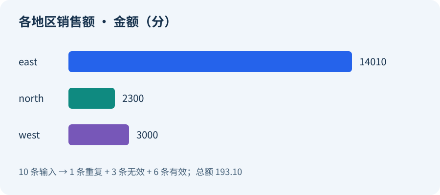

收到一份订单 CSV，想知道各地区的订单数、商品数量和销售额。数据里还有重复行、大小写不一致的地区名称，以及缺失或错误的数量，需要先清洗再汇总。

这类一次性任务可以交给临时沙箱：本地读取 CSV，把内容传给远端 Pandas，拿到汇总结果后结束任务。下面用 `@sandbox` 装饰器把这个过程放进一次 Python 函数调用。

## 准备一份小订单文件

本文使用 [05-orders.csv](./lab/05-orders.csv) 中的十条合成订单，便于看清每一步处理的效果：

```csv
order_id,region,quantity,unit_price
A001, east ,2,19.95
A002,west,3,10.00
A003,EAST,1,99.90
A004,north,5,2.50
A002,west,3,10.00
A005,,4,8.00
A006,west,-1,20.00
A007,west,two,11.00
A008,North,2,5.25
A009,east,3,0.10
```

这里有几种常见的小问题：订单 `A002` 重复出现，地区名称有空白和大小写差异，一条订单缺少地区，还有负数与非数字数量。

先约定处理规则，避免清洗时随意改变业务含义：同一个订单 ID 保留第一条；地区只接受 `east`、`west`、`north`；数量必须是正整数；价格是非负、最多两位小数的金额。这个例子处理的是这份固定格式的数据。

## 让本地程序连接沙箱

按照[官网上手指南](/start/)配置自己的 Express 沙箱账户，然后创建独立 Python 环境：

```bash
python3 -m venv .venv
. .venv/bin/activate
python -m pip install --index-url https://pypi.org/simple \
  'agent-sandbox-client==0.4.0a2'
```

这里使用 SDK alpha 版本。模型服务不参与这个流程，因此不需要 LLM API key。

计算使用 `code-interpreter-v1` 模板，其中已有 Pandas。本例运行时的 Pandas 版本为 `3.0.3`；本地只负责传入数据和接收结果，不需要为这次计算另装 Pandas。

## 把 Pandas 计算放进远端函数

在函数定义上添加 `@sandbox(template="code-interpreter-v1")`，就可以让这个 Python 函数在指定模板的沙箱里执行。业务函数的输入是 CSV 字符串，输出是普通 Python 数据；完整实现见 [05-data-processing.py](./lab/05-data-processing.py)。

处理过程先读取数据，按订单 ID 去重，再统一地区写法：

```python
import io
import pandas as pd

# 以下处理放在远端业务函数中，csv_text 来自调用参数。
df = pd.read_csv(io.StringIO(csv_text), dtype=str, keep_default_na=False)
rows_input = len(df)
df = df.drop_duplicates(subset=["order_id"], keep="first").copy()
rows_duplicate = rows_input - len(df)
df["region"] = df["region"].str.strip().str.lower()
```

先按字符串读取，可以保留价格的原始文本，也便于识别 `two` 这样的错误输入。接着把数量和价格转换为数值，用规则筛选可用行：

```python
qty = pd.to_numeric(df["quantity"], errors="coerce")
price = pd.to_numeric(df["unit_price"], errors="coerce")
valid = (
    df["order_id"].str.strip().ne("")
    & df["region"].isin(["east", "west", "north"])
    & qty.notna()
    & (qty > 0)
    & ((qty % 1) == 0)
    & price.notna()
    & (price >= 0)
)
rows_invalid = int((~valid).sum())
clean = df.loc[valid].copy()
clean["quantity"] = qty.loc[valid].astype(int)
```

被排除的行数也会返回给调用方，方便判断原始文件是否需要修正。

## 按地区计算订单数和销售额

金额从原始价格文本转为 `Decimal`，再换算为整数分。对于这份最多两位小数的数据，后续汇总就可以使用整数：

```python
from decimal import Decimal

clean["revenue_cents"] = [
    int(Decimal(price_text) * 100) * int(count)
    for price_text, count in zip(clean["unit_price"], clean["quantity"])
]
grouped = (
    clean.groupby("region")
    .agg(
        orders=("order_id", "count"),
        units=("quantity", "sum"),
        revenue_cents=("revenue_cents", "sum"),
    )
    .reset_index()
    .sort_values("region")
)
```

函数返回两种方便继续使用的形式：`grouped.to_dict(orient="records")` 供程序读取，`grouped.to_csv(index=False)` 供保存和分享。同时返回输入、重复、无效和有效行数。

## 一次运行，拿到本地结果

取得完整示例后直接运行：

```bash
git clone --depth 1 https://github.com/Alibaba-Agent-Sandbox/blogs.git agent-sandbox-cases
cd agent-sandbox-cases/posts/developer-journey-one-click-data
python lab/05-data-processing.py
```

程序会读取同目录的 CSV，把字符串传给装饰后的 `summarize_orders` 函数。远端函数返回后，程序将汇总表保存为 `lab/05-summary.csv`，详细结果保存为 `lab/05-data-result.json`。

这份数据得到的汇总是：

| 地区 | 有效订单 | 商品数量 | 销售额 |
| --- | ---: | ---: | ---: |
| east | 3 | 6 | 140.10 |
| north | 2 | 7 | 23.00 |
| west | 1 | 3 | 30.00 |
| 合计 | 6 | 16 | 193.10 |

十条输入中，一条重复、三条无效，最终六条参与汇总。地区中的空白与大小写差异已经归一，因此 ` east ` 和 `EAST` 会计入同一组。



输出的 CSV 可以直接交给后续程序或表格工具使用。远端函数返回的是 CSV 内容，本地程序负责写文件；它没有假设沙箱可以读取本机路径，也没有把远端文件路径当成可直接打开的本地文件。

## 用完这次计算，自动释放环境

这条装饰器路径会管理函数执行所需的沙箱生命周期。正常返回时会清理资源；业务函数抛出异常时，异常会回到调用方，清理流程仍会执行。因此日常调用可以围绕函数输入和结果组织，不必每次手写创建、连接和删除步骤。

完整示例还会用本地标准库算法核对这份固定输入的结果。需要了解异常处理方式时，可以查看附带的[最小调用示例](./lab/05-documentation-example.py)与[异常示例](./lab/05-failure-cleanup.py)。进程被强制终止则属于另一种情况，不能把正常返回时的自动清理理解为任意中断下都无需处理资源。

换成自己的订单文件前，应先明确字段和规则。比如，相同订单 ID 的两条记录内容不同，究竟取第一条还是报错？价格有三位小数时如何舍入？数据量增大后是否还适合一次传入整个字符串？把这些规则写进函数，再选择合适的模板和资源配置，就能沿用“本地输入—远端计算—本地结果”的调用方式。
