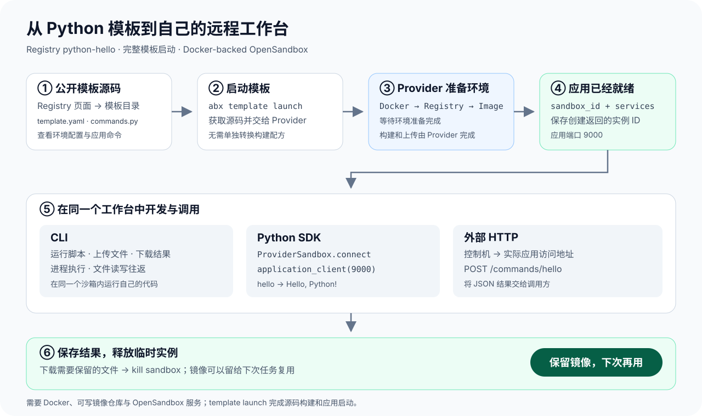

有一个 Python 脚本要临时跑一下，如果每次都从安装环境、启动服务开始，准备工作会比脚本本身更长。Registry 中的模板可以作为起点：先用现成的运行环境和应用命令，再上传自己的文件。

这篇选择 [python-hello](https://registry.agent-sandbox.cn/templates/python-hello/)，把它部署到 Docker 后端的 OpenSandbox，做一个可以从终端和程序中调用的 Python 工作台。我们会运行一段代码、上传文件、下载结果，并调用模板内的 HTTP 服务。

示例使用 CLI `0.5.6` 和 Python client `0.4.0a6`。本文使用官网独立二进制，本机无需额外安装 Node.js；还需要 Git、Docker，以及可访问的 OpenSandbox Docker 后端和可写镜像仓库。Provider 负责构建和推送镜像，OpenSandbox 从同一仓库拉取镜像启动沙箱。

## 先看看模板提供了什么

`python-hello` 不只是一个装好 Python 的镜像。它还包含应用命令，例如问候、运行代码字符串、运行文件和执行测试。创建沙箱后，可以发现这些命令，再按名称调用。

模板的主要文件各有职责：

| 文件 | 用途 |
| --- | --- |
| `template.yaml` | 描述模板和运行配置 |
| `Dockerfile` | 定义基础环境与依赖 |
| `commands.py` | 提供可从 CLI、SDK、HTTP 调用的命令 |

Registry 帮助我们找到模板，实际部署使用 Git 仓库中的源码。启动时可使用公开引用，也可以固定到 Git 提交，避免分支更新改变下一次构建的源码。



## 准备本机工具和账户配置

先按[安装案例](/blog/developer-journey-cli-install/)准备 CLI，然后安装 Python 客户端：

```bash
mkdir registry-lab
cd registry-lab
python3 -m venv .venv
. .venv/bin/activate
python -m pip install --index-url https://pypi.org/simple \
  'agent-sandbox-client==0.4.0a6'
```

先准备自己的 [OpenSandbox Docker 后端](https://github.com/opensandbox-group/OpenSandbox)。连接地址和 API key 应指向同一服务；镜像仓库需要同时允许构建机推送、后端拉取。本文的实际运行使用独立的 Linux Docker 后端和临时本地镜像仓库；连接已有服务时，替换成自己的地址与权限配置。

```bash
export ABX_PROVIDER=opensandbox
export ABX_OPENSANDBOX_BASE_URL='<YOUR_OPENSANDBOX_SERVER_URL>'
export ABX_OPENSANDBOX_API_KEY='<YOUR_OPENSANDBOX_API_KEY>'
export ABX_OPENSANDBOX_IMAGE_REPOSITORY='<YOUR_WRITABLE_REGISTRY/REPOSITORY>'
export ABX_SERVER_TOKEN="$(python -c 'import secrets; print(secrets.token_urlsafe(32))')"
```

私有仓库还需要按 [Provider 配置说明](https://github.com/Alibaba-Agent-Sandbox/awesome-providers/tree/main/opensandbox)配置 Docker 登录与后端拉取凭据。这些是运行平台的配置，不由模板提供账户信息。本例不调用模型，不需要 LLM API key。

安装 OpenSandbox Provider，再检查连接。下面的精确提交应使用你已查看并信任的公开版本；安装后的 CLI 和 Python SDK 共用同一个 Provider。

```bash
abx provider install \
  Alibaba-Agent-Sandbox/awesome-providers//opensandbox \
  --ref '<REVIEWED_40_HEX_PROVIDER_COMMIT>' --yes
abx provider doctor opensandbox
```

## 直接启动完整模板

```bash
abx --provider opensandbox --json template launch \
  alibaba-agent-sandbox/awesome-templates//python-hello \
  --sandbox-timeout 1200 --yes
```

这个命令拉取源码、准备镜像、创建沙箱、启动模板声明的服务并等待就绪。构建和镜像上传由 Provider 完成，无需先下载转换脚本，也不用在几种启动类型之间选择。

返回值包含 `sandbox_id`、`template_reference` 和 `services`。保存前两项，后续操作和清理都会用到：

```bash
export SANDBOX_ID='<RETURNED_SANDBOX_ID>'
export TEMPLATE_ID='<RETURNED_TEMPLATE_REFERENCE>'
abx --json sandbox command list "$SANDBOX_ID"
```

如果需要让团队固定复用同一份源码，在模板引用后加 `@<40位Git提交>`。不要把分支名当成不可变版本。

## 运行第一段 Python

这里创建了一个生命周期为 1200 秒的实例。命令列表可以帮助我们了解模板提供的接口。先调用 `hello`，再把一段 Python 交给 `run_script`：

```bash
abx --json run "$SANDBOX_ID" hello --arg name=Ada
abx --json run "$SANDBOX_ID" run_script \
  --json-args '{"code":"print(21 * 2)"}'
```

两次调用分别得到：

```json
{"result": "Hello, Ada!"}
```

```json
{"result": "42\n"}
```

命名命令适合复用模板已经封装好的操作。如果只是想直接执行沙箱进程，则使用 `abx exec`：

```bash
abx exec "$SANDBOX_ID" -- python3 -c 'print(6 * 7)'
```

## 上传自己的文件，再取回文件

代码变长后，把它存成文件会更方便：

```bash
printf 'print(6 * 7)\n' > main.py
abx upload "$SANDBOX_ID" main.py /home/user/app/main.py
abx --json run "$SANDBOX_ID" run --arg file=main.py
```

模板的 `run` 命令从应用工作目录运行这个文件，输出同样是 `42`。如果要查看远端文件或取回本地副本：

```bash
abx --json sandbox files list "$SANDBOX_ID" --path /home/user/app
abx download "$SANDBOX_ID" /home/user/app/main.py download.py
```

模板还提供 `test` 命令。可以上传项目的测试文件，然后用 `abx run ... test --arg path=...` 指定执行路径；示例脚本中包含一个最小 pytest 文件的完整操作。

## 从自己的 Python 程序里调用

CLI 方便人工操作，SDK 适合接入已有程序。下面连接刚刚创建的实例，并调用它的应用服务：

```python
import asyncio
import os
from agent_sandbox import ProviderSandbox

async def main():
    sandbox = await ProviderSandbox.connect(
        os.environ["SANDBOX_ID"], provider="opensandbox")
    try:
        async with await sandbox.application_client(
            9000, token=os.environ["ABX_SERVER_TOKEN"]) as client:
            result = await client.commands.run("hello", name="Python")
            print(result)
    finally:
        await sandbox.close()

asyncio.run(main())
```

这会输出 `Hello, Python!`。`ProviderSandbox` 管理沙箱连接，`application_client(9000)` 则连接模板在 9000 端口提供的应用。

也可以用普通 HTTP 客户端发送 POST。以下调用放在已经取得 `client` 的异步上下文中，并先 `import httpx`：

```python
async with httpx.AsyncClient(timeout=30) as http:
    response = await http.post(
        client.base_url.rstrip("/") + "/commands/hello",
        headers=client.auth_headers(),
        json={"name": "Ada"},
    )
    response.raise_for_status()
    print(response.json())
```

响应为 `{"result": "Hello, Ada!"}`。认证头由应用绑定提供。业务令牌使用前面设置的 `ABX_SERVER_TOKEN`。网关认证与应用令牌是不同的层次，控制面 API key 不能直接当作业务令牌使用。

## 同一个工作台，用完后释放

通过 `abx exec` 排查脚本时，使用的仍是前面创建的实例。文件上传、命名命令和普通进程执行各有用途，可以按任务选择；本例没有把应用命令当成平台原生解释器接口。

用完后先下载需要保留的文件，再删除实例：

```bash
abx kill "$SANDBOX_ID"
```

本例中返回的 `template_reference` 是 Provider 准备的镜像引用。删除沙箱不会删除镜像；可以保留它供下次创建实例，也可以在自己的镜像仓库中删除这次生成的精确标签。OpenSandbox 不提供 Express 的模板管理接口，不能用 `abx template delete` 代替仓库清理。

如果想从一台新的 Linux Docker 主机重做完整流程，可以使用[同一个公开启动脚本](https://github.com/Alibaba-Agent-Sandbox/awesome-templates/blob/main/scripts/public_launch_e2e.py)及[运行配置](https://github.com/Alibaba-Agent-Sandbox/awesome-templates/blob/main/.github/workflows/public-template-launch.yml)。它从公开 Registry 引用获取 `python-hello`，调用实际服务，校验文件往返，然后只清理本次所属沙箱和镜像。已有 OpenSandbox 服务的开发者也可以按本文的手动步骤，把它用作日常 Python 工作台。
