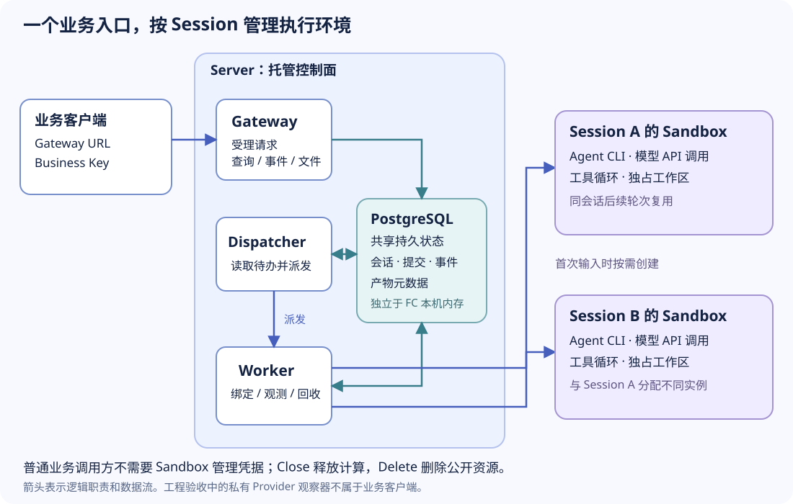

本文历史案例模板：[agents-api 0.1.4 固定源码](https://github.com/Alibaba-Agent-Sandbox/awesome-templates/tree/4971598a5b14b62207076dd2da4264c139423628/agents-api) · [Registry 模板入口](https://registry.agent-sandbox.cn/templates/agents-api/) · [Agent API 专题与后续 Harness](https://www.agent-sandbox.cn/blog/topics/agents-api/)

新版托管模板按 Harness 分开命名，目前仍在开发验证中。本文原始 Qwen CSV 产物与下面的旧版本记录保持不变；选择新模板时，请从专题读取其实际配置与限制。

> 使用版本：CSV 案例、HTTP 调用与下载产物来自模板 0.1.4 / CLI 0.5.10 的原实跑，不代表六个新 Harness 模板重新执行。复现该次部署时使用[固定模板源码及其说明](https://github.com/Alibaba-Agent-Sandbox/awesome-templates/tree/4971598a5b14b62207076dd2da4264c139423628/agents-api)。当前模板的安装、升级与资源清理从 [Agent API 专题](https://registry.agent-sandbox.cn/topics/agents-api/)进入；新版 YAML v1 不能直接搭配 CLI 0.5.10。

如果你希望把 Agent 接入自己的产品，通常不希望每个客户都先创建 Sandbox、查找实例地址、
配置云凭据，再处理工作区和回收。业务应用更需要一个固定入口：上传文件、发起任务、
追问修改、下载结果。

`agents-api` 应用模板提供这个入口。服务端 Gateway 管理 Session 和 Sandbox，
业务客户端只保存一个 Gateway URL 和业务 Key。本文用同一份订单 CSV 完成两轮任务：
先修复已有汇总程序，再在原工作区增加占比列，并把这条流程接入终端或 Python 应用。

## 1. 这个模板适合什么场景

它适合需要文件、代码执行和多轮上下文的 Agent 服务。例如：

| 场景 | 业务应用提供什么 | Agent 在 Sandbox 中完成什么 |
| --- | --- | --- |
| 数据处理助手 | CSV、处理要求、后续修改意见 | 编写或修改处理程序，运行后返回结果文件 |
| 现有代码修改 | 待修改工程、任务描述、测试要求 | 修改代码、执行工具和测试、导出补丁或源码 |
| 产品内的任务助手 | 页面上的上传、提交、进度和下载操作 | 在同一 Session 中连续处理任务，保留工作区上下文 |

后两项是可以基于接口开发的应用方式，需要你提供对应工程、任务内容和产品界面。
模板不是开箱即用的数据分析网站；它提供可集成的 Agent API 与运行基础。

与直接连接一个 Sandbox 相比，这个应用多承担了三件事：

- **统一入口**：业务方始终访问 Gateway，不随每个 Sandbox 更换 URL。
- **会话连续性**：同一 Session 的第二轮任务继续使用原工作区；不同 Session 使用独占 Sandbox。
- **结果访问**：通过 Gateway 查询任务、下载保存的产物，并关闭会话计算。



这种设计简化的是接入和管理。模型推理、工具执行和创建 Sandbox 仍有耗时，不应仅因为多了一层 API 就假定任务更快。

## 2. 先分清部署入口和业务入口

| 入口 | 使用者 | 本文用法 |
| --- | --- | --- |
| 所选模板的 CLI 部署与管理流程 | 部署者 | 部署、查看状态、更新和移除应用 |
| Gateway HTTP URL | 业务应用或终端用户 | 用 `curl` 上传文件、创建 Session、运行任务、下载结果 |
| Python HTTP 客户端 | Python 应用开发者 | 用 `httpx` 调用同一组 Gateway API |

CLI 负责部署和应用管理；终端业务调用使用 `curl` 连接 Gateway。
Python 0.4.0a7 提供服务端托管运行时，尚未提供专用的 Gateway 客户端 SDK。
因此本文的 Python 示例使用 `httpx`，不需要安装 Sandbox 管理 SDK，也不需要知道单个 Sandbox 的地址。

## 3. 部署前需要准备什么

部署者需要准备可访问的 Sandbox 平台、ACR 镜像仓库、FC 执行角色、已有 PostgreSQL 和模型访问配置。原 CSV 案例使用 Qwen Code 与支持工具调用的 Chat Completions；其他 Harness 的原生认证和模型协议可能不同，不能直接复用全部配置。

| 资源或配置 | 用途 | 谁准备 |
| --- | --- | --- |
| 阿里云部署身份、FC 执行角色 | 部署并运行 Gateway、Worker 和 Dispatcher | 部署者提供已有身份和角色 |
| ACR 镜像仓库及命名空间 | 存放构建镜像 | 部署者准备 |
| 已有 PostgreSQL | 保存会话、提交和文件数据 | 部署者提供；模板不自动创建数据库 |
| Sandbox 访问配置 | 创建 Session 所需的独占实例 | 部署者提供，留在服务端 |
| 模型或 Harness 原生凭据 | 在 Sandbox 内运行选定 Agent | 按对应模板说明提供 |
| 业务 Key | 调用 Gateway | 由部署流程准备，部署者只向业务应用分发该 Key |

FC、Sandbox、数据库、镜像存储和模型可能分别产生费用。网络和证书配置需要保证这些服务相互可达。业务 Key、模型 Key、Sandbox 管理 Key 和云 AK/SK 用途不同；业务客户端不需要部署者的云凭据。

## 4. 部署应用并配置业务客户端

现在从 [Registry Agent API 专题](https://registry.agent-sandbox.cn/topics/agents-api/)选择 Harness，使用其 README 中对应版本的源码获取、依赖安装、CLI 部署和私有配置步骤。新模板仍在开发验证，不应把旧版 `agents-api` 的绑定文件或命令直接复制到新 YAML。

需要复现本文旧版完整 CLI 部署时，使用 [0.1.4 固定源码的部署说明](https://github.com/Alibaba-Agent-Sandbox/awesome-templates/blob/4971598a5b14b62207076dd2da4264c139423628/agents-api/README.zh-CN.md)。本文保留下来的 CSV 结果与业务 HTTP 示例属于该版本。

部署完成后，业务客户端需要两个私有配置：

```bash
export AGENTS_API_BASE_URL='<所选模板返回的 Gateway URL>'
export AGENTS_API_KEY='<独立的业务 Key>'
```

在自己的密钥管理或私有配置中提供这些值，不打印 Key，也不启用 shell 命令跟踪。不要把数据库 URL、Sandbox 管理 Key、内部 Token 或整个部署凭据文件分发给业务应用。

## 5. 用同一份 CSV 完成两轮任务

模板在 `/workspace/agents-api-demo` 放了一份 CSV 练习程序及原始测试。
程序最初把同月金额覆盖，第一轮任务是修复累加逻辑，第二轮在同一程序上增加占比功能。

输入[销售数据 sales.csv](./sales.csv)：

```csv
month,amount,label
2026-01,19.90,"North, launch"
2026-01,10.10,中文客户
2026-02,2.50,Renewal
2026-02,7.50,Support
```

第一轮要求 Agent 修改已有 `aggregate.py`，保留原始测试并运行它们，然后生成
`/workspace/outputs/summary.csv`。正确结果为：

```csv
month,total
2026-01,30.00
2026-02,10.00
```

第二轮继续使用同一个 Session，要求给原程序增加 `--with-share`，保留默认模式，
生成 `summary-with-share.csv`。两个月占比应为 0.750000 和 0.250000。
这两轮文件处理已通过模板的真实 Qwen 任务验证。

输入附件安装到 `/workspace/input/`；需要下载的结果写到 `/workspace/outputs/`。
客户端从 Gateway 读取保存的产物，不需要直接连接工作区。

## 6. 通过 URL 和 curl 调用

Gateway 是带认证的 API 地址，不能只在浏览器地址栏中打开就提交任务。
下面的请求都使用同一个 `$AGENTS_API_BASE_URL`。

先查看当前应用提供的模型：

```bash
curl --fail-with-body "$AGENTS_API_BASE_URL/v1/models" \
  -H "Authorization: Bearer $AGENTS_API_KEY"
```

上传 CSV 时使用 multipart，而不是把本机路径放进 JSON：

```bash
curl --fail-with-body "$AGENTS_API_BASE_URL/v1/files" \
  -H "Authorization: Bearer $AGENTS_API_KEY" \
  -F purpose=user_data -F 'file=@sales.csv;type=text/csv'
```

用返回的文件 ID 创建 Session。下面将 `MODEL_ID` 和 `FILE_ID` 替换为前两步返回的值：

```bash
curl --fail-with-body -i "$AGENTS_API_BASE_URL/v1/agents/sessions" \
  -H "Authorization: Bearer $AGENTS_API_KEY" \
  -H 'Content-Type: application/json' \
  -H 'Idempotency-Key: csv-example-session-1' \
  --data '{
    "agent": {"model": "MODEL_ID"},
    "input": "修复 /workspace/agents-api-demo/aggregate.py 的重复月份金额累加问题。不要修改原始测试，运行测试后读取 /workspace/input/sales.csv，生成 /workspace/outputs/summary.csv，列为 month,total，月份升序、金额两位小数。暂不实现 --with-share。",
    "x_agent_sandbox": {"input_files": [
      {"file_id": "FILE_ID", "path": "/workspace/input/sales.csv"}
    ]}
  }'
```

创建成功返回 201，正文中 `id` 是 Session ID；响应头
`X-Agent-Sandbox-Submission-Id` 是首轮提交 ID。一次新任务使用新的请求键；
同一请求的重试复用原键和原请求内容。

使用这两个 ID 查询任务：

```bash
curl --fail-with-body \
  "$AGENTS_API_BASE_URL/v1/agent-sandbox/sessions/SESSION_ID/submissions/SUBMISSION_ID" \
  -H "Authorization: Bearer $AGENTS_API_KEY"
```

等到 `status` 为 `completed`，使用返回的 `turn_id` 查找本轮产物并下载：

```bash
curl --fail-with-body \
  "$AGENTS_API_BASE_URL/v1/agents/sessions/SESSION_ID/artifacts?limit=100&order=asc" \
  -H "Authorization: Bearer $AGENTS_API_KEY"

curl --fail-with-body \
  "$AGENTS_API_BASE_URL/v1/agents/sessions/SESSION_ID/artifacts/ARTIFACT_ID/content" \
  -H "Authorization: Bearer $AGENTS_API_KEY" --output summary.csv
```

产物按 `turn_id` 和 `path` 选择，例如 `outputs/summary.csv`，避免下载到其他轮次的同名文件。
把 URL 中的 `SESSION_ID`、`SUBMISSION_ID`、`ARTIFACT_ID` 替换为实际返回值。
第二轮向原 Session 发送输入：

```bash
curl --fail-with-body -i \
  "$AGENTS_API_BASE_URL/v1/agents/sessions/SESSION_ID/events" \
  -H "Authorization: Bearer $AGENTS_API_KEY" \
  -H 'Content-Type: application/json' \
  -H 'Idempotency-Key: csv-example-share-1' \
  --data '{"events":[{"type":"agent.session.input.message","input":"继续修改同一工作区的 aggregate.py，增加 --with-share。占比保留六位小数，总额为零时为 0.000000；保留默认模式和原始测试，运行测试并生成 /workspace/outputs/summary-with-share.csv。"}]}'
```

这个请求返回 202，**正文为空**；从响应头获取新的 Submission ID，再按同样方式等待和下载。

如果希望直接跑完整流程，下载 [curl 完整示例](./run_csv.sh)和[输入 CSV](./sales.csv)，
放在同一目录后运行：

```bash
bash run_csv.sh ./results
```

脚本自动处理 ID、轮询、分页、两轮产物下载、Session 关闭和输入文件删除。
成功时在 `results/` 下得到 `summary.csv`、`summary-with-share.csv` 和两版修改后的源码。
每次示例运行会新建 Session 并调用模型。

## 7. 在 Python 应用中调用

下载 [Python 完整示例](./run_csv.py)和[输入 CSV](./sales.csv)，放在同一目录。
沿用前面设置的 Gateway URL 和业务 Key：

```bash
python -m pip install httpx==0.28.1
python run_csv.py ./results
```

脚本使用普通 HTTP 客户端。上传和首轮请求的核心写法如下：

```python
import os
import uuid
from pathlib import Path
import httpx

with httpx.Client(
    base_url=os.environ["AGENTS_API_BASE_URL"].rstrip("/"),
    headers={"Authorization": "Bearer " + os.environ["AGENTS_API_KEY"]},
    timeout=30,
) as api:
    models = api.get("/v1/models").raise_for_status().json()["data"]
    uploaded = api.post(
        "/v1/files", data={"purpose": "user_data"},
        files={"file": ("sales.csv", Path("sales.csv").read_bytes(), "text/csv")},
    ).raise_for_status().json()
    response = api.post(
        "/v1/agents/sessions",
        headers={"Idempotency-Key": "csv-" + uuid.uuid4().hex},
        json={
            "agent": {"model": models[0]["id"]},
            "input": "读取 /workspace/input/sales.csv，按月份汇总金额，生成 /workspace/outputs/summary.csv。",
            "x_agent_sandbox": {"input_files": [
                {"file_id": uploaded["id"], "path": "/workspace/input/sales.csv"}
            ]},
        },
    ).raise_for_status()
    session_id = response.json()["id"]
    submission_id = response.headers["X-Agent-Sandbox-Submission-Id"]
```

这是请求部分的节选；可直接运行的完整示例还会等待两轮任务、检查 CSV 金额与占比、
下载文件，并释放 Session。下载的 Agent 源码作为文件保存，不在本机自动执行。

可以设置 `AGENTS_API_MODEL` 选择 `/v1/models` 中的模型 ID；未设置时使用列表中的第一个模型。
这个 ID 必须由当前部署提供，仅改变客户端字符串不会让服务端获得新的模型配置。

## 8. 接进自己的业务，而不只运行演示

从这个例子迁移到真实场景，可以分三步：

1. **换输入和任务**：上传自己的文件，修改输入要求和输出文件名。对于已有工程，
   先在派生模板中加入工程文件，并把任务中的练习路径替换为自己的项目路径。
2. **保留需要的会话**：在业务数据库中记录 Session ID，后续修改继续向它发送输入。
   不要在用户每次点击“继续”时创建新 Session；同一 Session 同时只运行一轮。
3. **把结果接回产品**：将 Submission 状态映射为页面进度，把 Artifact 下载接到文件列表，
   并在用户结束任务时关闭计算。下载示例在成功后会清理会话；需要持续会话时，应把关闭步骤移到业务结束的位置。

定制项及其生效方式：

| 要改什么 | 修改位置 | 生效方式 |
| --- | --- | --- |
| 每轮任务内容、输入文件、输出要求 | 业务请求 | 下一轮请求生效 |
| 默认模型、模型 endpoint、Harness | 对应版本模板的私有配置 | 按模板说明更新应用 |
| 预置代码、依赖或可编辑内容 | `fixtures/`、Dockerfile 及相关源码 | 重建镜像并更新应用 |
| 会话寿命、并发、执行预算、文件限额 | 对应版本模板的策略配置 | 按模板说明更新应用 |

按所选模板说明构建并更新应用，保留旧 Session 的 Worker 与工作区归属；需要新配置的任务创建新 Session。新版模板的配置位置与升级方式见 [Agent API 专题](https://registry.agent-sandbox.cn/topics/agents-api/)，不能沿用旧版 `application`/binding 层级。

## 9. 状态、限制和结束使用

提交被接受不等于任务完成。示例会等待 Submission 和对应 Turn 完成；若返回
`failed`、`cancelled` 或 `uncertain`，先查询该提交，不要直接创建重复任务。
客户端等待超时不会自动取消远端执行，示例会保留已知资源 ID，供继续查询或主动关闭。

关闭会话计算使用：

```bash
curl --fail-with-body -X POST \
  "$AGENTS_API_BASE_URL/v1/agent-sandbox/sessions/SESSION_ID/close" \
  -H "Authorization: Bearer $AGENTS_API_KEY" \
  -H 'Content-Type: application/json' --data '{}'
```

用返回的 Operation ID 查询 `/v1/agent-sandbox/operations/OPERATION_ID`，
直到 `status` 为 `succeeded`。Close 保留已保存的结果；不再需要数据时，删除 Session 和输入文件：

```bash
curl --fail-with-body -X DELETE \
  "$AGENTS_API_BASE_URL/v1/agents/sessions/SESSION_ID" \
  -H "Authorization: Bearer $AGENTS_API_KEY"
curl --fail-with-body -X DELETE "$AGENTS_API_BASE_URL/v1/files/FILE_ID" \
  -H "Authorization: Bearer $AGENTS_API_KEY"
```

完整示例会自动完成这些操作。默认 Session 空闲/最大寿命为 900/3600 秒，
结果保留期为 24 小时，单输入文件和单产物上限各 10 MiB。需要长期保存的结果应下载到自己的存储。

不再使用应用时，按照对应版本 README 的应用清理流程执行。新版模板使用带 drain 检查的清理入口，先停止接收任务、关闭会话计算，再移除应用资源；不要直接绕过该步骤删除正在服务会话的函数。自行准备的数据库、执行角色、共享网络和保留镜像仍由你管理。旧版资源的清理以[固定版本说明](https://github.com/Alibaba-Agent-Sandbox/awesome-templates/blob/4971598a5b14b62207076dd2da4264c139423628/agents-api/README.zh-CN.md)为准。

模板目前为 Beta，内置 FC 测试域名适合体验；生产接入需配置自己的 HTTPS 入口。
受支持的参数和接口以 Gateway 的 `/v1/agent-sandbox/capabilities` 及
[API 参考](https://github.com/Alibaba-Agent-Sandbox/awesome-templates/blob/main/docs/managed-agents-api.zh-CN.md)为准。
