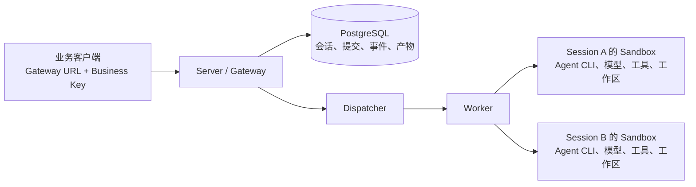

业务调用方希望配置一个 URL 和一把业务 Key，然后创建会话、上传文件、运行 Agent、
下载结果。每个 Sandbox 的地址、创建凭据、工作区和回收流程，应由服务端管理。
本文围绕这一目标，记录 `agents-api` 模板从本地验证到真实阿里云 FC 部署的操作。

**草稿状态：正式npm/PyPI的0.1.2公开recipe已完成正常ready、Qwen两轮源码/原测试与4/8项heldout、
39个正向接口及38个401、实时SSE和主动取消/同会话续轮。其Qwen→Codex候选业务检查失败，
原具体原因未保存，不宣称公版升级或Codex39通过。本窗口计算、RDS、6项guest镜像及2个空仓库均已独立确认释放。
源码候选的成功升级另列；0.1.3安全诊断已通过本地及远端CI，下一独立公开实测尚未完成，
本文继续保持草稿。**

所有结果都有明确的范围。命令中的本机路径、应用名称、账号及资源标识使用占位符；
密钥和完整私有日志不公开。代码块标为“实际返回脱敏节选”的内容，只保留真实返回中的
允许字段；标为“实际断言摘要”的内容来自执行后的检查，不是伪造的 API 原始响应。

## 1. 先把部署者与业务调用方的入口分开



Server 维护稳定的业务入口，首次输入才按需分配 Sandbox。同一个 Session 的后续轮次
继续使用原有工作区；不同 Session 各自独占 Sandbox。CLI 部署应用时配置云访问、镜像
仓库、数据库、模型及 Sandbox 管理凭据，普通业务客户端只拿 Gateway URL 和业务 Key。

会话关闭与删除分开：Close 释放计算，保留已保存的历史和产物；Delete 删除公开资源。
Close 请求返回一项 Operation，需要继续查询最终状态，不能只看到 HTTP202 就认为
远端进程已停止。客户端请求超时也不能据此自动重发一次任务。

这个模板参考 OpenAI Agents 的 Session/Turn 组织方式，支持一部分接口并提供明确的托管
扩展。它把完整 Agent CLI、模型调用和工具循环放在 Sandbox，能力边界以 Gateway 的
`/v1/agent-sandbox/capabilities` 为准。路径相似不构成任意 OpenAI SDK 或完整托管
harness 的兼容声明。

## 2. 安装正式CLI，固定镜像中的公开SDK版本

普通部署主机需要Node.js20+、Docker、可访问的镜像仓库，以及Python虚拟环境中的
`httpx==0.28.1`。使用npm分发的正式CLI0.5.9；业务HTTP客户端只需httpx、Gateway和业务Key，
不要求安装Sandbox管理SDK。常规准备命令如下：

```bash
npm install --global @agent-sandbox/cli@0.5.9
git clone https://github.com/Alibaba-Agent-Sandbox/awesome-templates.git
cd awesome-templates/agents-api
python3 -m venv .abx/venv
. .abx/venv/bin/activate
python -m pip install httpx==0.28.1
abx --version
```

本次为独立验证公开发行物，实际使用fresh安装目录下载、核对npm公开tarball后安装，
没有用源码目录覆盖同名包。已安装正式CLI的实际版本输出为：

```text
abx, version 0.5.9
```

两个Dockerfile固定使用公开PyPI0.4.0a7，分别提供Sandbox的guest bridge与Server侧托管服务。
本次公开包验证身份如下，后续复现应同时保存版本和字节摘要：

| 发行物 | 实际身份 |
| --- | --- |
| npm CLI | 0.5.9，合并源码`dbc0224474c556710569f9e72d3835f685a69597` |
| 公开npm tarball SHA-256 | `ca3c750b119cc5106e71f883f54b3ae31c5122c562602c7082fd0bd0ffcf69f8` |
| Python SDK合并源码 | `fa15efd7e679b1697e140363a395d998cde7f66a` |
| client wheel SHA-256 | `c5f981545bb9266663f47e8ca3ce02a48a2259125b0ffd44c575973e3205482a` |
| server wheel SHA-256 | `210db5e796f4fc63e84156d19076c946d261b48c47ec6c8c1db82b8b60691f08` |

模板recipe版本0.1.2，Sandbox镜像固定Node.js24.16.0、Codex0.162.1和Qwen Code0.23.0。
Host与Sandbox的Node版本是不同配置。模型实际可用性必须另测，CLI能查版本不代表工具回合可用。

公开recipe验证保留a6d37c32的14文件快照，后续模板CI修补没有改动这14文件；应用名称和
部署access按真实环境配置。本篇前面的正常步骤使用公开包，源码候选及原失败的版本对照
保留在附录12，不能把同样报告0.4.0a7的两个不同client wheel混为同一镜像。

参考实现与实际发行来源：
[SDK PR156](https://github.com/Alibaba-Agent-Sandbox/python-sdk/pull/156)、
[CLI PR235](https://github.com/Alibaba-Agent-Sandbox/agent-sandbox/pull/235)、
[CLI0.5.9发行](https://github.com/Alibaba-Agent-Sandbox/agent-sandbox/releases/tag/v0.5.9)、
[模板PR296](https://github.com/Alibaba-Agent-Sandbox/awesome-templates/pull/296)。
公开包可安装及初始ready已经实际验证，完整公开模板业务与最终清理仍需后文独立结果。

## 3. 准备凭据与私有配置

先明确每项凭据的用途，避免把部署权限交给业务调用方。

| 配置 | 用途和来源 | 使用位置 |
| --- | --- | --- |
| 云 AK/SK 或已有 STS 凭据 | 来自已有云访问身份，部署 FC、构建或查询拥有的镜像 | 部署 CLI 子进程 |
| Sandbox 管理凭据 | 来自已有 Sandbox 账号配置，创建和回收 Session 的计算实例 | Server 的 Provider binding |
| 模型 Key、端点、模型 ID | 来自实际模型服务账号；先验证工具结果回合 | Sandbox 中所选 Agent 的模型配置 |
| PostgreSQL URL、密码、CA | 本轮临时私网数据库及其实际 CA | Server；启用 verify-full |
| Business Key | CLI 首次 Apply 生成并安全保存，后续部署复用 | 业务客户端 |
| Internal Token | CLI 生成的私有控制鉴权，独立于业务 Key | Server 内部控制调用 |
| Sandbox 应用令牌 | 运行时为应用连接单独准备，独立于云 Key 和模型 Key | Server 与 Sandbox 应用服务之间 |

应用令牌不是去云控制台申请的 API Key。普通用户使用模板时，应让 CLI 自动准备并
保存缺省应用认证；不需要先手工生成一串随机令牌才能开始。

从模板的受支持示例复制私有binding，保持它在被忽略的`.abx/`内：

```bash
cp bindings.example.json .abx/bindings.json
chmod 600 .abx/bindings.json
```

示例中的`{env: ...}`由Apply在部署host读取。普通配置需要提供
`ABX_MANAGED_DATABASE_URL`、`SANDBOX_API_KEY`、`SANDBOX_BASE_URL`、`SANDBOX_DOMAIN`、
`SANDBOX_REGION`、模型的`OPENAI_API_KEY/OPENAI_BASE_URL/OPENAI_MODEL`，以及已有
`AGENTS_FC_ROLE_ARN`。这些名称是公开示例的配置引用；本轮工程控制器使用自己私有的引用
名称，不需要把它们照搬进业务客户端。模型ID实际选择`qwen3.5-plus`，首个adapter为`qwen-code`。

本轮数据库只走私网，state binding包含`databaseUrl`、`databaseCa`及`vpcConfig`。
下面是可供部署者填写的形状示例，环境引用和host路径是占位配置，不冒充原私有JSON：

```json
{
  "agents-state": {
    "databaseUrl": {"env": "ABX_MANAGED_DATABASE_URL"},
    "databaseCa": {"file": "/absolute/private/database-ca.pem"},
    "vpcConfig": {
      "vpcId": {"env": "AGENTS_VPC_ID"},
      "vSwitchIds": [{"env": "AGENTS_VSWITCH_ID"}],
      "securityGroupId": {"env": "AGENTS_SECURITY_GROUP_ID"}
    }
  }
}
```

这是替换已有binding中的state对象，其余示例对象继续保留。数据库URL使用证书覆盖的
主机名及`sslmode=verify-full`，CA从数据库服务获得并核对有效链；不把密码或CA塞进Dockerfile。
清单的地域与已有网络、镜像仓库、Sandbox平台保持一致，accessRef选择已有的云访问配置。
本轮使用显式环境访问身份，已有网络和执行角色按借用处理，业务/内部Key由首次Apply新生成。


本轮凭据只在子进程中加载，不打印值，不写入公开仓库或文章素材。还遇到了一个真实
环境限制：共享工作区对 chmod 的语义与本机文件系统不同，申请0600后仍可能显示0777。
后续明文 binding、密码和原始日志全部放到本机0700目录，文件逐一检查为0600；跨环境
恢复只保存认证加密后的备份。不能看到一条 chmod 命令退出0就宣称秘密文件已受保护。

数据库保持私网访问，没有为方便控制器而开启公网数据库或搭建隧道。已有 VPC、交换机、
安全组和执行角色按借用处理，不在清理时删除。

## 4. 先验证模型的工具回合

Agent 编码任务通常包含“模型要求调用工具→执行工具→把工具结果发回模型→继续生成”。
简单文本请求成功、`/models` 列出模型，以及 CLI 版本查询，都不足以证明这个流程可用。

本轮用当前账号实际可用的 `qwen3.5-plus`，分别检测 Chat Completions 和 Responses。
探针只做加法：模型调用 `add(a=2,b=3)`，控制器回传5，要求最终回答精确为5。
探针不执行模型生成的任意函数体。

实际执行的 Chat 工具回合探针：

```bash
<TEST_PYTHON> <VALIDATION_DIR>/model_preflight.py
```

实际结果脱敏节选：

```json
{
  "models_status": 200,
  "tests": [{
    "model": "qwen3.5-plus",
    "first_status": 200,
    "tool_call": true,
    "roundtrip_pass": true,
    "second_status": 200,
    "elapsed_seconds": 4.53
  }]
}
```

实际执行的 Responses 工具结果回合探针：

```bash
<TEST_PYTHON> <VALIDATION_DIR>/responses_tool_preflight.py
```

实际输出：

```json
{
  "model": "qwen3.5-plus",
  "first_status": 200,
  "tool_call_valid": true,
  "function_call_output_accepted": true,
  "roundtrip_passed": true,
  "second_status": 200,
  "elapsed_seconds": 4.963
}
```

[Chat 实际结果](./chat-tool-preflight.json)与[Responses 实际结果](./responses-tool-preflight.json)
保留了探测摘要。这证明本轮账号、端点和模型能够完成所测协议回合。仅凭这两个探针
不能证明最终 FC 文件任务；后文另给完整业务证据，也不能推广为所有 BYOK 端点都兼容。

## 5. 用有缺陷的现有工程作为业务练习

只让 Agent 新建一个包含固定文字的文件，很难判断真实代码修改能力。模板在
`/workspace/agents-api-demo` 预置一个 CSV 汇总程序和原始测试。程序故意把同月金额覆盖，
第一轮需要修改现有源码，使重复月份可以正确累加。

实际练习文件的内容如下，包含重复月份、带逗号的字段和中文：

```csv
month,amount,label
2026-01,19.90,"North, launch"
2026-01,10.10,中文客户
2026-02,2.50,Renewal
2026-02,7.50,Support
```

[原始练习源码](https://github.com/Alibaba-Agent-Sandbox/awesome-templates/blob/f5c7ce5ecce2a7787fb7c8275b2c383d9a55c0ae/agents-api/fixtures/csv-analysis/aggregate.py)
中的缺陷是同一月份反复执行下面的覆盖赋值；原始测试由独立验证保留，Agent 需要修改程序：

```python
totals[row["month"]] = Decimal(row["amount"])
```

输入文件通过 Gateway 上传，附件目标固定为 `/workspace/input/sales.csv`。程序源码和
测试放在练习工程目录，输出放到 `/workspace/outputs/`。这几个路径承担不同职责。

本轮先发现附件路径写成练习目录下的 `input/`，实际服务校验拒绝了它。用原服务做本地
准入检查得到：

```text
/workspace/agents-api-demo/input/sales.csv -> HTTP 400, invalid_path
/workspace/input/sales.csv                 -> HTTP 201, Submission receipt present
```

这是实际接口准入结果；该检查没有连接 Provider，也没有运行模型。修复只改模板中的
附件路径和两轮提示词，保留运行时对附件目录的限制，没有为了让示例通过而放宽服务端。

两轮任务的业务断言是：第一轮输出 `month,total`，两个月分别为30.00和10.00；第二轮
继续修改同一文件，加入 `--with-share`，输出占比分别为0.750000和0.250000，同时保留
默认模式及第一轮产物。这些数值先作为任务合同；第7节给出实际两轮CSV、源码与独立测试结果。

先执行本地模板检查：

```bash
cd <TEMPLATES_CHECKOUT>
<TEST_PYTHON> scripts/test_spec_tools.py
<TEST_PYTHON> scripts/check_template.py --all
<TEST_PYTHON> scripts/check_docs.py
<TEST_PYTHON> -m pytest agents-api/test_smoke.py
```

实际断言摘要：

```text
spec tools: 52 passed
complete template checks: 48 directories conformant
document checks: 232 documents, no failures
managed smoke regression: 7 passed
seed program: unchanged original suite fails exactly 2 tests
```

本地还分别启动 managed 服务及既有 Python/Node 模板，检查新增启动入口与旧模板路径。
这些结果证明模板检查、启动和 smoke 的错误处理成立，不替代真实模型的两轮任务。

## 6. 使用公开安装包正常部署：获得稳定 Gateway

公开包验证另起一个独立资源窗口，使用新nonce、空数据库、项目目录和本机HOME，
不复用源码窗口已经删除的数据库连接。模板目录来自同一份14文件公开recipe；仅按普通
配置修改应用名称及accessRef，两个Dockerfile字节与公开候选导出完全相同，没有COPY本地wheel。
Host使用正式npm CLI0.5.9及公开PyPI client/server0.4.0a7，Python依赖在独立虚拟环境中。

部署前要先确认数据库TLS真正进入enabled=on/status=success，再准备CA及binding。
本次一次过早的本机准备已经复制好项目，随后因TLS仍为off/setting而被SSL断言拦截，
该步骤没有云变更。等10:39 UTC原生读回on/success后，单独准备binding退出0、耗时0.214秒；
没有为了继续部署而降低verify-full要求。

正常公开CLI命令为：

```bash
abx app build template.yaml --out .abx/build.json --yes
abx app plan template.yaml --build-receipt .abx/build.json --out .abx/plan.json
abx app apply .abx/plan.json --bindings <PRIVATE_BINDINGS_FILE> --yes
```

本次实际返回脱敏节选与耗时如下：

| 步骤 | 实际退出码 | 耗时/秒 | 实际返回状态 |
| --- | ---: | ---: | --- |
| Build | 0 | 19.999 | built |
| Plan | 0 | 0.915 | planned，operation=apply |
| Apply | 0 | 451.161 | ready，phase=ready |

```json
{"status": "ready", "phase": "ready"}
```

这里的ready来自正常CLI候选验证与生产发布流程，没有手工驱动Dispatcher或改写收据。CLI Status与Reconcile也实际退出0，合计3.068秒。
另外用已有操作身份验证了空revision的私有控制边界：4次原生FC调用的外层状态均为200，
两个不合法控制请求在应用响应中精确返回`invalid_invocation`，前后控制状态不变，
探针实际退出0、耗时73.294秒。这里读取的是原生Invoke包装内的应用错误；没有把它描述成
FC监听器直接返回HTTP400，也不把私有控制凭据加入业务客户端配置。
[公开recipe初始部署的实际脱敏摘要](./public-normal-ready.json)列出实际步骤，以及随后
独立确认镜像内新代码的结果。检查为该确切本地imageID创建了一个never-started容器，
只通过只读archive读取安装模块，确认8689字节及SHA-256：

```text
9a23fd1e621f6666e8027bae0423e656cf70ee8679e4596435959e8be349d032
```

容器从未启动，镜像代码没有在host执行；检查容器随后明确不存在。此检查证明本次镜像
包含预期的新模块字节，不替代后面的真实模型、文件、接口和清理验收。第7节另给公开Qwen模型业务结果；主动取消、升级及最终清理完成前，仍不能仅凭ready或
这一模块hash宣称完整模板通过。

数据库创建阶段也保留过一次39.036秒的create-uncertain：当时没有拿到ID，没有重复Create。
通过唯一nonce/description的独立只读发现恰好一个所属实例后才继续配置；这不能被写成
已证明的网络故障。完整源码候选部署对照仍保留在附录11，旧结果没有被覆盖或当作公版通过。

## 7. 公开Qwen路径：同一个 Gateway 完成两轮代码修改

业务过程依次是上传 CSV、创建带附件的 Session、查询持久化 Submission/Turn、下载产物，
再给同一个 Session 提交第二轮输入。工程验收控制器同时使用固定可信检查程序，在所属
Sandbox 内执行原测试和未提前交给 Agent 的 heldout；业务 HTTP 客户端始终只有业务 Key。

Apply的afterReady已经运行模板自带的`scripts/smoke.py`；它只经Gateway上传文件、驱动两轮
并下载CSV/源码。普通业务机器只需`AGENTS_API_BASE_URL`和`AGENTS_API_KEY`，不需要云管理Key。
部署者从本机凭据文件仅取出businessKey再分发，不把internalToken或整个凭据文件交给业务方。
已将这两项放入业务客户端自己的环境配置后，可在公开模板目录直接复现两轮：

```bash
python scripts/smoke.py
```

这条普通调用不需要`<VALIDATION_DIR>`或Provider管理权限；脚本通过`/v1/models`发现默认模型，
也可用`AGENTS_API_MODEL`指定已发布的模型ID。正常Apply已实际运行同一脚本，成功输出固定为：

```text
PASS: Gateway input, two real Agent turns, independent CSV results and owned compute close
```

它验证输入、两轮结果及Close/Delete；下面额外的39接口和Sandbox内原测试/heldout属于独立
工程验收，不把私有工程控制器作为业务用户的安装前提。

本次额外的工程独立验收实际入口为：

```bash
<PUBLIC_PYTHON> <VALIDATION_DIR>/run_acceptance.py public public-final-qwen-public-39
```

这个工程组合控制器显式持有Provider管理凭据，用于所属Sandbox内的独立测试，因此结果中的
`provider_credentials_used=true`。其中业务HTTP客户端的
`business_client_provider_credentials_used=false`、`private_provider_inspection_used=true`；
两者分工明确，没有把“只使用Gateway”的业务要求误写成整个工程进程没有管理权限。

本次实际退出0，耗时455.761秒。它遍历39个 V1 operation 的正向响应；除公开健康检查外，
另外38个受保护 operation 实际使用无效 Bearer 验证返回401。输入、输出和清理也全部经过
同一个 Gateway。完整[实际结果脱敏摘要](./public-qwen-acceptance.json)及
[534次实际HTTP观察的逐步脱敏记录](./public-qwen-http-transcript.jsonl)可下载；后者保留
method、路径稳定占位符、状态码及允许的返回字段，没有复制请求正文、提示词或认证头。

关键业务顺序和实际状态码为：

| 实际操作 | HTTP 状态 | 结果判定 |
| --- | ---: | --- |
| 上传 sales.csv，purpose=user_data | 200 | 返回 File ID，作为 Session 附件 |
| 创建带初始任务的 Session | 201 | 返回 Session 及 Submission 收据头 |
| 查询 Submission 与保存的 Turn | 200 | completed，产物发布完整 |
| 下载首轮源码、CSV、报告 | 200 | 核对字节、金额及源码哈希 |
| 向相同 Session 提交第二轮输入 | 202 | 响应头提供新的 Submission；继续查询终态 |
| 下载第二轮源码及带占比 CSV | 200 | 占比与独立测试通过 |
| Close | 202 | 查询 Operation，确认 succeeded/compute released |
| Delete 后查询 Session | 200 / 404 | 公开资源已删除 |

第一轮实际 CSV 是：

```csv
month,total
2026-01,30.00
2026-02,10.00
```

第二轮实际 CSV 是：

```csv
month,total,share
2026-01,30.00,0.750000
2026-02,10.00,0.250000
```

独立检查不是阅读 Agent 的“完成”文字。每轮先确认 Session、revision、唯一原生实例、
原始创建模板的 ID/name 归属与 Turn 发布状态，再在这个 Sandbox 内运行固定可信检查程序。
原测试文件哈希在执行前后保持不变；从 Gateway 下载的源码、Sandbox 中真正执行的源码
和捕获为产物的源码哈希一致。检查程序结束且原生 PID 已消失后才发起下一轮输入。

实际独立断言摘要为：

| 轮次 | 原始测试 | heldout | 原测试未变 | 下载源码=执行源码 | 检查进程退出 |
| --- | --- | ---: | --- | --- | --- |
| summary | 通过 | 4项通过 | true | true | true |
| share | 通过 | 8项通过 | true | true | true |

首轮源码1548字节，SHA-256为 `f6a9f9a24b4fde819e1253dba2e4df2b0bac32db14ae99a0a53d76c93261a027`；
第二轮源码2030字节，SHA-256为 `c2f4b896c6ca6788b18f27c9dee5a2f24e49af683be24b1aa6610600b5942977`。
可下载[首轮源码](./public-qwen-summary.generated.py)、[首轮CSV](./public-qwen-summary.csv)、
[该轮模型报告](./public-qwen-report.generated.txt)、[第二轮源码](./public-qwen-share.generated.py)
和[第二轮CSV](./public-qwen-share.csv)。这些模型生成文本经过人工阅读和已知凭据字节检查，
没有在宿主机执行；报告自述与独立测试结果仍分开记载。

这里验证的是当前固定 V1 operation 和实际业务。终态取消接口返回202，不等于正在执行
的进程已经被停止；list接口一次成功，也不能扩大为所有分页边界都经过真实云端验证。
同 UID 的合作进程、文件与哈希检查不构成对敌对 Agent 的防篡改证明；本轮未从宿主直连
私网PG做所有权证明。独立 Provider 最终不存在证明在应用全部关闭后另做，当前业务摘要
中的该字段仍为 false，不能提前修改成 true。

## 8. 公开Gateway实时SSE：首帧先到，正常读完再关闭

历史Turn结束后GETevents成功，不能独立证明实时flush。因此另建一个没有input的空Session，
确认其idle/unallocated、Submission为空，没有创建模型任务。开始GETevents after0后，
在连接期间另发一次GETSession，读取SSE直到服务正常结束，不提前断开制造FC499。

实际入口为公开安装环境中的`live_sse_acceptance.py --label public-final-live-sse`；
控制器实际退出0、总耗时96.022秒，其中SSE连接的真实观测为：

```json
{"passed": true, "model_turn_started": false,
 "first_frame_seconds": 0.175, "stream_seconds": 20.174,
 "normal_eof": true, "concurrent_session_read_passed": true,
 "concurrent_read_completed_before_eof": true,
 "cleanup_public_confirmed": true}
```

首帧在0.175秒到达，连接在20.174秒后正常EOF，并发GET在EOF之前成功。
这个时间差能排除“结束后才一次性返回全部帧”的情况；它证明空会话事件的实时流式路径，
不冒称本次观测到了真实模型的中间delta。控制器随后查询Close到compute released，
Delete后再GET返回404，公开清理通过。Provider独立不存在确认仍由最终工程清理阶段完成，
原结果中的该字段保持false，没有拿公开tombstone替代原生absence。

[公开控制边界与实时SSE的实际摘要](./public-control-and-stream.json)保留逐步骤耗时。
20秒正常EOF是一个有限slice的结束，不代表某个Agent任务已完成；有任务时继续查询
Submission/Turn，并按事件cursor重连。源码窗口的独立SSE对照保留在附录13。

## 9. 公开版本主动取消：证明停止，再继续同一工作区

取消测试先让 Agent 前台执行一个固定合作程序。该程序保存 nonce、PID、kernel startticks，
写入工作区marker，再等待50秒才会写完成文件。50秒低于模板保持不变的60秒单工具预算。
工程观察器使用固定可信命令读取真实`/proc`身份，不在宿主机执行 Agent 源码，也不开放
新的业务exec接口。每次私有观察命令必须退出0且确认观察者PID已消失，再继续公共操作。

本次实际执行入口和结果是：

```bash
<PUBLIC_PYTHON> <VALIDATION_DIR>/run_acceptance.py active public-final-active-discovery-retry
```

```json
{"passed": true, "active_cancel_stop_passed": true,
 "same_session_continuation_passed": true,
 "cleanup_public_confirmed": true, "cleanup_native_confirmed": true,
 "probe_sleep_seconds": 50, "observed_active_seconds_before_cancel": 27.538,
 "uncertain_mutations": []}
```

实际退出0，耗时267.264秒。取消意图完成持久化及加密备份之后，再次确认原Turn仍为
in_progress且原PID/startticks仍匹配、进程存活；本次这一观测距首次看到started标记为27.538秒。
这一步不能省略：网络或完整备份可能跨过程序自然结束时间，届时应该记为时序不确定，不能
把对终态任务调用cancel成功当作正在执行的任务被停止。

本次实际断言依次通过：普通输入返回409且没有新增Submission；显式排队返回queued且未
生成Turn；定向取消queued输入；取消原活动Turn并查询Operation到stop-confirmed；原
Submission和Turn为cancelled、原进程消失；等待超过原自然结束时间后完成文件仍不存在。
随后在同Session读取原工作区marker，产物字节一致；回放旧取消key得到原Operation，
没有取消后继Turn。最后Close/Delete和原生Sandbox不存在确认通过。

[实际控制器结果及每次备份耗时](./public-active-cancel.json)完整保留。业务HTTP仍只
使用Gateway和业务Key；原生进程观察是单独的工程验证步骤，不能把其管理凭据写成业务
调用方要求。此处是同UID合作进程的实测，不能扩大为对敌对代码的隔离证明。

公开版本第一次尝试在locate-owned-sandbox阶段失败，耗时87.644秒，尚未进入busy、queue
或cancel。原错误`native_session_not_unique`没有记录候选数量，可能是0，也可能大于1，
不能补写为已经证实的“创建中”或“列表延迟”。当次公开Close/Delete通过，但原控制器没有
绑定NativeID，所以它自己的native-cleanup字段仍为false。之后11:18 UTC的独立只读
inventory为0、确切SID匹配为0，仅证明清理后没有残留，不反推失败当时的候选数量。

工程验收工具随后加入预启动只读发现：仅在明确0候选时，原公开Session/Submission仍属
同一SID/revision且未终态，才最多等待30秒；包括ready在内的零候选不授予任何访问权限。
大于1、HTTP未知、重复或截断inventory、身份/模板/状态不匹配都立即失败。找到单例后仍
执行原有strict GetInfo、running、模板归属、PID/startticks及取消后自然期限检查。
已完成Turn的39接口检查完全没有放宽。18项独立本地回归覆盖这些边界，其中Submission
真实wire状态为running，不能用Session/Turn的`in_progress`状态替代。

本次fresh独立重验通过，但实际发现记录只有一项：

```json
[{"candidate_count": 1, "page_count": 1, "exhausted": true}]
```

因此本次没有在真实云中走0候选等待分支，也没有证明原失败原因。旧失败、新通过和独立
事后absence记录分别保留。源码窗口此前的文件观察失败及停止证明对照见附录15。

## 10. 首个公开窗口的Codex更新失败：保留负面证据

本次先准备一个新的Qwen旧Session，核对其原生实例、随机工作区marker及已捕获产物，
实际退出0、耗时82.460秒。随后只把模型binding中的adapter切为codex，原配置先保存，
使用同一Build和确切旧收据生成更新计划：

```bash
abx app plan template.yaml --build-receipt .abx/build.json \
  --previous-receipt <OLD_READY_RECEIPT> --out .abx/plan-update.json
abx app apply .abx/plan-update.json --bindings <PRIVATE_BINDINGS_FILE> --yes
```

Plan实际退出0、耗时0.965秒；Apply退出1、耗时144.290秒，错误码E7000，收据为
requires_reconcile、phase为candidate-smoke，保留1个旧revision。该次候选业务没有通过，
没有把失败改成ready，也没有继续声称公版Codex39接口、旧会话续轮或成功retire已经验证。

0.1.2的smoke只打印泛化失败，临时hook结果后来由CLI移除，所以原失败的具体检查标签
没有留下。不能从耗时、后续成功或源码窗口的Codex通过反推其根因；本篇保留“原因未知”。
源码候选曾成功完成Qwen→Codex升级，其完整记录在附录16，不能替代这个公版负面结果。

为后续独立重验，模板0.1.3仅增加host侧的安全进度报告，不改模型提示、业务断言、执行
预算、Gateway协议或已发行的SDK/CLI。报告位于固定模板根的
`.abx/agents-smoke-reports/latest.json`及每次独立JSONL；只记录有限阶段、固定检查码、
实际HTTP整数、终态枚举和已知资源清理布尔值，不写URL、资源ID、模型正文或异常字符串。

20项本地回归包括真实本机HTTP错误、SIGKILL留下running检查点、报告IO失败保持失败，
以及primary失败不被cleanup覆盖。报告写入失败打印静态report_io，旧latest不能被当成
本次成功。这是可观测性修补，不是对原未知根因的修复声明；新recipe仍需独立窗口实测。
0.1.3对应模板提交为`a4d43370ff82e244c542412d0af0c68759d19fdb`，
本地20项smoke回归及远端e2e、模板镜像L1均已通过。Canonical工作流只验证授权和证据门禁，
没有执行额外云调用。这些检查不替代下一轮真实公开包的升级、业务产物和最终资源释放。

## 11. 首个公开窗口已经完整释放本次已知临时资源

为避免继续占用费用，选择正常CLI销毁失败更新收据及其完整retained历史。销毁前逐字保存
原requires-reconcile快照和原ready快照，不伪造任何状态。实际命令仍使用公开CLI：

```bash
abx app plan --destroy <FAILED_UPDATE_RECEIPT> --out .abx/destroy-update.json
abx app destroy .abx/destroy-update.json --bindings <PRIVATE_BINDINGS_FILE> --yes
```

Destroy-plan退出0、耗时0.515秒；Destroy退出0、耗时10.680秒。真正的当前收据随后进入
destroyed、drain confirmed，所有已记录cleanup确认，retained为空。原旧ready历史仍保持原字节，
失败快照另存。独立查询确认完整图中的5个FC函数、2个原生模板均明确不存在；3个已记录
Sandbox逐个typed NotFound，两个revision的完整inventory没有匹配残留。

本轮RDS删除退出0、耗时25.088秒，原生独立确认不存在，cleanupConfirmedAt为
11:58:14.045 UTC。其绝对截止为12:22:19.743 UTC，提前约24分05秒释放，没有延长旧窗口。
已有VPC、交换机、安全组和执行角色均属借用，不删除。后续免费元数据查询不需要RDS继续运行。

当前revision的3项guest镜像记录经普通destroyed guard处理，退出0、耗时64.379秒，
3/3独立不存在；其中1项已不存在、2项实际删除。旧ready的3项记录使用单独的受限authority：
真实整图destroyed收据、完整previousReceipt链、销毁前两个原快照、原journal和全图原生
absence共同授权，绝不把旧ready改成destroyed，也不要求从未发生的retire条目。
旧3项实际清理退出0、耗时54.295秒；fresh只读复核7.081秒再次确认3项全部不存在。
两组只删各自精确tag，共享digest不扩大选择范围，原journal和收据不被手工改写。

第一次组合proof因尚未纳入最终current-peer-journal字段而正确失败，耗时6.699秒，没有删除。
冻结最终实现后，用fresh v2重新查询、组合并验证，原失败文件保留，没有给旧proof补字段后冒充原结果。
[失败更新及整图释放的实际摘要](./public-failed-update-cleanup.json)保留这些操作的退出码和耗时。
单独离线预构建的本次owned本地image tag也经精确identity核对删除，未使用force/prune或删除借用镜像。

最后检查两个本次自动创建的空ACR仓库：其name、nonce、原创建意图、原生repo ID及创建时间
都与最早实际Build/Apply窗口匹配；全图函数/模板及可见镜像引用重新查询为空，tags total=0。
每个仓库只发一次精确DeleteRepo，之后由fresh进程再次查询明确REPO_NOT_EXIST。
[空仓库释放摘要](./public-repository-completion.json)记录2次删除、0个未知结果及
12:22:40.779 UTC的独立确认。不删除Namespace，不宣称全账号或不可见历史copy目标都被清空。

因此首个公开窗口的本次已知临时资源已经释放，公版完整升级/Codex39仍没有通过。
下一次实测将使用新nonce、新空库、独立绝对截止和0.1.3安全报告，不复用已删除数据库，
不覆盖旧失败记录，也不把下一阶段的结果回填成这次更新成功。

## 附录1：第一次实际 Build：镜像构建成功

构建与部署是两个操作。本轮从模板源码快照构建 Server 镜像，输出独立构建收据：

```bash
<CANDIDATE_ABX> app build template.yaml --out .abx/build.json --yes
```

实际退出码0，耗时47.922秒。实际返回脱敏节选：

```json
{
  "status": "built",
  "component": "fc3@0.1.26",
  "image": "<OWNED_ACR_REPOSITORY>@sha256:<IMAGE_DIGEST>",
  "build_receipt": ".abx/<BUILD_RECEIPT>.json"
}
```

构建收据保存本次拥有的唯一镜像 tag 与 digest。后续不会按仓库名前缀猜测“哪些镜像
看起来像本次资源”，也不会把同名的既有镜像收养成本次可删资源。

## 附录2：创建冻结部署计划

```bash
<CANDIDATE_ABX> app plan template.yaml \
  --build-receipt .abx/build.json --out .abx/plan.json
```

第一次命令的备份步骤暴露了并发备份竞争，保留原失败后，用加锁后的备份流程重新生成
计划。下方为随后实际成功的计划操作，退出码0，耗时0.865秒：

```json
{
  "status": "planned",
  "plan_file": ".abx/<PLAN>.json",
  "revision": "<REVISION>",
  "plan_id": "<PLAN_ID>",
  "steps": [
    "sandbox-template", "worker", "dispatcher", "gateway",
    "candidate-verification", "publish"
  ]
}
```

计划固定了将执行的输入及资源身份。Apply 出现不确定结果后，应查询、协调和清理已保存
的收据；换一个输出文件名并不能让重放同一创建请求变得安全。

## 附录3：第一次 Apply：保留失败，查明镜像输入限制

```bash
<CANDIDATE_ABX> app apply .abx/plan.json \
  --bindings <PRIVATE_BINDINGS_FILE> --yes
```

实际退出码1，耗时210.451秒。实际返回脱敏节选：

```json
{
  "status": "error",
  "code": "E7000",
  "message": "FC create-only operation failed or its outcome is unknown (HTTP 400, InvalidArgument); reconcile the saved intent."
}
```

本次 Sandbox 模板已准备成功，失败发生在 `reserve-worker`，还没有获得可供业务使用的
Gateway endpoint。独立原生查询先确认精确函数不存在，再用同一冻结输入做了一次诊断，
实际复现了 digest-only ACR 输入对应的 `IMAGE_NOT_EXIST`。不能由这条错误推测成云账号
没有权限，也不能因为 ACR 镜像存在就忽略 FC 对输入形式的实际要求。

修订保留 digest 作为镜像身份，给 FC 提供本次唯一且确属本次构建的 tag，并在 FC 返回
中核对解析后的镜像 digest。借用的任意 digest 输入不会被自动猜成某个 tag。

同一轮还量出了环境变量总量6033字节，其中 CA PEM4123字节，超过 FC4096字节限制。
即使镜像输入修好，这个配置也不能被宣传为可部署。后续把公开 CA 通过严格校验的启动
参数传入，角色秘密继续放环境变量；不能把 Key 或数据库密码放进启动参数。

## 附录4：先释放第一次失败尝试的资源

协调查询的实际命令为：

```bash
<CANDIDATE_ABX> app reconcile <ORIGINAL_RECEIPT> \
  --bindings <PRIVATE_BINDINGS_FILE> --yes
```

实际退出码0，耗时1.015秒。实际返回脱敏节选：

```json
{
  "status": "requires_reconcile",
  "phase": "reserve-worker",
  "retained_revision_count": 0,
  "retained_build_artifact_count": 3,
  "resources": [{"kind": "function", "state": "absent"}]
}
```

随后为该收据生成销毁计划并执行：

```bash
<CANDIDATE_ABX> app plan --destroy <ORIGINAL_RECEIPT> \
  --out .abx/<DESTROY_PLAN>.json
<CANDIDATE_ABX> app destroy .abx/<DESTROY_PLAN>.json \
  --bindings <PRIVATE_BINDINGS_FILE> --yes
<CANDIDATE_ABX> app status <ORIGINAL_RECEIPT>
```

三步实际退出码均为0，耗时分别0.464、2.718、0.965秒。销毁与后续查询实际返回脱敏节选：

```json
{
  "status": "destroyed",
  "phase": "destroyed",
  "retained_build_artifact_count": 3,
  "resources": [{"kind": "function", "state": "absent"}]
}
```

这里仍有3项构建资源需要单独处理，所以不能只凭 `status=destroyed` 就写“所有临时资源
都清理完毕”。工程清理控制器根据精确收据、创建意图和原生镜像身份，先检查，再删除：

```text
inspect: exit 0, elapsed 4.925s, exactTargets 3, present 2, deleted 0
apply:   exit 0, elapsed 30.09s, independentAbsence 3, passed true
```

这是实际断言摘要，其中两个目标在检查时存在，第三个已不存在；最后对三个精确目标都
独立确认了不存在。旧记录没有被覆盖。第一轮仍保留临时私网数据库供下一次有时限的
尝试使用；这时数据库还没有清理，空镜像仓库也要另行确认。

首轮10项已执行步骤的[脱敏返回汇总](./first-attempt-steps.json)可逐项核对。

## 附录5：第二次实际 Build 与 Apply：验证参数长度限制

修订 CA 传递后，重新构建新镜像并生成新的计划，没有重放第一次 Apply。
第二次构建实际退出码0，耗时31.664秒，仍返回 `status=built` 和 `fc3@0.1.26`。

第二次创建 FC 函数又返回明确错误：`Command` 的单个元素不能超过2048字符。实际
4123字节 CA 的 Base64 不能作为单个长参数传递。该轮原生查询确认函数不存在，之后正常
销毁应用，独立确认3个 guest 镜像目标都已不存在。

后续修改把 Base64 拆成每段1920字符，并保持原来的单参数形式兼容；参数解码后仍走原有
CA/X.509 校验。环境变量4096字节限制与单个参数2048字符限制是两件事，修好其中一项
不能推导另一项也符合。这里只报告本轮实际 CA 链和实际 FC 返回，不承诺所有大小的 CA
bundle 都能部署。

## 附录6：真实私有调用与流式传输还需要单独验证

后续实际部署已创建三角色，但私有调用暴露了其他协议适配问题，尚未据此发布业务入口：

- FC 内部调用的响应体可能是字节流，不能统一按字符串读取。
- FC Web Function 的私有 `/invoke` 转发使用 `application/octet-stream`。旧运行时只接收
  JSON MIME 时，会在外层调用 HTTP200 中返回 `unsupported_media_type`；HTTP200 本身
  不等于内部控制操作成功。
- FC 的 SSE 路径需要正确的 HTTP chunk framing，包括正常结束的零长度 chunk。对已结束
  任务读取历史事件，不能单独证明实时逐帧发送。

对应修订仅允许非 Gateway 的既有私有 `/invoke` 分支接受 octet-stream；请求仍必须是
有界、有限数字的 JSON object，并通过原有角色绑定的 canonical-payload HMAC。公有
业务 JSON 入口不因此放宽。错误 HMAC、错误角色、畸形 JSON、NaN、超限请求和公有 MIME
拒绝均有独立本机回归。

当前仍应等待新的实际部署与返回，不能把这些修订的本地测试冒称为 FC 业务已通过。
实际 FC SSE 检查会创建不含输入的空 Session，完整读取正常20秒事件连接，在 EOF 前
独立查询同一 Session 的 idle/unallocated 状态。模型中间 delta 的实时表现属于另一项
业务证据，不能借用空 Session 流式检查的结果。

### 恢复第三次失败应用的清理通道

第三次应用的私有控制器需要新运行时才能沿正常 drain/destroy 流程释放资源。这里先让
新 Server 镜像完成真实构建：新构建退出0、耗时32.504秒，计划退出0、耗时0.865秒。
新构建尚不等于新应用已就绪。

恢复工具保留原函数创建身份、全量环境变量、启动命令、执行角色和私网配置，只更换到
已核验 tag/digest 的新镜像。更新前先用真实 CLI 锁保护构建收据，保留既有 usedBy 并追加
旧应用引用，完成持久化与加密备份。初次恢复未进入原生 update-intent；原进程已退出、
原日志完整且没有更新意图后，另一次经过审查的 complete-admission 才补完原恢复操作。
有任何更新意图或不确定更新结果时只做查询，不重新调用 UpdateFunction。

实际补完操作为：

```bash
node <VALIDATION_DIR>/recover_cleanup_dispatcher_image.mjs \
  complete-admission <RECOVERY_ADMISSION> <FRESH_RECOVERY_JOURNAL> <EXIT_PROOF>
```

实际退出码0，耗时60.305秒。实际返回脱敏节选：

```json
{
  "scope": "exact_failed_dispatcher_cleanup_image_only",
  "readback_confirmed": true,
  "native_identity_preserved": true,
  "full_environment_preserved": true,
  "build_consumer_protection_retained": true,
  "application_apply_replayed": false,
  "public_control_trigger_created": false,
  "ledger_activated": false,
  "image_delete_performed": false,
  "update_calls_permitted": 1
}
```

原生读回核对了 Active/Successful、新 tag 与解析后 digest、原函数身份及全量环境配置。
恢复完成后，继续生成针对原收据的销毁计划并使用正常 CLI 执行；两步实际退出码均为0，
耗时分别0.465和15.025秒，销毁返回 `status=destroyed, phase=destroyed`。

这项结果仅覆盖第三次失败应用的恢复与 CLI 销毁。其 guest 镜像、空仓库、最终原生不存在
确认和本轮数据库仍需独立记录，不能把恢复清理通道当成两轮 Agent 编码业务已经通过。
[这五步的实际脱敏返回](./source-recovery-steps.json)单独保存，没有改写前两次失败记录。

## 附录7：在本机真实 PostgreSQL 上检查故障语义

本轮也运行了真实本机 PostgreSQL、独立 HTTP/子进程测试。扩展用例实际结果为：

```text
40 passed in 40.46s
```

它包含取消、接收回执丢失、不确定队列和慢观察者等场景。模型和 Provider 在这些用例中
采用确定性本机 fixture，因此不称作“真实 FC 模型取消通过”。

数据库故障探针实际停止本机 PostgreSQL，再使用同一数据目录恢复：

```bash
<TEST_PYTHON> <VALIDATION_DIR>/sdk/postgres_outage_probe.py
```

实际输出节选：

```json
{
  "scope": "real_local_pg_stop_restart_before_admission",
  "passed": true,
  "cloud_resources": false,
  "model_provider_executed": false,
  "checks": [
    {
      "name": "store_readiness_reads_replay_and_fresh_admission_fail_closed",
      "statuses": [503, 503, 503, 503],
      "passed": true
    },
    {
      "name": "same_persistent_state_and_warm_gateway_recover_without_new_acceptance",
      "counts_unchanged": true,
      "same_session": true,
      "same_state_id": true,
      "passed": true
    }
  ],
  "cleanup_confirmed": true
}
```

[完整摘要](./postgres-outage-result.json)保留了实际范围。这是本机真实数据库停止/恢复，
不是云 RDS 网络故障演练。

另外两项实际独立进程实验使用 SIGKILL：观察者进程被终止后，由另一个进程接续观察，
实际只有1次 Submission POST、1次 CLI 副作用计数和1次 backend create；guest bridge
重启后 epoch 改变，host 标记 uncertain，队列后继被冻结。后一个实验还观察到旧 CLI
原生进程仍在继续，因此没有把“连接断开”或“lease 到期”当成外部副作用已经停止。

这些探针证明了所测故障边界。它们不能替代生产 Sandbox 的原生停止证据；同 UID 的
guest 文件、journal 和进程标记，也不是对敌对代码的防篡改证明。

## 附录8：两轮候选 hook 已通过，独立验收停在模板身份检查

第四次实际 Apply 运行294.151秒后退出1，停在 `stable-trigger` 的临时验证凭据拒绝检查。
按冻结 CLI 的执行顺序，此阶段位于候选 `afterReady` hook、两轮真实 Agent、每轮下载与
CSV 值检查、Close/Delete，以及移除验证认证、发布版本和 alias 之后。实际 hook 代码
仍是本模板 `scripts/smoke.py`。因此可以记录“候选统一 Gateway 上的两轮文件业务与
数值校验已通过”，不能把最终 Apply 的退出1改成部署成功。

这个通过结论来自实际执行阶段及冻结控制流，并没有保存那次 hook 下载的全部原始
代码/CSV。完整39路由及独立源码测试另跑，不能靠 hook 推断。

首次独立控制器明确使用 `source_requires_reconcile_manual_dispatch` 范围：应用仍非ready，
业务调用只用业务 Key；另一个工程控制器通过既有私有签名调用驱动 outbox，没有开启 timer、
新增公网控制路由、修改收据或给予公开资格。它开始和结束均检查固定 state identity 与
三项活动计数，业务 finally 清理完成后才停止。

实际执行入口为：

```bash
<TEST_PYTHON> <VALIDATION_DIR>/run_candidate_acceptance.py \
  --label <FRESH_SOURCE_ATTEMPT> --live-sse
```

本次整体退出1，20个路由取得正向返回，首轮实际下载了三个产物：

| 产物 | 实际字节数 | SHA-256 |
| --- | ---: | --- |
| aggregate.py | 1588 | `17aaaab637422f01a5cdd8d6d8901ac24b6a54c62848b3ccfffe1789887263d9` |
| summary.csv | 43 | `091a6cd799dc38f6a859ed4c0acc35ffb2032db42c10044a71642633235b02d6` |
| report.md | 1067 | `43ada243c8a779d82364a2c64b2a8f7674a81952760656170675f36886919ac1` |

实际下载的 CSV 如下，原文件保留CRLF换行：

```csv
month,total
2026-01,30.00
2026-02,10.00
```

下载源码的关键修改为按月累加，仍使用 Decimal：

```python
month = row["month"]
amount = Decimal(row["amount"])
if month in totals:
    totals[month] += amount
else:
    totals[month] = amount
```

[完整首轮模型源码](./aggregate.first-turn.generated.py)、[实际 CSV](./summary.first-turn.csv)、
[模型生成的说明](./report.first-turn.generated.txt)及[字节/哈希清单](./first-turn-artifacts.json)
已做文本检查，没有在宿主机执行。说明中“原始测试全部通过”是 Agent 的自述，这次独立
控制器尚未执行原始/heldout 测试，不能把报告的陈述当成独立结果。

独立检查失败的静态标签是 `native_template_not_frozen`，在确认 native Sandbox metadata
及 GetInfo 的同一实例ID后、授予执行权限之前被拦截，onOwned 尚未调用。实际进一步取证
发现：兼容 GetInfo 的 `templateID` 投影返回管理 API 的模板 name，而创建收据保存管理 API
的模板ID，两者非空但不相等。管理 API 按ID查询成功，按该name查询原生404。

这暴露了工程验收器把两个接口表示当成同一种ID的假设失配，没有证据说明实际 Sandbox
用了另一个模板，也不应写成 Agent 编码或模型调用失败。此处没有把name单向加入允许列表，
没有放宽metadata/唯一性/GetInfo/ready门禁，也没有执行未完成身份确认的独立检查程序。

截至本节，剩余路由、第二轮独立源码检查、heldout、主动取消及升级仍未全部运行完成。
后续需要先通过原生完整模板清单证明 name 唯一对应原创建ID，再在新的受限验证窗口重跑。

离线修正没有改变 SDK 的 `SandboxInfo.template`，也没有把任意名称当作模板身份。
工程控制器读取明确指定的原收据，冻结其 SHA-256、账号、地域、revision 和唯一自建模板ID。
随后按这个ID查询原生模板，穷尽同团队模板列表，要求原生名称仅对应这一ID，再按相同ID
查询一次；创建时间、完整 runtimeConfig 及其中镜像必须保持一致。只有这些检查都通过，
兼容 GetInfo 返回的原生名称才能与原始ID一样被接受。列表截断、重复ID/游标、同名模板、
跨团队、缺少创建时间/镜像和二次读回变化都会失败。

这份证据仅供工程验收。业务 HTTP 客户端仍只配置 Gateway endpoint 和业务 Key；
读取云管理信息使用工程控制器显式传入、经账号核对的已有凭据，不能称其为 IAM 只读凭据。
相同校验同时接入源码独立检查、主动取消、升级控制器，避免只修复其中一个入口。

实际离线检查命令为：

```bash
node --test <VALIDATION_DIR>/test_collect_owned_template_identity_proof.mjs
<TEST_PYTHON> -m unittest discover -s <VALIDATION_DIR> \
  -p 'test_canonical_template*.py' -v
<TEST_PYTHON> -I <VALIDATION_DIR>/verify_template_identity_bridge.py
```

实际结果为9项 Node、11项 Python 和一次 Node 收集器到 Python 消费者的合同验证全部通过；
其中还实例化安装的官方原生 SDK 模型，检查字段的真实序列化。它们没有调用云 API、模型，
也没有在宿主机执行模型源码。离线通过不等于已取得真实穷尽清单；新的完整业务验证仍待执行。

## 附录9：真实 FC SSE：首帧在连接结束之前到达

同一阶段的独立 SSE 用例使用另一个空 Session，没有提交模型输入，也没有分配 Sandbox。
它完整读取正常有限事件连接，同时在连接尚未结束时查询 Session，最后 Close/Delete。
实际结果为：

```json
{
  "scope": "actual_gateway_live_sse_idle_session_without_model",
  "passed": true,
  "model_turn_started": false,
  "normal_eof": true,
  "concurrent_session_read_passed": true,
  "concurrent_read_completed_before_eof": true,
  "concurrent_session_read_seconds": 1.663,
  "first_frame_seconds": 0.192,
  "stream_seconds": 20.188,
  "frames_observed": 1,
  "cleanup_public_confirmed": true,
  "provider_absence_independently_verified": false
}
```

[完整实际结果](./live-sse-idle-session.json)说明FC这条路径可以在连接结束前发送事件，且正常
读到EOF。它没有靠收到第一帧就主动断开来推断完整传输；也没有把已结束任务的历史事件
当成实时模型delta。这里没有启动模型，因此模型中间输出的实时性仍需独立业务证据。

## 附录10：原窗口计算资源和数据库已释放，镜像元数据单独处理

本轮的清理顺序是先停止新增业务，再处理 Session、Sandbox、FC 函数及模板、拥有的
镜像，最后释放临时数据库。每次使用精确收据和原生创建身份，已经确认不存在的资源
不重复删除，借用资源保持借用边界。

对更新结果未知的恢复操作，只查询结果，不重复提交。一个镜像如果临时被旧清理控制器
使用，需要先写入构建引用保护，等旧函数独立确认不存在以后再按确切归属处理，不能为了
让 clean-build 通过而删除 usedBy 记录。

原资源窗口已停止新增部署和模型任务。第四、第五个应用分别使用各自冻结计划生成销毁计划，
然后执行正常 `abx app destroy`；没有把失败收据改成 ready，也没有重放 Apply。实际结果为：

| 操作 | 实际退出码 | 实际耗时/秒 | 核对结果 |
| --- | ---: | ---: | --- |
| 第五应用正常销毁 | 0 | 9.279 | destroyed / destroyed |
| 第四应用正常销毁 | 0 | 7.171 | destroyed / destroyed |
| 第五应用三个原生函数独立查询 | 0 | 1.330 | gateway、worker、dispatcher 均不存在 |
| 第四应用三个原生函数独立查询 | 0 | 1.570 | gateway、worker、dispatcher 均不存在 |
| 第五应用三个确切 guest 镜像目标清理 | 0 | 57.719 | 3个目标、3个独立不存在确认 |
| 第四应用三个确切 guest 镜像目标清理 | 0 | 76.381 | 3个目标、3个独立不存在确认 |
| 原窗口 RDS 删除及不存在确认 | 0 | 28.732 | deleted，保存 cleanupConfirmedAt |
| 随后的原生 Sandbox 独立查询 | 0 | 8.046 | 穷尽列表0行，已知实例ID直接查询为 typed NotFound |

[这些步骤的实际返回脱敏投影](./original-window-cleanup.json)只保留状态、数量、耗时和布尔值，
省略函数名、账号、实例ID、网络和密钥。数据库清理收据记录07:07:40.599 UTC，早于该窗口
07:19的清理期限。Sandbox 的最终独立查询发生在数据库删除之后，不能改写两步的顺序。

原生函数查询与正常销毁收据共同确认了这两个应用的计算资源释放。最后一次诊断的私有
driver 由于硬期限被终止，不能写成它成功退出；后续正常 drain/destroy 及独立不存在查询
提供了另外的清理证据。前面保留的失败记录依旧是失败。

镜像 tag 删除不一定删除空 ACR 仓库。空仓库必须继续使用确切仓库名、原生 repoId、创建
时间、本轮创建意图和关联 journal 证明归属，再独立确认完整 tag 列表为空；不能按应用名
前缀批量删除。历史镜像恢复也不能仅凭名称猜测。这些元数据清理单独记录，尚未在本文
声称全任务资源清零。

**待补：新的独立受限窗口的完整业务结果，以及所有拥有镜像/空仓库的最终处理结果。
当前文章继续保持 draft，不把原窗口清理完成当成模板资格已经通过。**

## 附录11：源码候选窗口的正常部署对照

新的独立资源窗口使用另一个应用名称、空数据库和源码目录，原窗口的数据库已经删除，
其截止时间没有被改写。新窗口配置经过验证的 PostgreSQL CA，连接保持 `sslmode=verify-full`。
本次使用 CLI v7 候选制品、SDK 固定源码 `cd43e9e` 的 CI 原始 wheel；后续 SDK 修补和
公开发布是另外的步骤，不能把之后的新 hash 倒贴到这次成功结果上。

在准备好的模板目录中，实际 Build/Plan/Apply 命令为：

```bash
<CANDIDATE_ABX> app build template.yaml --out .abx/build.json --yes
<CANDIDATE_ABX> app plan template.yaml --build-receipt .abx/build.json --out .abx/plan.json
<CANDIDATE_ABX> app apply .abx/plan.json --bindings <PRIVATE_BINDINGS_FILE> --yes
```

真实执行结果如下：

| 步骤 | 实际退出码 | 耗时/秒 | 实际状态 |
| --- | ---: | ---: | --- |
| Build | 0 | 15.587 | built |
| Plan | 0 | 0.915 | planned，operation=apply |
| Apply | 0 | 351.767 | ready，phase=ready |

Plan 实际列出的执行步骤为：

```json
["sandbox-template", "worker", "dispatcher", "gateway", "candidate-verification", "publish"]
```

Apply 的实际返回脱敏节选为：

```json
{"status": "ready", "phase": "ready"}
```

此处的 ready 来自正常 CLI 发布流程，包含候选业务检查和最终生产入口检查；没有手工
驱动 Dispatcher、开启额外公网控制入口，或把 requires-reconcile 收据修改为 ready。
保存 Apply 返回的 endpoint、receipt_file 和 credentials_file，后续业务只使用这个
endpoint 及凭据文件中的 businessKey。

实际镜像使用的两个 CI wheel 字节身份是：

```text
client 1ac32d508980297ec80629b6c9e2fb5fd0b268db354d13d39120dfbaada8d4e0
server 210db5e796f4fc63e84156d19076c946d261b48c47ec6c8c1db82b8b60691f08
```


## 附录12：源码候选与正式发行的身份对照

本文验证的是独立安装的 CLI 候选制品和固定源码构建的 Python wheel，未将未发布的新
模块冒称为已有安装命令。实际候选 CLI 版本查询为：

```bash
<CANDIDATE_ABX> --version
```

实际输出：

```text
abx, version 0.5.9
```

这条输出说明运行制品的版本字段，不说明 npm 已发行该版本。准备时，公开 npm 为
0.5.8，公开 Python client/server 为0.4.0a6；a6 不含本模板所需的
`agent_sandbox.managed_agents` 和 `agent_sandbox.server.managed`。因此本轮使用独立
候选安装目录和 CI 原始 wheel，保持旧制品不被覆盖。

本轮模板加入 CSV 代码修复练习，配置版本为0.1.2；Sandbox 镜像配置包括 Node.js24.16.0、
Codex0.162.1、Qwen Code0.23.0。模型实际可用性另行探测，不能由 CLI 能查版本推导。

相关实现与后续发行状态应在各自仓库核查：
[Python runtime](https://github.com/Alibaba-Agent-Sandbox/python-sdk/pull/156)、
[CLI 应用部署](https://github.com/Alibaba-Agent-Sandbox/agent-sandbox/pull/235)、
[agents-api 模板](https://github.com/Alibaba-Agent-Sandbox/awesome-templates/pull/296)。
上述SDK与CLI随后正常合并并发行：公开PyPI client/server为0.4.0a7，npm CLI为0.5.9；
实际公开下载摘要分别与发行metadata匹配。本文源码云运行使用的client wheel仍为前述固定
候选身份，不能因为版本字符串相同就改写成后来公开a7字节。公开recipe另在全新项目重验，
未完成前不把安装和版本查询当作云端业务通过。模板PR的最终状态还要以实际检查为准。

最终公开SDK来自合并源码`fa15efd7e679b1697e140363a395d998cde7f66a`；独立下载的
client wheel SHA-256为
`c5f981545bb9266663f47e8ca3ce02a48a2259125b0ffd44c575973e3205482a`，
server wheel为
`210db5e796f4fc63e84156d19076c946d261b48c47ec6c8c1db82b8b60691f08`。
公开client与源码窗口的client字节不同；两者都报告0.4.0a7，因此必须同时记录hash。


## 附录13：源码窗口的实时SSE对照 — 正常入口的实时 SSE 与并发读取

在正常 ready endpoint 上，用独立空 Session 完整读取20秒事件连接，没有模型输入或
Sandbox 分配；同时另一个请求查询该 Session。实际首帧0.169秒到达，正常EOF20.369秒，
并发GET在EOF之前完成，Close/Delete通过。

```json
{"passed": true, "first_frame_seconds": 0.169, "stream_seconds": 20.369,
 "normal_eof": true, "concurrent_read_completed_before_eof": true,
 "cleanup_public_confirmed": true, "model_turn_started": false}
```

这证明这条FC HTTP路径能在连接结束前flush，并完整读到正常终止。已完成Turn后的历史
事件读取和此实时空Session检查分别记录；本段没有把空Session结果说成模型delta实时性。


## 附录14：源码候选的两轮独立验收对照

业务过程依次是上传 CSV、创建带附件的 Session、查询持久化 Submission/Turn、下载产物，
再给同一个 Session 提交第二轮输入。工程验收控制器同时使用固定可信检查程序，在所属
Sandbox 内执行原测试和未提前交给 Agent 的 heldout；业务 HTTP 客户端始终只有业务 Key。

实际正常验收入口为：

```bash
<TEST_PYTHON> <VALIDATION_DIR>/run_acceptance.py public source-final-public-39
```

本次实际退出0，耗时412.514秒。它遍历39个 V1 operation 的正向响应；除公开健康检查外，
另外38个受保护 operation 实际使用无效 Bearer 验证返回401。输入、输出和清理也全部经过
同一个 Gateway。完整[实际结果脱敏摘要](./source-normal-acceptance.json)及
[548次实际HTTP观察的逐步脱敏记录](./source-normal-http-transcript.jsonl)可下载；后者保留
method、路径稳定占位符、状态码及允许的返回字段，没有复制请求正文、提示词或认证头。

关键业务顺序和实际状态码为：

| 实际操作 | HTTP 状态 | 结果判定 |
| --- | ---: | --- |
| 上传 sales.csv，purpose=user_data | 200 | 返回 File ID，作为 Session 附件 |
| 创建带初始任务的 Session | 201 | 返回 Session 及 Submission 收据头 |
| 查询 Submission 与保存的 Turn | 200 | completed，产物发布完整 |
| 下载首轮源码、CSV、报告 | 200 | 核对字节、金额及源码哈希 |
| 向相同 Session 提交第二轮输入 | 202 | 响应头提供新的 Submission；继续查询终态 |
| 下载第二轮源码及带占比 CSV | 200 | 占比与独立测试通过 |
| Close | 202 | 查询 Operation，确认 succeeded/compute released |
| Delete 后查询 Session | 200 / 404 | 公开资源已删除 |

第一轮实际 CSV 是：

```csv
month,total
2026-01,30.00
2026-02,10.00
```

第二轮实际 CSV 是：

```csv
month,total,share
2026-01,30.00,0.750000
2026-02,10.00,0.250000
```

独立检查不是阅读 Agent 的“完成”文字。每轮先确认 Session、revision、唯一原生实例、
原始创建模板的 ID/name 归属与 Turn 发布状态，再在这个 Sandbox 内运行固定可信检查程序。
原测试文件哈希在执行前后保持不变；从 Gateway 下载的源码、Sandbox 中真正执行的源码
和捕获为产物的源码哈希一致。检查程序结束且原生 PID 已消失后才发起下一轮输入。

实际独立断言摘要为：

| 轮次 | 原始测试 | heldout | 原测试未变 | 下载源码=执行源码 | 检查进程退出 |
| --- | --- | ---: | --- | --- | --- |
| summary | 通过 | 4项通过 | true | true | true |
| share | 通过 | 8项通过 | true | true | true |

首轮源码1588字节，SHA-256为 `17aaaab637422f01a5cdd8d6d8901ac24b6a54c62848b3ccfffe1789887263d9`；
第二轮源码2018字节，SHA-256为 `2dfde99d935353c58ba91f343057690b5725aefb11a6c683266eb49ca2845d48`。
可下载[首轮源码](./source-normal-summary.generated.py)、[首轮CSV](./source-normal-summary.csv)、
[该轮模型报告](./source-normal-report.generated.txt)、[第二轮源码](./source-normal-share.generated.py)
和[第二轮CSV](./source-normal-share.csv)。这些模型生成文本经过人工阅读和已知凭据字节检查，
没有在宿主机执行；报告自述与独立测试结果仍分开记载。

这里验证的是当前固定 V1 operation 和实际业务。终态取消接口返回202，不等于正在执行
的进程已经被停止；list接口一次成功，也不能扩大为所有分页边界都经过真实云端验证。
同 UID 的合作进程、文件与哈希检查不构成对敌对 Agent 的防篡改证明；本轮未从宿主直连
私网PG做所有权证明。独立 Provider 最终不存在证明在应用全部关闭后另做，当前业务摘要
中的该字段仍为 false，不能提前修改成 true。

## 附录15：源码候选主动取消与两次文件观察失败

取消测试先让 Agent 前台执行一个固定合作程序。该程序保存 nonce、PID、kernel startticks，
写入工作区marker，再等待50秒才会写完成文件。50秒低于模板保持不变的60秒单工具预算。
工程观察器使用固定可信命令读取真实`/proc`身份，不在宿主机执行 Agent 源码，也不开放
新的业务exec接口。每次私有观察命令必须退出0且确认观察者PID已消失，再继续公共操作。

本次实际执行入口和结果是：

```bash
<TEST_PYTHON> <VALIDATION_DIR>/run_acceptance.py active source-final-active-fixed-proc
```

```json
{"passed": true, "active_cancel_stop_passed": true,
 "same_session_continuation_passed": true,
 "cleanup_public_confirmed": true, "cleanup_native_confirmed": true,
 "probe_sleep_seconds": 50, "observed_active_seconds_before_cancel": 41.045,
 "uncertain_mutations": []}
```

实际退出0，耗时224.219秒。取消意图完成持久化及加密备份之后，再次确认原Turn仍为
in_progress且原PID/startticks仍匹配、进程存活；本次这一观测距首次看到started标记为41.045秒。
这一步不能省略：网络或完整备份可能跨过程序自然结束时间，届时应该记为时序不确定，不能
把对终态任务调用cancel成功当作正在执行的任务被停止。

本次实际断言依次通过：普通输入返回409且没有新增Submission；显式排队返回queued且未
生成Turn；定向取消queued输入；取消原活动Turn并查询Operation到stop-confirmed；原
Submission和Turn为cancelled、原进程消失；等待超过原自然结束时间后完成文件仍不存在。
随后在同Session读取原工作区marker，产物字节一致；回放旧取消key得到原Operation，
没有取消后继Turn。最后Close/Delete和原生Sandbox不存在确认通过。

[实际控制器结果及每次备份耗时](./source-normal-active-cancel.json)完整保留。业务HTTP仍只
使用Gateway和业务Key；原生进程观察是单独的工程验证步骤，不能把其管理凭据写成业务
调用方要求。此处是同UID合作进程的实测，不能扩大为对敌对代码的隔离证明。

前两次真实观察失败均保留。第一次只记录FileOperationError，无法还原其HTTP细节；第二次
私有诊断定位到Files HTTP读取`/proc`伪文件返回500。两次都发生在busy/queue/cancel之前，
没有证明业务取消失败，也没有被当作NotFound。固定观察器只把真实OS ENOENT
视为不存在，未知HTTP、超时、非零退出仍然失败；修正后使用新标签获得上面的独立通过。

## 附录16：源码候选窗口的成功升级与清理对照

第一次升级尝试未通过候选健康检查，其原收据、失败分支和自动idle关闭的旧Session均保留。
该次131.182秒的准备不能当作升级连续性通过。清理失败的新分支后，重新准备了一个新的
Qwen旧会话，实际退出0、耗时99.610秒；它包含核对过的原生实例、工作区marker及捕获产物。

这一次仅将模型binding的adapter由`qwen-code`改为`codex`，模型仍为已验证的
`qwen3.5-plus`。用现有Build收据生成带previous-receipt的新计划，然后正常Apply：

```bash
<CANDIDATE_ABX> app plan template.yaml --build-receipt .abx/build.json \
  --previous-receipt <OLD_READY_RECEIPT> --out .abx/plan-update-retry.json
<CANDIDATE_ABX> app apply .abx/plan-update-retry.json \
  --bindings <PRIVATE_BINDINGS_FILE> --yes
```

实际Plan退出0、耗时1.016秒；正常Update退出0、耗时240.669秒，在09:34:57 UTC
成为ready。候选afterReady已由Codex实际完成两轮CSV任务，稳定入口健康检查及临时验证
凭据撤销检查正常。随后再执行独立升级检查，耗时267.293秒，在09:40:16 UTC退出0。
实际断言摘要为：

```json
{"passed": true, "stable_endpoint": true,
 "new_session_new_revision": true, "old_session_pinned_and_continued": true,
 "native_workspace_isolation": true, "old_session_retained": true,
 "old_adapter": "qwen-code", "new_adapter": "codex",
 "generated_code_executed_on_host": false}
```

新Session使用新revision/Codex及独立工作区，不能看见旧Session的marker；旧Session
在原revision/Qwen和同一个原生Sandbox中继续运行，读取原marker，并发布字节一致的
续轮产物。两个会话仍使用同一Gateway endpoint。此时保留旧会话，供CLI退役主动关闭，
没有在retire前先调用客户端Close来制造已清空的状态。

正常退役命令是：

```bash
<CANDIDATE_ABX> app retire <CURRENT_READY_RECEIPT> --revision <OLD_REVISION> \
  --bindings <PRIVATE_BINDINGS_FILE> --yes
```

第一次请求在draining期间退出1、耗时1.567秒；保留这一受控未完成结果后重试同一
退役命令，退出0、耗时4.524秒。独立只读检查又用0.965秒确认：旧公开Session仍可查询，
`status=idle`、lifecycle为`closed`且revision保持原值；原生Sandbox返回明确的
`SandboxNotFoundError`；当前收据已移除retained旧revision。这些检查在任何客户端
fallback Close之前完成，所以证明的是CLI退役发起的释放。

[升级、退役及最终清理的实际脱敏摘要](./source-completion.json)保留逐步骤退出码和耗时。
这里没有声称在Apply尚未发布时并发提交了旧会话任务；该候选步骤没有执行，真正续轮发生在
正常新revision发布之后。原生OpenAI账号及所有BYOK端点也不在这次模型兼容范围内。

### 源码窗口最终释放范围

最后根据确切当前收据生成销毁计划，执行正常Destroy：

```bash
<CANDIDATE_ABX> app plan --destroy <CURRENT_READY_RECEIPT> --out .abx/destroy-update-retry.json
<CANDIDATE_ABX> app destroy .abx/destroy-update-retry.json \
  --bindings <PRIVATE_BINDINGS_FILE> --yes
```

Destroy实际退出0、耗时7.078秒，在09:45:59 UTC完成，当前收据为destroyed、
`drainConfirmed=true`、retained为空。这条正常Destroy释放成功部署链；此前失败升级的额外
分支已经由单独的受限恢复控制器清理，实际退出0、耗时82.467秒，原失败收据没有改写，
旧Gateway发布及共享镜像保持原归属。随后独立管理查询同时覆盖成功链与该已恢复失败分支：7个已记录FC函数、
3个原生模板均返回其精确NotFound；7个工程owned账本中的Sandbox逐一明确不存在，
按revision/Session筛选的完整原生inventory也没有遗留。该Provider检查退出0、耗时7.476秒。

RDS在计算释放后独立删除并确认不存在，退出0、耗时13.740秒，09:49 UTC完成，早于本窗口
10:01的绝对费用截止。09:41已停止新业务任务，没有为了继续发版而延长旧数据库的期限。
已有VPC、交换机、安全组和执行角色保持借用，不加入删除集合。

正常CLI不会把手工构建记录自动等价为可以删除的资源。当前revision、已退役旧revision和
失败升级分支的guest镜像分别使用原创建journal、精确tag和原生digest/imageID核对。
原来的ready或requires-reconcile收据不改写为destroyed；专用工程恢复依据完整最终释放链
授权，普通destroyed guard保持原样。三组实际Apply结果为：

| 精确guest镜像组 | 退出码 | 耗时/秒 | 独立确认不存在 |
| --- | ---: | ---: | ---: |
| 当前revision的3项记录 | 0 | 42.251 | 3/3 |
| 已退役旧revision的3项记录 | 0 | 90.063 | 3/3 |
| 失败升级分支的3项记录 | 0 | 95.246 | 3/3 |

这不等于清空整个云账号；删除仅针对本次journal中的精确tag，本地不使用force，远端不按
digest或名称前缀扩大范围。免费空ACR仓库的元数据还要单独证明repository归属及无引用，
本摘要尚未把它们记为已删除。新公开包窗口使用另一个nonce、项目和空数据库，旧窗口的
已释放记录不替代新窗口的最终清理。

## 附录17：0.1.3的新独立公开实测窗口已开始

前一个公开窗口的付费资源、6项guest镜像和两个空仓库全部释放后，才启动下一窗口。
本次使用相同的正式npm0.5.9和PyPI0.4.0a7、上文0.1.3提交导出的14个原文件；
部署项目只调整本次应用name和本机accessRef，两个Dockerfile字节保持导出原样。
新项目、新认证范围和新空数据库不与旧窗口共用状态。

新的RDS创建时间为12:35:16.044 UTC，停止新任务时间为14:15:16.044 UTC，
绝对清理截止为14:35:16.044 UTC，没有重置或延长旧窗口。实际RDS报价为0.172元/小时，
两小时约0.344元；该估算不含FC、模型及其他实际用量费用。单次Create等待25秒后结果
不确定且未拿到ID，之后只读按确切nonce和描述核对，发现唯一owned Creating实例，
没有重复Create，也不把不确定结果归因为已经证明的网络故障。

12:37:42 UTC已准备新项目；此检查点仍在等数据库Running及TLS/DSN准备。
计划按原方向重验Qwen初始部署、两轮源码任务、SSE、主动取消，再准备新的旧会话并
正常更新到Codex，独立核对旧工作区续轮、新会话隔离、退役、Codex接口与业务，最后释放。
以上是冻结输入和待执行顺序，不是未来结果；本文在这些结果及清理实际记录前继续保持草稿。
