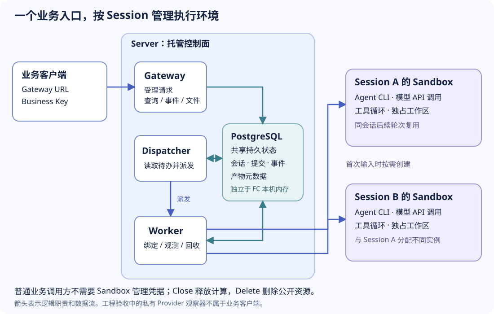

本文模板：[agents-api 应用模板](https://registry.agent-sandbox.cn/templates/agents-api/) · [源码与配置](https://github.com/Alibaba-Agent-Sandbox/awesome-templates/tree/main/agents-api)

> 版本说明：本文保留写作时的 CLI、模板版本及实跑步骤，包含旧命令入口。使用当前源码 CLI 时，请从[当前模板使用指南](https://github.com/Alibaba-Agent-Sandbox/awesome-templates/blob/main/docs/using-templates.zh-CN.md)开始；源码获取使用 `template init --from`，部署使用 `deploy`，沙箱操作归入 `sandbox`，清理使用 `delete`。复现本文结果时遵循正文固定的版本。

如果你希望把 Agent 接入自己的产品，通常不希望每个客户都先创建 Sandbox、查找实例地址、
配置云凭据，再处理工作区和回收。业务应用更需要一个固定入口：上传文件、发起任务、
追问修改、下载结果。

`agents-api` 应用模板提供这个入口。服务端 Gateway 管理 Session 和 Sandbox，
业务客户端只保存一个 Gateway URL 和业务 Key。本文用同一份订单 CSV 完成两轮任务：
先修复已有汇总程序，再在原工作区增加占比列，并把这条流程接入终端或 Python 应用。

## 1. 这个模板适合什么场景

它适合需要文件、代码执行和多轮上下文的 Agent 服务。例如：

| 场景 | 业务应用提供什么 | Agent 在 Sandbox 中完成什么 |
| --- | --- | --- |
| 数据处理助手 | CSV、处理要求、后续修改意见 | 编写或修改处理程序，运行后返回结果文件 |
| 现有代码修改 | 待修改工程、任务描述、测试要求 | 修改代码、执行工具和测试、导出补丁或源码 |
| 产品内的任务助手 | 页面上的上传、提交、进度和下载操作 | 在同一 Session 中连续处理任务，保留工作区上下文 |

后两项是可以基于接口开发的应用方式，需要你提供对应工程、任务内容和产品界面。
模板不是开箱即用的数据分析网站；它提供可集成的 Agent API 与运行基础。

与直接连接一个 Sandbox 相比，这个应用多承担了三件事：

- **统一入口**：业务方始终访问 Gateway，不随每个 Sandbox 更换 URL。
- **会话连续性**：同一 Session 的第二轮任务继续使用原工作区；不同 Session 使用独占 Sandbox。
- **结果访问**：通过 Gateway 查询任务、下载保存的产物，并关闭会话计算。



这种设计简化的是接入和管理。模型推理、工具执行和创建 Sandbox 仍有耗时，不应仅因为多了一层 API 就假定任务更快。

## 2. 先分清部署入口和业务入口

| 入口 | 使用者 | 本文用法 |
| --- | --- | --- |
| `abx app` CLI | 部署者 | 构建、部署、查看状态、移除应用 |
| Gateway HTTP URL | 业务应用或终端用户 | 用 `curl` 上传文件、创建 Session、运行任务、下载结果 |
| Python HTTP 客户端 | Python 应用开发者 | 用 `httpx` 调用同一组 Gateway API |

当前 CLI 0.5.10 没有专门的业务任务调用命令；终端业务调用使用 `curl`。
Python 0.4.0a7 提供服务端托管运行时，尚未提供专用的 Gateway 客户端 SDK。
因此本文的 Python 示例使用 `httpx`，不需要安装 Sandbox 管理 SDK，也不需要知道单个 Sandbox 的地址。

## 3. 部署前需要准备什么

本文使用模板 0.1.4、CLI 0.5.10，以及镜像内固定的 client/server 0.4.0a7。
部署主机需要 Node.js 20+、Docker 和 Python 3；运行后文终端示例还需要 Bash、`curl` 和 `jq`。

| 资源或配置 | 用途 | 谁准备 |
| --- | --- | --- |
| 阿里云部署身份、FC 执行角色 | 部署并运行 Gateway 等服务 | 部署者提供已有身份和角色 |
| ACR 镜像仓库及命名空间 | 存放构建镜像 | 部署者准备 |
| 已有 PostgreSQL | 保存会话、提交和文件数据 | 部署者提供；模板不自动创建数据库 |
| Sandbox 访问配置 | 创建 Session 所需的独占实例 | 部署者提供，留在服务端 |
| 模型 Key、接口地址和模型 ID | 在 Sandbox 内运行 Agent | 部署者提供 |
| 业务 Key | 调用 Gateway | 首次 Apply 自动生成，由部署者分发给业务应用 |

应用部署 FC Gateway、Worker 和 Dispatcher，并准备 Guest Sandbox 模板。
Guest 默认请求 2 vCPU、4096 MB；每个活跃 Session 持有自己的 Sandbox。
FC、Sandbox、数据库、镜像存储和模型分别可能产生费用。

FC、数据库网络、镜像仓库和 Sandbox 配置需要相互可达。数据库仅能通过 VPC 访问时，
在 binding 中配置已有 VPC、交换机和安全组；使用私有数据库 CA 时，还需要配置 CA 链。
具体配置见[模板配置说明](https://github.com/Alibaba-Agent-Sandbox/awesome-templates/blob/4971598a5b14b62207076dd2da4264c139423628/agents-api/README.zh-CN.md#配置)。

### 安装与获取模板

```bash
npm install --global @agent-sandbox/cli@0.5.10
git clone https://github.com/Alibaba-Agent-Sandbox/awesome-templates.git
cd awesome-templates
git checkout 4971598a5b14b62207076dd2da4264c139423628
cd agents-api

mkdir -p .abx
python3 -m venv .abx/venv
. .abx/venv/bin/activate
python -m pip install httpx==0.28.1
cp bindings.example.json .abx/bindings.json
chmod 600 .abx/bindings.json
```

保持这个虚拟环境激活，部署后的业务检查会使用其中的 `httpx`。
按[模板安装指南](https://github.com/Alibaba-Agent-Sandbox/awesome-templates/blob/4971598a5b14b62207076dd2da4264c139423628/docs/using-templates.md#installation)
完成 Sandbox 和镜像构建配置，并设置已有 ACR 命名空间：

```bash
abx config set acr_namespace YOUR_EXISTING_ACR_NAMESPACE
```

`YOUR_EXISTING_ACR_NAMESPACE` 替换为自己的命名空间。
清单中 `application.deployment.accessRef` 选择已有 Serverless Devs access，
`region` 使用实际部署地域。

### 填写私有配置

`bindings.example.json` 使用环境变量引用。部署前在当前终端准备下表中的值，
不要将密钥写进 Dockerfile 或公开源码：

| 环境变量 | 从哪里取得 |
| --- | --- |
| `ABX_MANAGED_DATABASE_URL` | 数据库服务提供的 PostgreSQL URL，使用可达主机名和相应 TLS 配置 |
| `SANDBOX_API_KEY` | Sandbox 平台访问配置中的管理 Key |
| `SANDBOX_BASE_URL`、`SANDBOX_DOMAIN`、`SANDBOX_REGION` | 同一平台的 API 地址、实例域名和地域 |
| `OPENAI_API_KEY`、`OPENAI_BASE_URL`、`OPENAI_MODEL` | 模型服务账号提供的 Key、兼容接口地址和可用模型 ID |
| `AGENTS_FC_ROLE_ARN` | 已有 FC 执行角色 ARN，需允许调用该应用的私有 Worker/Dispatcher |

默认 model binding 使用 `qwen-code` adapter，需要支持工具调用的 Chat Completions。
本文案例使用 `qwen3.5-plus`；实际可用模型取决于你的账号和接口。
改用 `codex` 时，需要支持工具结果回合的 Responses 接口。

应用令牌和模型 Key 用途不同。普通部署由 CLI 和运行时准备应用认证，不需要先手工生成
`ABX_SERVER_TOKEN`。业务应用也不需要获得云 AK/SK、Sandbox 管理 Key 或内部 Token。

## 4. 用 CLI 部署，取得一个 Gateway URL

在 `agents-api` 模板目录运行：

```bash
abx app build template.yaml --out .abx/build.json --yes
abx app plan template.yaml --build-receipt .abx/build.json --out .abx/plan.json
abx app apply .abx/plan.json --bindings .abx/bindings.json --yes
```

保存 Apply 输出中的三个字段：

| 字段 | 后续用途 |
| --- | --- |
| `endpoint` | 业务客户端的 Gateway URL |
| `receipt_file` | 查看状态、更新和移除应用 |
| `credentials_file` | 本机私有凭据文件，其中 `businessKey` 用于业务调用 |

用返回的收据路径查看应用状态：

```bash
abx app status '<receipt_file>'
```

把 `<receipt_file>` 替换为实际路径。对业务应用只分发 `endpoint` 和 `businessKey`，
不要直接分发整个凭据文件。

在部署主机上，可以从私有文件读取业务 Key：

```bash
export AGENTS_API_BASE_URL='<Apply 返回的 endpoint>'
export AGENTS_CREDENTIALS_FILE='<Apply 返回的 credentials_file 路径>'
export AGENTS_API_KEY="$(python - <<'PY'
import json, os
from pathlib import Path
print(json.loads(Path(os.environ['AGENTS_CREDENTIALS_FILE']).read_text())['businessKey'])
PY
)"
```

业务应用只需通过自己的私有配置提供 `AGENTS_API_BASE_URL` 和 `AGENTS_API_KEY`，
无需持有部署者的凭据文件。不要打印 Key 或启用 shell 命令跟踪。

## 5. 用同一份 CSV 完成两轮任务

模板在 `/workspace/agents-api-demo` 放了一份 CSV 练习程序及原始测试。
程序最初把同月金额覆盖，第一轮任务是修复累加逻辑，第二轮在同一程序上增加占比功能。

输入[销售数据 sales.csv](./sales.csv)：

```csv
month,amount,label
2026-01,19.90,"North, launch"
2026-01,10.10,中文客户
2026-02,2.50,Renewal
2026-02,7.50,Support
```

第一轮要求 Agent 修改已有 `aggregate.py`，保留原始测试并运行它们，然后生成
`/workspace/outputs/summary.csv`。正确结果为：

```csv
month,total
2026-01,30.00
2026-02,10.00
```

第二轮继续使用同一个 Session，要求给原程序增加 `--with-share`，保留默认模式，
生成 `summary-with-share.csv`。两个月占比应为 0.750000 和 0.250000。
这两轮文件处理已通过模板的真实 Qwen 任务验证。

输入附件安装到 `/workspace/input/`；需要下载的结果写到 `/workspace/outputs/`。
客户端从 Gateway 读取保存的产物，不需要直接连接工作区。

## 6. 通过 URL 和 curl 调用

Gateway 是带认证的 API 地址，不能只在浏览器地址栏中打开就提交任务。
下面的请求都使用同一个 `$AGENTS_API_BASE_URL`。

先查看当前应用提供的模型：

```bash
curl --fail-with-body "$AGENTS_API_BASE_URL/v1/models" \
  -H "Authorization: Bearer $AGENTS_API_KEY"
```

上传 CSV 时使用 multipart，而不是把本机路径放进 JSON：

```bash
curl --fail-with-body "$AGENTS_API_BASE_URL/v1/files" \
  -H "Authorization: Bearer $AGENTS_API_KEY" \
  -F purpose=user_data -F 'file=@sales.csv;type=text/csv'
```

用返回的文件 ID 创建 Session。下面将 `MODEL_ID` 和 `FILE_ID` 替换为前两步返回的值：

```bash
curl --fail-with-body -i "$AGENTS_API_BASE_URL/v1/agents/sessions" \
  -H "Authorization: Bearer $AGENTS_API_KEY" \
  -H 'Content-Type: application/json' \
  -H 'Idempotency-Key: csv-example-session-1' \
  --data '{
    "agent": {"model": "MODEL_ID"},
    "input": "修复 /workspace/agents-api-demo/aggregate.py 的重复月份金额累加问题。不要修改原始测试，运行测试后读取 /workspace/input/sales.csv，生成 /workspace/outputs/summary.csv，列为 month,total，月份升序、金额两位小数。暂不实现 --with-share。",
    "x_agent_sandbox": {"input_files": [
      {"file_id": "FILE_ID", "path": "/workspace/input/sales.csv"}
    ]}
  }'
```

创建成功返回 201，正文中 `id` 是 Session ID；响应头
`X-Agent-Sandbox-Submission-Id` 是首轮提交 ID。一次新任务使用新的请求键；
同一请求的重试复用原键和原请求内容。

使用这两个 ID 查询任务：

```bash
curl --fail-with-body \
  "$AGENTS_API_BASE_URL/v1/agent-sandbox/sessions/SESSION_ID/submissions/SUBMISSION_ID" \
  -H "Authorization: Bearer $AGENTS_API_KEY"
```

等到 `status` 为 `completed`，使用返回的 `turn_id` 查找本轮产物并下载：

```bash
curl --fail-with-body \
  "$AGENTS_API_BASE_URL/v1/agents/sessions/SESSION_ID/artifacts?limit=100&order=asc" \
  -H "Authorization: Bearer $AGENTS_API_KEY"

curl --fail-with-body \
  "$AGENTS_API_BASE_URL/v1/agents/sessions/SESSION_ID/artifacts/ARTIFACT_ID/content" \
  -H "Authorization: Bearer $AGENTS_API_KEY" --output summary.csv
```

产物按 `turn_id` 和 `path` 选择，例如 `outputs/summary.csv`，避免下载到其他轮次的同名文件。
把 URL 中的 `SESSION_ID`、`SUBMISSION_ID`、`ARTIFACT_ID` 替换为实际返回值。
第二轮向原 Session 发送输入：

```bash
curl --fail-with-body -i \
  "$AGENTS_API_BASE_URL/v1/agents/sessions/SESSION_ID/events" \
  -H "Authorization: Bearer $AGENTS_API_KEY" \
  -H 'Content-Type: application/json' \
  -H 'Idempotency-Key: csv-example-share-1' \
  --data '{"events":[{"type":"agent.session.input.message","input":"继续修改同一工作区的 aggregate.py，增加 --with-share。占比保留六位小数，总额为零时为 0.000000；保留默认模式和原始测试，运行测试并生成 /workspace/outputs/summary-with-share.csv。"}]}'
```

这个请求返回 202，**正文为空**；从响应头获取新的 Submission ID，再按同样方式等待和下载。

如果希望直接跑完整流程，下载 [curl 完整示例](./run_csv.sh)和[输入 CSV](./sales.csv)，
放在同一目录后运行：

```bash
bash run_csv.sh ./results
```

脚本自动处理 ID、轮询、分页、两轮产物下载、Session 关闭和输入文件删除。
成功时在 `results/` 下得到 `summary.csv`、`summary-with-share.csv` 和两版修改后的源码。
每次示例运行会新建 Session 并调用模型。

## 7. 在 Python 应用中调用

下载 [Python 完整示例](./run_csv.py)和[输入 CSV](./sales.csv)，放在同一目录。
沿用前面设置的 Gateway URL 和业务 Key：

```bash
python -m pip install httpx==0.28.1
python run_csv.py ./results
```

脚本使用普通 HTTP 客户端。上传和首轮请求的核心写法如下：

```python
import os
import uuid
from pathlib import Path
import httpx

with httpx.Client(
    base_url=os.environ["AGENTS_API_BASE_URL"].rstrip("/"),
    headers={"Authorization": "Bearer " + os.environ["AGENTS_API_KEY"]},
    timeout=30,
) as api:
    models = api.get("/v1/models").raise_for_status().json()["data"]
    uploaded = api.post(
        "/v1/files", data={"purpose": "user_data"},
        files={"file": ("sales.csv", Path("sales.csv").read_bytes(), "text/csv")},
    ).raise_for_status().json()
    response = api.post(
        "/v1/agents/sessions",
        headers={"Idempotency-Key": "csv-" + uuid.uuid4().hex},
        json={
            "agent": {"model": models[0]["id"]},
            "input": "读取 /workspace/input/sales.csv，按月份汇总金额，生成 /workspace/outputs/summary.csv。",
            "x_agent_sandbox": {"input_files": [
                {"file_id": uploaded["id"], "path": "/workspace/input/sales.csv"}
            ]},
        },
    ).raise_for_status()
    session_id = response.json()["id"]
    submission_id = response.headers["X-Agent-Sandbox-Submission-Id"]
```

这是请求部分的节选；可直接运行的完整示例还会等待两轮任务、检查 CSV 金额与占比、
下载文件，并释放 Session。下载的 Agent 源码作为文件保存，不在本机自动执行。

可以设置 `AGENTS_API_MODEL` 选择 `/v1/models` 中的模型 ID；未设置时使用列表中的第一个模型。
这个 ID 必须由当前部署提供，仅改变客户端字符串不会让服务端获得新的模型配置。

## 8. 接进自己的业务，而不只运行演示

从这个例子迁移到真实场景，可以分三步：

1. **换输入和任务**：上传自己的文件，修改输入要求和输出文件名。对于已有工程，
   先在派生模板中加入工程文件，并把任务中的练习路径替换为自己的项目路径。
2. **保留需要的会话**：在业务数据库中记录 Session ID，后续修改继续向它发送输入。
   不要在用户每次点击“继续”时创建新 Session；同一 Session 同时只运行一轮。
3. **把结果接回产品**：将 Submission 状态映射为页面进度，把 Artifact 下载接到文件列表，
   并在用户结束任务时关闭计算。下载示例在成功后会清理会话；需要持续会话时，应把关闭步骤移到业务结束的位置。

定制项及其生效方式：

| 要改什么 | 修改位置 | 生效方式 |
| --- | --- | --- |
| 每轮任务内容、输入文件、输出要求 | 业务请求 | 下一轮请求生效 |
| 默认模型、模型 endpoint、adapter | 私有 model binding | 更新应用部署 |
| 预置代码、依赖或可编辑内容 | `fixtures/`、Dockerfile 及相关源码 | 重建镜像并更新应用 |
| 会话寿命、并发、执行预算、文件限额 | `template.yaml` 的 `application` 配置 | 生成新部署计划并更新应用 |

修改模板或绑定后，重新 Build，并在 Plan 中提供当前收据：

```bash
abx app build template.yaml --out .abx/build-next.json --yes
abx app plan template.yaml --build-receipt .abx/build-next.json \
  --previous-receipt '<receipt_file>' --out .abx/plan-next.json
abx app apply .abx/plan-next.json --bindings .abx/bindings.json --yes
```

已有 Session 继续绑定原 revision；需要新配置的任务应创建新 Session。
旧 revision 的保留与退休操作见[模板使用说明](https://github.com/Alibaba-Agent-Sandbox/awesome-templates/blob/4971598a5b14b62207076dd2da4264c139423628/agents-api/README.zh-CN.md)。

## 9. 状态、限制和结束使用

提交被接受不等于任务完成。示例会等待 Submission 和对应 Turn 完成；若返回
`failed`、`cancelled` 或 `uncertain`，先查询该提交，不要直接创建重复任务。
客户端等待超时不会自动取消远端执行，示例会保留已知资源 ID，供继续查询或主动关闭。

关闭会话计算使用：

```bash
curl --fail-with-body -X POST \
  "$AGENTS_API_BASE_URL/v1/agent-sandbox/sessions/SESSION_ID/close" \
  -H "Authorization: Bearer $AGENTS_API_KEY" \
  -H 'Content-Type: application/json' --data '{}'
```

用返回的 Operation ID 查询 `/v1/agent-sandbox/operations/OPERATION_ID`，
直到 `status` 为 `succeeded`。Close 保留已保存的结果；不再需要数据时，删除 Session 和输入文件：

```bash
curl --fail-with-body -X DELETE \
  "$AGENTS_API_BASE_URL/v1/agents/sessions/SESSION_ID" \
  -H "Authorization: Bearer $AGENTS_API_KEY"
curl --fail-with-body -X DELETE "$AGENTS_API_BASE_URL/v1/files/FILE_ID" \
  -H "Authorization: Bearer $AGENTS_API_KEY"
```

完整示例会自动完成这些操作。默认 Session 空闲/最大寿命为 900/3600 秒，
结果保留期为 24 小时，单输入文件和单产物上限各 10 MiB。需要长期保存的结果应下载到自己的存储。

不再使用应用时，运行：

```bash
abx app plan --destroy '<receipt_file>' --out .abx/destroy.json
abx app destroy .abx/destroy.json --bindings .abx/bindings.json --yes
```

自行准备的数据库和共享网络仍由你管理；镜像构建产物的保留与清理按[模板资源说明](https://github.com/Alibaba-Agent-Sandbox/awesome-templates/blob/4971598a5b14b62207076dd2da4264c139423628/agents-api/README.zh-CN.md#资源)处理。

模板目前为 Beta，内置 FC 测试域名适合体验；生产接入需配置自己的 HTTPS 入口。
受支持的参数和接口以 Gateway 的 `/v1/agent-sandbox/capabilities` 及
[API 参考](https://github.com/Alibaba-Agent-Sandbox/awesome-templates/blob/4971598a5b14b62207076dd2da4264c139423628/docs/managed-agents-api.zh-CN.md)为准。
