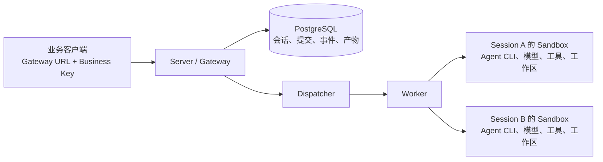

业务调用方希望配置一个 URL 和一把业务 Key，然后创建会话、上传文件、运行 Agent、
下载结果。每个 Sandbox 的地址、创建凭据、工作区和回收流程，应由服务端管理。
本文围绕这一目标，记录 `agents-api` 模板从本地验证到真实阿里云 FC 部署的操作。

**草稿状态：已记录真实构建、失败部署、两轮候选业务 hook、独立首轮产物下载、实时 SSE、
本机 PostgreSQL 故障实验和真实模型工具回合。正式发布验证与独立模板身份检查仍有失败；
完整39路由、源码 heldout、升级及最终全部资源释放尚未全部证实。本文当前不能作为
“公开发行版已完整跑通”的证明。**

所有结果都有明确的范围。命令中的本机路径、应用名称、账号及资源标识使用占位符；
密钥和完整私有日志不公开。代码块标为“实际返回脱敏节选”的内容，只保留真实返回中的
允许字段；标为“实际断言摘要”的内容来自执行后的检查，不是伪造的 API 原始响应。

## 1. 先把部署者与业务调用方的入口分开



Server 维护稳定的业务入口，首次输入才按需分配 Sandbox。同一个 Session 的后续轮次
继续使用原有工作区；不同 Session 各自独占 Sandbox。CLI 部署应用时配置云访问、镜像
仓库、数据库、模型及 Sandbox 管理凭据，普通业务客户端只拿 Gateway URL 和业务 Key。

会话关闭与删除分开：Close 释放计算，保留已保存的历史和产物；Delete 删除公开资源。
Close 请求返回一项 Operation，需要继续查询最终状态，不能只看到 HTTP202 就认为
远端进程已停止。客户端请求超时也不能据此自动重发一次任务。

这个模板参考 OpenAI Agents 的 Session/Turn 组织方式，支持一部分接口并提供明确的托管
扩展。它把完整 Agent CLI、模型调用和工具循环放在 Sandbox，能力边界以 Gateway 的
`/v1/agent-sandbox/capabilities` 为准。路径相似不构成任意 OpenAI SDK 或完整托管
harness 的兼容声明。

## 2. 记录实际版本，区分公开发行物与候选包

本文验证的是独立安装的 CLI 候选制品和固定源码构建的 Python wheel，未将未发布的新
模块冒称为已有安装命令。实际候选 CLI 版本查询为：

```bash
<CANDIDATE_ABX> --version
```

实际输出：

```text
abx, version 0.5.9
```

这条输出说明运行制品的版本字段，不说明 npm 已发行该版本。准备时，公开 npm 为
0.5.8，公开 Python client/server 为0.4.0a6；a6 不含本模板所需的
`agent_sandbox.managed_agents` 和 `agent_sandbox.server.managed`。因此本轮使用独立
候选安装目录和 CI 原始 wheel，保持旧制品不被覆盖。

本轮模板加入 CSV 代码修复练习，配置版本为0.1.2；Sandbox 镜像配置包括 Node.js24.16.0、
Codex0.162.1、Qwen Code0.23.0。模型实际可用性另行探测，不能由 CLI 能查版本推导。

相关实现与后续发行状态应在各自仓库核查：
[Python runtime](https://github.com/Alibaba-Agent-Sandbox/python-sdk/pull/156)、
[CLI 应用部署](https://github.com/Alibaba-Agent-Sandbox/agent-sandbox/pull/235)、
[agents-api 模板](https://github.com/Alibaba-Agent-Sandbox/awesome-templates/pull/296)。
这些链接当前用于说明来源，不声明其已合并或发布。

## 3. 准备凭据与私有配置

先明确每项凭据的用途，避免把部署权限交给业务调用方。

| 配置 | 用途和来源 | 使用位置 |
| --- | --- | --- |
| 云 AK/SK 或已有 STS 凭据 | 来自已有云访问身份，部署 FC、构建或查询拥有的镜像 | 部署 CLI 子进程 |
| Sandbox 管理凭据 | 来自已有 Sandbox 账号配置，创建和回收 Session 的计算实例 | Server 的 Provider binding |
| 模型 Key、端点、模型 ID | 来自实际模型服务账号；先验证工具结果回合 | Sandbox 中所选 Agent 的模型配置 |
| PostgreSQL URL、密码、CA | 本轮临时私网数据库及其实际 CA | Server；启用 verify-full |
| Business Key | CLI 首次 Apply 生成并安全保存，后续部署复用 | 业务客户端 |
| Internal Token | CLI 生成的私有控制鉴权，独立于业务 Key | Server 内部控制调用 |
| Sandbox 应用令牌 | 运行时为应用连接单独准备，独立于云 Key 和模型 Key | Server 与 Sandbox 应用服务之间 |

应用令牌不是去云控制台申请的 API Key。普通用户使用模板时，应让 CLI 自动准备并
保存缺省应用认证；不需要先手工生成一串随机令牌才能开始。

本轮凭据只在子进程中加载，不打印值，不写入公开仓库或文章素材。还遇到了一个真实
环境限制：共享工作区对 chmod 的语义与本机文件系统不同，申请0600后仍可能显示0777。
后续明文 binding、密码和原始日志全部放到本机0700目录，文件逐一检查为0600；跨环境
恢复只保存认证加密后的备份。不能看到一条 chmod 命令退出0就宣称秘密文件已受保护。

数据库保持私网访问，没有为方便控制器而开启公网数据库或搭建隧道。已有 VPC、交换机、
安全组和执行角色按借用处理，不在清理时删除。

## 4. 先验证模型的工具回合

Agent 编码任务通常包含“模型要求调用工具→执行工具→把工具结果发回模型→继续生成”。
简单文本请求成功、`/models` 列出模型，以及 CLI 版本查询，都不足以证明这个流程可用。

本轮用当前账号实际可用的 `qwen3.5-plus`，分别检测 Chat Completions 和 Responses。
探针只做加法：模型调用 `add(a=2,b=3)`，控制器回传5，要求最终回答精确为5。
探针不执行模型生成的任意函数体。

实际执行的 Chat 工具回合探针：

```bash
<TEST_PYTHON> <VALIDATION_DIR>/model_preflight.py
```

实际结果脱敏节选：

```json
{
  "models_status": 200,
  "tests": [{
    "model": "qwen3.5-plus",
    "first_status": 200,
    "tool_call": true,
    "roundtrip_pass": true,
    "second_status": 200,
    "elapsed_seconds": 4.53
  }]
}
```

实际执行的 Responses 工具结果回合探针：

```bash
<TEST_PYTHON> <VALIDATION_DIR>/responses_tool_preflight.py
```

实际输出：

```json
{
  "model": "qwen3.5-plus",
  "first_status": 200,
  "tool_call_valid": true,
  "function_call_output_accepted": true,
  "roundtrip_passed": true,
  "second_status": 200,
  "elapsed_seconds": 4.963
}
```

[Chat 实际结果](./chat-tool-preflight.json)与[Responses 实际结果](./responses-tool-preflight.json)
保留了探测摘要。这证明本轮账号、端点和模型能够完成所测协议回合，还没有证明 Codex
或 Qwen Code 在最终 FC 应用里完成了文件任务，也不能推广为所有 BYOK 端点都兼容。

## 5. 用有缺陷的现有工程作为业务练习

只让 Agent 新建一个包含固定文字的文件，很难判断真实代码修改能力。模板在
`/workspace/agents-api-demo` 预置一个 CSV 汇总程序和原始测试。程序故意把同月金额覆盖，
第一轮需要修改现有源码，使重复月份可以正确累加。

实际练习文件的内容如下，包含重复月份、带逗号的字段和中文：

```csv
month,amount,label
2026-01,19.90,"North, launch"
2026-01,10.10,中文客户
2026-02,2.50,Renewal
2026-02,7.50,Support
```

[原始练习源码](https://github.com/Alibaba-Agent-Sandbox/awesome-templates/blob/f5c7ce5ecce2a7787fb7c8275b2c383d9a55c0ae/agents-api/fixtures/csv-analysis/aggregate.py)
中的缺陷是同一月份反复执行下面的覆盖赋值；原始测试由独立验证保留，Agent 需要修改程序：

```python
totals[row["month"]] = Decimal(row["amount"])
```

输入文件通过 Gateway 上传，附件目标固定为 `/workspace/input/sales.csv`。程序源码和
测试放在练习工程目录，输出放到 `/workspace/outputs/`。这几个路径承担不同职责。

本轮先发现附件路径写成练习目录下的 `input/`，实际服务校验拒绝了它。用原服务做本地
准入检查得到：

```text
/workspace/agents-api-demo/input/sales.csv -> HTTP 400, invalid_path
/workspace/input/sales.csv                 -> HTTP 201, Submission receipt present
```

这是实际接口准入结果；该检查没有连接 Provider，也没有运行模型。修复只改模板中的
附件路径和两轮提示词，保留运行时对附件目录的限制，没有为了让示例通过而放宽服务端。

两轮任务的业务断言是：第一轮输出 `month,total`，两个月分别为30.00和10.00；第二轮
继续修改同一文件，加入 `--with-share`，输出占比分别为0.750000和0.250000，同时保留
默认模式及第一轮产物。这些数值先作为任务合同；下文候选业务 hook 已检查实际结果，另一次独立验收也保存了首轮 CSV 原始字节。两者的验证范围分别记录。

先执行本地模板检查：

```bash
cd <TEMPLATES_CHECKOUT>
<TEST_PYTHON> scripts/test_spec_tools.py
<TEST_PYTHON> scripts/check_template.py --all
<TEST_PYTHON> scripts/check_docs.py
<TEST_PYTHON> -m pytest agents-api/test_smoke.py
```

实际断言摘要：

```text
spec tools: 52 passed
complete template checks: 48 directories conformant
document checks: 232 documents, no failures
managed smoke regression: 7 passed
seed program: unchanged original suite fails exactly 2 tests
```

本地还分别启动 managed 服务及既有 Python/Node 模板，检查新增启动入口与旧模板路径。
这些结果证明模板检查、启动和 smoke 的错误处理成立，不替代真实模型的两轮任务。

## 6. 第一次实际 Build：镜像构建成功

构建与部署是两个操作。本轮从模板源码快照构建 Server 镜像，输出独立构建收据：

```bash
<CANDIDATE_ABX> app build template.yaml --out .abx/build.json --yes
```

实际退出码0，耗时47.922秒。实际返回脱敏节选：

```json
{
  "status": "built",
  "component": "fc3@0.1.26",
  "image": "<OWNED_ACR_REPOSITORY>@sha256:<IMAGE_DIGEST>",
  "build_receipt": ".abx/<BUILD_RECEIPT>.json"
}
```

构建收据保存本次拥有的唯一镜像 tag 与 digest。后续不会按仓库名前缀猜测“哪些镜像
看起来像本次资源”，也不会把同名的既有镜像收养成本次可删资源。

## 7. 创建冻结部署计划

```bash
<CANDIDATE_ABX> app plan template.yaml \
  --build-receipt .abx/build.json --out .abx/plan.json
```

第一次命令的备份步骤暴露了并发备份竞争，保留原失败后，用加锁后的备份流程重新生成
计划。下方为随后实际成功的计划操作，退出码0，耗时0.865秒：

```json
{
  "status": "planned",
  "plan_file": ".abx/<PLAN>.json",
  "revision": "<REVISION>",
  "plan_id": "<PLAN_ID>",
  "steps": [
    "sandbox-template", "worker", "dispatcher", "gateway",
    "candidate-verification", "publish"
  ]
}
```

计划固定了将执行的输入及资源身份。Apply 出现不确定结果后，应查询、协调和清理已保存
的收据；换一个输出文件名并不能让重放同一创建请求变得安全。

## 8. 第一次 Apply：保留失败，查明镜像输入限制

```bash
<CANDIDATE_ABX> app apply .abx/plan.json \
  --bindings <PRIVATE_BINDINGS_FILE> --yes
```

实际退出码1，耗时210.451秒。实际返回脱敏节选：

```json
{
  "status": "error",
  "code": "E7000",
  "message": "FC create-only operation failed or its outcome is unknown (HTTP 400, InvalidArgument); reconcile the saved intent."
}
```

本次 Sandbox 模板已准备成功，失败发生在 `reserve-worker`，还没有获得可供业务使用的
Gateway endpoint。独立原生查询先确认精确函数不存在，再用同一冻结输入做了一次诊断，
实际复现了 digest-only ACR 输入对应的 `IMAGE_NOT_EXIST`。不能由这条错误推测成云账号
没有权限，也不能因为 ACR 镜像存在就忽略 FC 对输入形式的实际要求。

修订保留 digest 作为镜像身份，给 FC 提供本次唯一且确属本次构建的 tag，并在 FC 返回
中核对解析后的镜像 digest。借用的任意 digest 输入不会被自动猜成某个 tag。

同一轮还量出了环境变量总量6033字节，其中 CA PEM4123字节，超过 FC4096字节限制。
即使镜像输入修好，这个配置也不能被宣传为可部署。后续把公开 CA 通过严格校验的启动
参数传入，角色秘密继续放环境变量；不能把 Key 或数据库密码放进启动参数。

## 9. 先释放第一次失败尝试的资源

协调查询的实际命令为：

```bash
<CANDIDATE_ABX> app reconcile <ORIGINAL_RECEIPT> \
  --bindings <PRIVATE_BINDINGS_FILE> --yes
```

实际退出码0，耗时1.015秒。实际返回脱敏节选：

```json
{
  "status": "requires_reconcile",
  "phase": "reserve-worker",
  "retained_revision_count": 0,
  "retained_build_artifact_count": 3,
  "resources": [{"kind": "function", "state": "absent"}]
}
```

随后为该收据生成销毁计划并执行：

```bash
<CANDIDATE_ABX> app plan --destroy <ORIGINAL_RECEIPT> \
  --out .abx/<DESTROY_PLAN>.json
<CANDIDATE_ABX> app destroy .abx/<DESTROY_PLAN>.json \
  --bindings <PRIVATE_BINDINGS_FILE> --yes
<CANDIDATE_ABX> app status <ORIGINAL_RECEIPT>
```

三步实际退出码均为0，耗时分别0.464、2.718、0.965秒。销毁与后续查询实际返回脱敏节选：

```json
{
  "status": "destroyed",
  "phase": "destroyed",
  "retained_build_artifact_count": 3,
  "resources": [{"kind": "function", "state": "absent"}]
}
```

这里仍有3项构建资源需要单独处理，所以不能只凭 `status=destroyed` 就写“所有临时资源
都清理完毕”。工程清理控制器根据精确收据、创建意图和原生镜像身份，先检查，再删除：

```text
inspect: exit 0, elapsed 4.925s, exactTargets 3, present 2, deleted 0
apply:   exit 0, elapsed 30.09s, independentAbsence 3, passed true
```

这是实际断言摘要，其中两个目标在检查时存在，第三个已不存在；最后对三个精确目标都
独立确认了不存在。旧记录没有被覆盖。第一轮仍保留临时私网数据库供下一次有时限的
尝试使用；这时数据库还没有清理，空镜像仓库也要另行确认。

首轮10项已执行步骤的[脱敏返回汇总](./first-attempt-steps.json)可逐项核对。

## 10. 第二次实际 Build 与 Apply：验证参数长度限制

修订 CA 传递后，重新构建新镜像并生成新的计划，没有重放第一次 Apply。
第二次构建实际退出码0，耗时31.664秒，仍返回 `status=built` 和 `fc3@0.1.26`。

第二次创建 FC 函数又返回明确错误：`Command` 的单个元素不能超过2048字符。实际
4123字节 CA 的 Base64 不能作为单个长参数传递。该轮原生查询确认函数不存在，之后正常
销毁应用，独立确认3个 guest 镜像目标都已不存在。

后续修改把 Base64 拆成每段1920字符，并保持原来的单参数形式兼容；参数解码后仍走原有
CA/X.509 校验。环境变量4096字节限制与单个参数2048字符限制是两件事，修好其中一项
不能推导另一项也符合。这里只报告本轮实际 CA 链和实际 FC 返回，不承诺所有大小的 CA
bundle 都能部署。

## 11. 真实私有调用与流式传输还需要单独验证

后续实际部署已创建三角色，但私有调用暴露了其他协议适配问题，尚未据此发布业务入口：

- FC 内部调用的响应体可能是字节流，不能统一按字符串读取。
- FC Web Function 的私有 `/invoke` 转发使用 `application/octet-stream`。旧运行时只接收
  JSON MIME 时，会在外层调用 HTTP200 中返回 `unsupported_media_type`；HTTP200 本身
  不等于内部控制操作成功。
- FC 的 SSE 路径需要正确的 HTTP chunk framing，包括正常结束的零长度 chunk。对已结束
  任务读取历史事件，不能单独证明实时逐帧发送。

对应修订仅允许非 Gateway 的既有私有 `/invoke` 分支接受 octet-stream；请求仍必须是
有界、有限数字的 JSON object，并通过原有角色绑定的 canonical-payload HMAC。公有
业务 JSON 入口不因此放宽。错误 HMAC、错误角色、畸形 JSON、NaN、超限请求和公有 MIME
拒绝均有独立本机回归。

当前仍应等待新的实际部署与返回，不能把这些修订的本地测试冒称为 FC 业务已通过。
实际 FC SSE 检查会创建不含输入的空 Session，完整读取正常20秒事件连接，在 EOF 前
独立查询同一 Session 的 idle/unallocated 状态。模型中间 delta 的实时表现属于另一项
业务证据，不能借用空 Session 流式检查的结果。

### 恢复第三次失败应用的清理通道

第三次应用的私有控制器需要新运行时才能沿正常 drain/destroy 流程释放资源。这里先让
新 Server 镜像完成真实构建：新构建退出0、耗时32.504秒，计划退出0、耗时0.865秒。
新构建尚不等于新应用已就绪。

恢复工具保留原函数创建身份、全量环境变量、启动命令、执行角色和私网配置，只更换到
已核验 tag/digest 的新镜像。更新前先用真实 CLI 锁保护构建收据，保留既有 usedBy 并追加
旧应用引用，完成持久化与加密备份。初次恢复未进入原生 update-intent；原进程已退出、
原日志完整且没有更新意图后，另一次经过审查的 complete-admission 才补完原恢复操作。
有任何更新意图或不确定更新结果时只做查询，不重新调用 UpdateFunction。

实际补完操作为：

```bash
node <VALIDATION_DIR>/recover_cleanup_dispatcher_image.mjs \
  complete-admission <RECOVERY_ADMISSION> <FRESH_RECOVERY_JOURNAL> <EXIT_PROOF>
```

实际退出码0，耗时60.305秒。实际返回脱敏节选：

```json
{
  "scope": "exact_failed_dispatcher_cleanup_image_only",
  "readback_confirmed": true,
  "native_identity_preserved": true,
  "full_environment_preserved": true,
  "build_consumer_protection_retained": true,
  "application_apply_replayed": false,
  "public_control_trigger_created": false,
  "ledger_activated": false,
  "image_delete_performed": false,
  "update_calls_permitted": 1
}
```

原生读回核对了 Active/Successful、新 tag 与解析后 digest、原函数身份及全量环境配置。
恢复完成后，继续生成针对原收据的销毁计划并使用正常 CLI 执行；两步实际退出码均为0，
耗时分别0.465和15.025秒，销毁返回 `status=destroyed, phase=destroyed`。

这项结果仅覆盖第三次失败应用的恢复与 CLI 销毁。其 guest 镜像、空仓库、最终原生不存在
确认和本轮数据库仍需独立记录，不能把恢复清理通道当成两轮 Agent 编码业务已经通过。
[这五步的实际脱敏返回](./source-recovery-steps.json)单独保存，没有改写前两次失败记录。

## 12. 在本机真实 PostgreSQL 上检查故障语义

本轮也运行了真实本机 PostgreSQL、独立 HTTP/子进程测试。扩展用例实际结果为：

```text
40 passed in 40.46s
```

它包含取消、接收回执丢失、不确定队列和慢观察者等场景。模型和 Provider 在这些用例中
采用确定性本机 fixture，因此不称作“真实 FC 模型取消通过”。

数据库故障探针实际停止本机 PostgreSQL，再使用同一数据目录恢复：

```bash
<TEST_PYTHON> <VALIDATION_DIR>/sdk/postgres_outage_probe.py
```

实际输出节选：

```json
{
  "scope": "real_local_pg_stop_restart_before_admission",
  "passed": true,
  "cloud_resources": false,
  "model_provider_executed": false,
  "checks": [
    {
      "name": "store_readiness_reads_replay_and_fresh_admission_fail_closed",
      "statuses": [503, 503, 503, 503],
      "passed": true
    },
    {
      "name": "same_persistent_state_and_warm_gateway_recover_without_new_acceptance",
      "counts_unchanged": true,
      "same_session": true,
      "same_state_id": true,
      "passed": true
    }
  ],
  "cleanup_confirmed": true
}
```

[完整摘要](./postgres-outage-result.json)保留了实际范围。这是本机真实数据库停止/恢复，
不是云 RDS 网络故障演练。

另外两项实际独立进程实验使用 SIGKILL：观察者进程被终止后，由另一个进程接续观察，
实际只有1次 Submission POST、1次 CLI 副作用计数和1次 backend create；guest bridge
重启后 epoch 改变，host 标记 uncertain，队列后继被冻结。后一个实验还观察到旧 CLI
原生进程仍在继续，因此没有把“连接断开”或“lease 到期”当成外部副作用已经停止。

这些探针证明了所测故障边界。它们不能替代生产 Sandbox 的原生停止证据；同 UID 的
guest 文件、journal 和进程标记，也不是对敌对代码的防篡改证明。

## 13. 两轮候选 hook 已通过，独立验收停在模板身份检查

第四次实际 Apply 运行294.151秒后退出1，停在 `stable-trigger` 的临时验证凭据拒绝检查。
按冻结 CLI 的执行顺序，此阶段位于候选 `afterReady` hook、两轮真实 Agent、每轮下载与
CSV 值检查、Close/Delete，以及移除验证认证、发布版本和 alias 之后。实际 hook 代码
仍是本模板 `scripts/smoke.py`。因此可以记录“候选统一 Gateway 上的两轮文件业务与
数值校验已通过”，不能把最终 Apply 的退出1改成部署成功。

这个通过结论来自实际执行阶段及冻结控制流，并没有保存那次 hook 下载的全部原始
代码/CSV。完整39路由及独立源码测试另跑，不能靠 hook 推断。

首次独立控制器明确使用 `source_requires_reconcile_manual_dispatch` 范围：应用仍非ready，
业务调用只用业务 Key；另一个工程控制器通过既有私有签名调用驱动 outbox，没有开启 timer、
新增公网控制路由、修改收据或给予公开资格。它开始和结束均检查固定 state identity 与
三项活动计数，业务 finally 清理完成后才停止。

实际执行入口为：

```bash
<TEST_PYTHON> <VALIDATION_DIR>/run_candidate_acceptance.py \
  --label <FRESH_SOURCE_ATTEMPT> --live-sse
```

本次整体退出1，20个路由取得正向返回，首轮实际下载了三个产物：

| 产物 | 实际字节数 | SHA-256 |
| --- | ---: | --- |
| aggregate.py | 1588 | `17aaaab637422f01a5cdd8d6d8901ac24b6a54c62848b3ccfffe1789887263d9` |
| summary.csv | 43 | `091a6cd799dc38f6a859ed4c0acc35ffb2032db42c10044a71642633235b02d6` |
| report.md | 1067 | `43ada243c8a779d82364a2c64b2a8f7674a81952760656170675f36886919ac1` |

实际下载的 CSV 如下，原文件保留CRLF换行：

```csv
month,total
2026-01,30.00
2026-02,10.00
```

下载源码的关键修改为按月累加，仍使用 Decimal：

```python
month = row["month"]
amount = Decimal(row["amount"])
if month in totals:
    totals[month] += amount
else:
    totals[month] = amount
```

[完整首轮模型源码](./aggregate.first-turn.generated.py)、[实际 CSV](./summary.first-turn.csv)、
[模型生成的说明](./report.first-turn.generated.txt)及[字节/哈希清单](./first-turn-artifacts.json)
已做文本检查，没有在宿主机执行。说明中“原始测试全部通过”是 Agent 的自述，这次独立
控制器尚未执行原始/heldout 测试，不能把报告的陈述当成独立结果。

独立检查失败的静态标签是 `native_template_not_frozen`，在确认 native Sandbox metadata
及 GetInfo 的同一实例ID后、授予执行权限之前被拦截，onOwned 尚未调用。实际进一步取证
发现：兼容 GetInfo 的 `templateID` 投影返回管理 API 的模板 name，而创建收据保存管理 API
的模板ID，两者非空但不相等。管理 API 按ID查询成功，按该name查询原生404。

这暴露了工程验收器把两个接口表示当成同一种ID的假设失配，没有证据说明实际 Sandbox
用了另一个模板，也不应写成 Agent 编码或模型调用失败。此处没有把name单向加入允许列表，
没有放宽metadata/唯一性/GetInfo/ready门禁，也没有执行未完成身份确认的独立检查程序。

截至本节，剩余路由、第二轮独立源码检查、heldout、主动取消及升级仍未全部运行完成。
后续需要先通过原生完整模板清单证明 name 唯一对应原创建ID，再在新的受限验证窗口重跑。

离线修正没有改变 SDK 的 `SandboxInfo.template`，也没有把任意名称当作模板身份。
工程控制器读取明确指定的原收据，冻结其 SHA-256、账号、地域、revision 和唯一自建模板ID。
随后按这个ID查询原生模板，穷尽同团队模板列表，要求原生名称仅对应这一ID，再按相同ID
查询一次；创建时间、完整 runtimeConfig 及其中镜像必须保持一致。只有这些检查都通过，
兼容 GetInfo 返回的原生名称才能与原始ID一样被接受。列表截断、重复ID/游标、同名模板、
跨团队、缺少创建时间/镜像和二次读回变化都会失败。

这份证据仅供工程验收。业务 HTTP 客户端仍只配置 Gateway endpoint 和业务 Key；
读取云管理信息使用工程控制器显式传入、经账号核对的已有凭据，不能称其为 IAM 只读凭据。
相同校验同时接入源码独立检查、主动取消、升级控制器，避免只修复其中一个入口。

实际离线检查命令为：

```bash
node --test <VALIDATION_DIR>/test_collect_owned_template_identity_proof.mjs
<TEST_PYTHON> -m unittest discover -s <VALIDATION_DIR> \
  -p 'test_canonical_template*.py' -v
<TEST_PYTHON> -I <VALIDATION_DIR>/verify_template_identity_bridge.py
```

实际结果为9项 Node、11项 Python 和一次 Node 收集器到 Python 消费者的合同验证全部通过；
其中还实例化安装的官方原生 SDK 模型，检查字段的真实序列化。它们没有调用云 API、模型，
也没有在宿主机执行模型源码。离线通过不等于已取得真实穷尽清单；新的完整业务验证仍待执行。

## 14. 真实 FC SSE：首帧在连接结束之前到达

同一阶段的独立 SSE 用例使用另一个空 Session，没有提交模型输入，也没有分配 Sandbox。
它完整读取正常有限事件连接，同时在连接尚未结束时查询 Session，最后 Close/Delete。
实际结果为：

```json
{
  "scope": "actual_gateway_live_sse_idle_session_without_model",
  "passed": true,
  "model_turn_started": false,
  "normal_eof": true,
  "concurrent_session_read_passed": true,
  "concurrent_read_completed_before_eof": true,
  "concurrent_session_read_seconds": 1.663,
  "first_frame_seconds": 0.192,
  "stream_seconds": 20.188,
  "frames_observed": 1,
  "cleanup_public_confirmed": true,
  "provider_absence_independently_verified": false
}
```

[完整实际结果](./live-sse-idle-session.json)说明FC这条路径可以在连接结束前发送事件，且正常
读到EOF。它没有靠收到第一帧就主动断开来推断完整传输；也没有把已结束任务的历史事件
当成实时模型delta。这里没有启动模型，因此模型中间输出的实时性仍需独立业务证据。

## 15. Active cancel、升级与退役：待补本轮实际结果

取消已完成任务能验证接口的终态幂等性，不能证明正在执行的进程已停止。真实主动取消
检查需要先观察到运行中 Turn 与固定合作进程的 started 标记，再检查普通输入409、显式
排队、定向取消、最终 stop-confirmed，以及跨过原预计执行时刻后没有发生后续文件副作用。
若运行时选择销毁整个 Sandbox 确认停止，就不能同时声称同 Session 原工作区复用成功。

升级检查需要保留一个旧 Session，重新 Build/Plan/Apply 更新应用，确认同一 endpoint 下
旧 Session 仍使用旧 revision、原 Sandbox 和工作区，新 Session 使用新 revision 及其模型
adapter。退役时需要观察 drain fence 和活动计数收敛，再确认旧计算与旧部署资源不存在。

**待补：本轮真实主动取消、同 Session 续轮、Qwen→Codex revision 更新、稳定 endpoint、
旧 revision drain/retire 的实际输出。控制器已经准备并审查，不等于这些操作已经执行。**

## 16. 原窗口计算资源和数据库已释放，镜像元数据单独处理

本轮的清理顺序是先停止新增业务，再处理 Session、Sandbox、FC 函数及模板、拥有的
镜像，最后释放临时数据库。每次使用精确收据和原生创建身份，已经确认不存在的资源
不重复删除，借用资源保持借用边界。

对更新结果未知的恢复操作，只查询结果，不重复提交。一个镜像如果临时被旧清理控制器
使用，需要先写入构建引用保护，等旧函数独立确认不存在以后再按确切归属处理，不能为了
让 clean-build 通过而删除 usedBy 记录。

原资源窗口已停止新增部署和模型任务。第四、第五个应用分别使用各自冻结计划生成销毁计划，
然后执行正常 `abx app destroy`；没有把失败收据改成 ready，也没有重放 Apply。实际结果为：

| 操作 | 实际退出码 | 实际耗时/秒 | 核对结果 |
| --- | ---: | ---: | --- |
| 第五应用正常销毁 | 0 | 9.279 | destroyed / destroyed |
| 第四应用正常销毁 | 0 | 7.171 | destroyed / destroyed |
| 第五应用三个原生函数独立查询 | 0 | 1.330 | gateway、worker、dispatcher 均不存在 |
| 第四应用三个原生函数独立查询 | 0 | 1.570 | gateway、worker、dispatcher 均不存在 |
| 第五应用三个确切 guest 镜像目标清理 | 0 | 57.719 | 3个目标、3个独立不存在确认 |
| 第四应用三个确切 guest 镜像目标清理 | 0 | 76.381 | 3个目标、3个独立不存在确认 |
| 原窗口 RDS 删除及不存在确认 | 0 | 28.732 | deleted，保存 cleanupConfirmedAt |
| 随后的原生 Sandbox 独立查询 | 0 | 8.046 | 穷尽列表0行，已知实例ID直接查询为 typed NotFound |

[这些步骤的实际返回脱敏投影](./original-window-cleanup.json)只保留状态、数量、耗时和布尔值，
省略函数名、账号、实例ID、网络和密钥。数据库清理收据记录07:07:40.599 UTC，早于该窗口
07:19的清理期限。Sandbox 的最终独立查询发生在数据库删除之后，不能改写两步的顺序。

原生函数查询与正常销毁收据共同确认了这两个应用的计算资源释放。最后一次诊断的私有
driver 由于硬期限被终止，不能写成它成功退出；后续正常 drain/destroy 及独立不存在查询
提供了另外的清理证据。前面保留的失败记录依旧是失败。

镜像 tag 删除不一定删除空 ACR 仓库。空仓库必须继续使用确切仓库名、原生 repoId、创建
时间、本轮创建意图和关联 journal 证明归属，再独立确认完整 tag 列表为空；不能按应用名
前缀批量删除。历史镜像恢复也不能仅凭名称猜测。这些元数据清理单独记录，尚未在本文
声称全任务资源清零。

**待补：新的独立受限窗口的完整业务结果，以及所有拥有镜像/空仓库的最终处理结果。
当前文章继续保持 draft，不把原窗口清理完成当成模板资格已经通过。**
