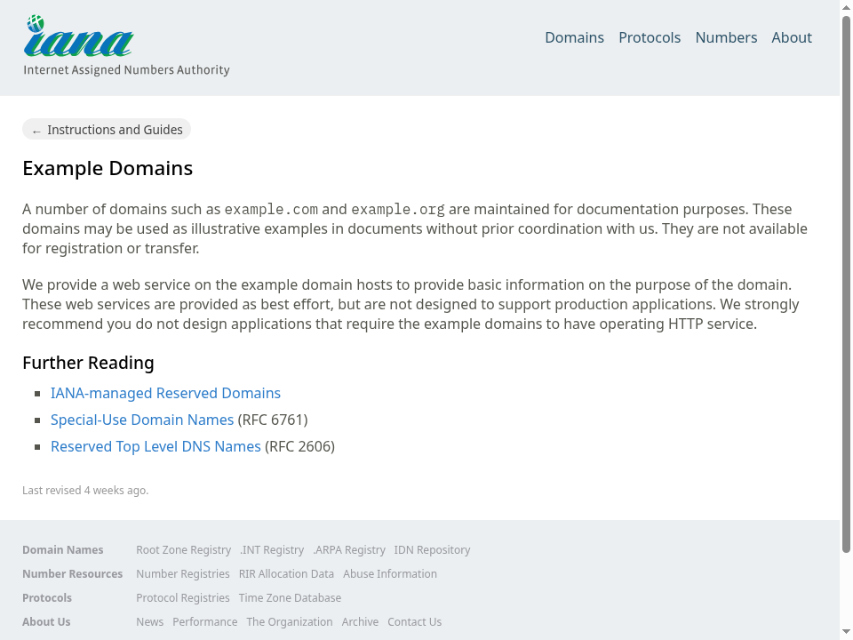

需要从网页提取一个字段时，可以先从明确的页面和小任务开始。本例让原版 browser-use0.13.11 在本地 Chromium 中读取 [IANA 的 Example Domains 页面](https://www.iana.org/help/example-domains)，返回实际标题并保存那一次浏览器的 PNG。

实际返回的标题为 Example Domains。CLI、完整 SDK 与直接 HTTP 三种入口都打开了相同公开页面，返回原生完成/成功状态，并分别下载截图。PNG 解码后的画面如下，保留实际字节，没有重新绘制。



## 配置平台和模型

本例使用极速版默认源码配方、CLI0.5.7 和 client/server0.4.0a6。先按[平台配置指南](https://github.com/Alibaba-Agent-Sandbox/awesome-templates/blob/main/docs/using-templates.zh-CN.md#安装)准备沙箱 API Key、地域、连接地址、Docker、构建权限和镜像仓库。应用令牌与模型密钥分别设置，所有尖括号替换为自己的值：

```bash
curl -fsSL https://www.agent-sandbox.cn/install.sh | ABX_VERSION=0.5.7 sh
export PATH="$HOME/.local/bin:$PATH"
python3 -m venv .venv
. .venv/bin/activate
python -m pip install --index-url https://pypi.org/simple 'agent-sandbox-client==0.4.0a6'
export ABX_PROVIDER=alicloud-express
export ABX_SERVER_TOKEN="$(python3 -c 'import secrets; print(secrets.token_urlsafe(32))')"
export BROWSER_USE_API_KEY='<YOUR_MODEL_API_KEY>'
export BROWSER_USE_BASE_URL='<YOUR_CHAT_COMPLETIONS_API_BASE>'
export BROWSER_USE_MODEL='<YOUR_AUTHORIZED_MODEL_ID>'
export ABX_HTTP_TIMEOUT=450
abx template launch Alibaba-Agent-Sandbox/awesome-templates//browser-use --sandbox-timeout 1800 --yes
export SANDBOX_ID='<launch 返回的沙箱 ID>'
abx sandbox command list "$SANDBOX_ID"
```

模型、API base 和 Key 来自自己有权限的同一个服务；base 使用供应商要求的前缀，常见为 `/v1`，不要再追加 `/chat/completions`。API Key 模式无需浏览器 OAuth 登录。

## 运行页面任务与保存结果

```bash
abx run "$SANDBOX_ID" browser_use --json-args '{"task": "Read the heading of this page and return it.", "url": "https://www.iana.org/help/example-domains", "max_steps": 8, "command_timeout": 300}'
# 使用返回的 screenshot_path，而不是猜测文件名。
abx download "$SANDBOX_ID" '<screenshot_path>' ./page.png
```

返回字段、参数边界和原生版本见[模板说明](https://github.com/Alibaba-Agent-Sandbox/awesome-templates/blob/main/browser-use/README.zh-CN.md)。
任务执行期限、客户端等待和实例1800秒寿命分别设置。网页内容会变化，自己的流程应核对实际标题和页面状态。

## 用 SDK 或 HTTP 接到应用

下载 [quickstart.py](./quickstart.py)，保留上述变量和实例 ID，执行 `python quickstart.py`。这是实际执行过的完整模板 SDK 示例，连接同一个实例并把那一次截图保存到本机。

HTTP 按[直接调用指南](https://github.com/Alibaba-Agent-Sandbox/awesome-templates/blob/main/docs/using-templates.zh-CN.md#http-post)解析9000端口，保留网关头、路径、查询并添加应用认证，发送 `POST /commands/browser_use`，body 为上面 --json-args 中的直接对象，不加 args 包装。用实际返回的 screenshot_path 导出 PNG。

CLI、SDK、HTTP 是替代入口，选择一种即可。本例 browser-use 的复杂页面交互使用 qwen3.8-flash，三种文档入口使用 qwen3.8-max。更换模型、Key 或 endpoint 时，先保存产物，重新 export 对应三项并创建新实例；本机后来改变环境不会更新旧应用。

## 二次开发与业务边界

该入口提供 text-DOM 浏览器代理，不需要 Browser Use Cloud 账号、云浏览器 token 或本机浏览器登录。模型使用显式兼容 Chat Completions API Key。网站如需账号，应在这个远端浏览器的实际流程中处理，模板不会继承本机 cookie；敏感截图按自己的数据要求保存。

二次开发时，把 url 改成自己的页面，在 task 中明确动作、完成条件与需要取回的字段。当前限定为原生15种浏览器动作，不提供任意 JavaScript、shell 或文件工具。实际交互链路已完成三次点击、填写并提交唯一代码，独立读取服务器状态确认计数和保存值；模型的 success 仍应和自己的业务状态一起检查。

模型不保证每次完成任务。检查 done、success、result 和 error_summary，再决定下一步；页面已改变而最后一轮模型失败时，也不能把整次操作当成成功。当前模板对单轮模型等待、8192-token输出、最多3次连续原生失败和总任务期限都有上限。选择 max_steps 和 command_timeout 时保留足够额度，切换模型后从自己的小任务重新确认。

## 导出并结束

截图可能包含业务数据，先保存需要的结果，再结束自己的实例：

```bash
abx kill "$SANDBOX_ID"
```

SDK close 只关闭连接。模板和镜像用于复用时可保留，按[清理指南](https://github.com/Alibaba-Agent-Sandbox/awesome-templates/blob/main/docs/using-templates.zh-CN.md#导出文件与清理)只删除自己创建的精确资源。本例的实例、预备模板、本地/远端镜像以及业务截图文件均独立确认不存在。
