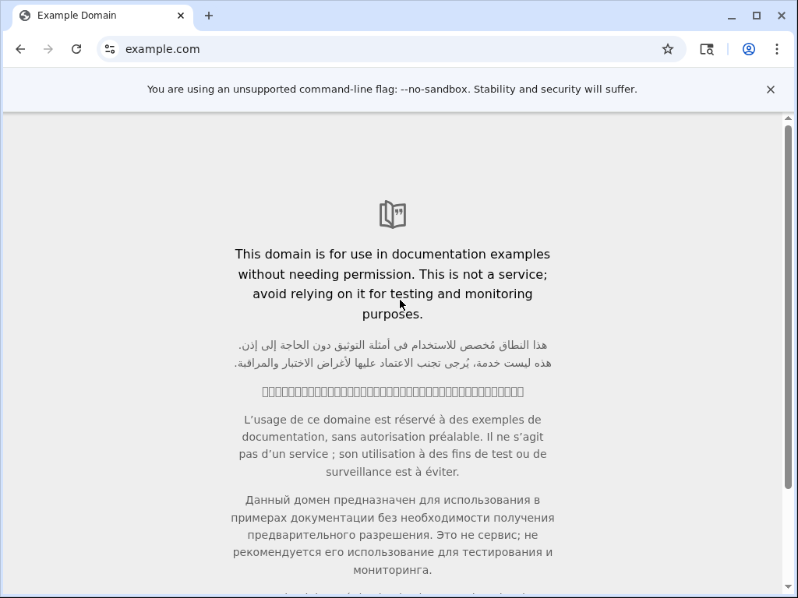

当浏览器工作需要可见屏幕时，可以让自动化和远端桌面操作同一个 Chrome。这里启动私有 Xvfb/Openbox 桌面，打开 Example Domain，再把同一会话的屏幕导出。

真实有界面 Chrome 返回 Example Domain 标题；CLI 与 SDK 截图均从远端下载后独立解码为 PNG。三种文档调用均完成导航，并停止本次桌面会话。



## 准备平台与工作区

本例使用极速版、默认 Docker 配方、CLI `0.5.7` 和 Python client/server `0.4.0a6`。
按[平台配置](https://github.com/Alibaba-Agent-Sandbox/awesome-templates/blob/main/docs/using-templates.zh-CN.md#安装)
准备沙箱 API Key、地域、连接地址、Docker、构建权限和镜像仓库，再运行：

```bash
curl -fsSL https://www.agent-sandbox.cn/install.sh | ABX_VERSION=0.5.7 sh
export PATH="$HOME/.local/bin:$PATH"
python3 -m venv .venv
. .venv/bin/activate
python -m pip install --index-url https://pypi.org/simple 'agent-sandbox-client==0.4.0a6'
export ABX_PROVIDER=alicloud-express
export ABX_SERVER_TOKEN="$(python3 -c 'import secrets; print(secrets.token_urlsafe(32))')"
export ABX_HTTP_TIMEOUT=450
abx template launch Alibaba-Agent-Sandbox/awesome-templates//chrome --sandbox-timeout 1800 --yes
export SANDBOX_ID='<返回的沙箱 ID>'
abx sandbox command list "$SANDBOX_ID"
```

这个模板的业务操作不需要模型 endpoint、模型 Key 或产品登录；应用令牌独立于平台认证。

## 完成一次实际业务流程

```bash
abx run "$SANDBOX_ID" chrome_start --json-args '{}'
abx run "$SANDBOX_ID" chrome_open --json-args '{"url":"https://example.com"}'
abx run "$SANDBOX_ID" chrome_screenshot --json-args '{}'
```

真实有界面 Chrome 返回 Example Domain 标题；CLI 与 SDK 截图均从远端下载后独立解码为 PNG。三种文档调用均完成导航，并停止本次桌面会话。

全部八个命名入口实际使用。原生 CDP、带认证的 RFB/noVNC、屏幕 PNG 与浏览器/桌面子进程的清理均已完成。截图附件保持原始字节。

命令参数、返回字段与期限见[此模板完整说明](https://github.com/Alibaba-Agent-Sandbox/awesome-templates/blob/main/chrome/README.zh-CN.md)。
任务的执行期限、客户端等待和1800秒实例寿命分别控制不同阶段。

chrome_screenshot 返回 path、bytes 和 sha256，使用实际 path 导出：

```bash
abx download "$SANDBOX_ID" '<path-from-chrome_screenshot>' ./chrome.png
```

## 通过 Python 或 HTTP 接入

下载 [quickstart.py](./quickstart.py)，保留上面的环境变量与实例 ID，执行
`python quickstart.py`。它是实际运行的完整模板 SDK 示例，通过 `ProviderSandbox.connect`
连接同一实例，使用应用令牌调用业务方法，最后关闭本机连接。
脚本会把实际产物下载到本机。

HTTP 用户按[直接 HTTP 指南](https://github.com/Alibaba-Agent-Sandbox/awesome-templates/blob/main/docs/using-templates.zh-CN.md#http-post)
解析9000端口，保留网关头、路径、查询，再添加独立应用认证。
按模板 HTTP 章节给定的顺序调用 `POST /commands/<命令名>`，发送直接 JSON 参数对象，
不加 args 包装。多步服务先启动再调用，结束后显式停止；具体请求与完整返回合同见上面的模板说明。

CLI、Python、HTTP是替代入口，选择适合自己程序的一种即可。本例分别执行了三种方式；
服务在替代调用之间停止，文件或数据使用自己的新状态，生成的产物独立取回确认。

## 二次开发与业务边界

chrome_start 返回本次会话的 VNC 密码。解析6080端口，通过保留网关认证的预览入口打开 noVNC，再输入该密码；CDP使用9222端口和应用认证。网站账号要在远端这个浏览器里登录，本机 cookie 不会传入。需要自己的浏览器操作时，从同一会话的 CDP 开始，保存结果后 chrome_stop；该模板提供浏览器应用，不附带模型推理。

修改模板时从自己的源码副本开始，固定依赖和项目配置，保留上游许可证。
自己的代码、数据和页面保存在沙箱工作区，先导出需要的结果再结束实例。

## 在 OpenSandbox 中使用同一工作流

这个案例也可以在 OpenSandbox 中完成。先按[OpenSandbox 提供方指南](https://github.com/Alibaba-Agent-Sandbox/awesome-providers/blob/main/opensandbox/docs/README.md)准备服务地址、服务 API Key 和镜像仓库，然后在创建实例前选择平台：

```bash
export ABX_PROVIDER=opensandbox
export ABX_OPENSANDBOX_USE_SERVER_PROXY=true
```

接着执行上面的 launch、业务命令和 SDK 示例；后续终端与 Python 继续使用同一个平台和实例 ID。沙箱 API Key 与应用令牌分别配置，原有业务输入、返回结果和结束实例的方法相同。

这里使用 OpenSandbox1.1.1 的服务代理模式；CLI、完整 SDK 示例和直接 HTTP 都能完成文中的实际任务。代理模式要求客户端能访问服务地址。若部署环境改为直连模式，客户端还必须能访问提供方解析出的端点；更换配置后重新创建自己的实例，不复用另一平台的 ID。

CDP 的 HTTP/WebSocket 连接使用应用令牌，与 noVNC 的会话密码分开。代理可能移除 Authorization；Chrome1.0.9 支持在没有收到 Authorization 时使用 `X-Access-Token`。保留提供方返回的网关头、URL 路径和查询，使用空闲的应用认证头，避免覆盖网关认证；如果没有空闲认证头，需要兼容的路由。到达 relay 的显式错误 Bearer 不会被正确 fallback 补救。6080端口继续输入 chrome_start 返回的原生 VNC 密码。

## 导出并结束

业务完成后，按完整说明停止自己启动的服务，下载需要的文件，再执行：

```bash
abx run "$SANDBOX_ID" chrome_stop
abx kill "$SANDBOX_ID"
```

SDK close 只关闭连接。预备模板和镜像按[清理指南](https://github.com/Alibaba-Agent-Sandbox/awesome-templates/blob/main/docs/using-templates.zh-CN.md#导出文件与清理)
仅删除自己的资源。本例的沙箱、预备模板、本次本地与远端镜像均独立确认不存在。
