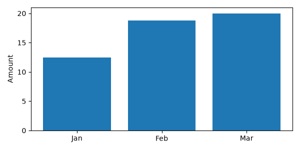

月度费用报表通常需要两份产物：给程序读取的汇总 JSON，以及可以放进周报的图表。
`code-interpreter-v1` 已经提供 pandas、numpy 和 matplotlib，可以把计算放到临时工作区，
只把结果下载回来。本例输入三个月的金额，得到
[expenses-summary.json](./expenses-summary.json) 和这张实际生成的图：



```json
{"rows": 3, "total": "51.30", "total_cents": 5130}
```

这里使用极速版托管模板、Python client `0.4.0a6`，实例内 Python 为 `3.13.13`。
托管镜像由平台更新，需要具体依赖版本时，应在自己的实例中查询版本。

## 准备客户端与账号连接

在本机创建虚拟环境，安装已发布的客户端：

```bash
python3 -m venv .venv
. .venv/bin/activate
python -m pip install --index-url https://pypi.org/simple 'agent-sandbox-client==0.4.0a6'
export ABX_SANDBOX_API_KEY='<YOUR_SANDBOX_API_KEY>'
export ABX_SANDBOX_BASE_URL='<YOUR_SANDBOX_API_URL>'
export ABX_SANDBOX_DOMAIN='<YOUR_SANDBOX_DOMAIN>'
```

三个值使用同一地域的极速版账号配置，域名填主机名；详细说明见
[连接配置参考](https://github.com/Alibaba-Agent-Sandbox/agent-sandbox/blob/main/docs/zh/reference/configuration.md)。
这里的 API Key 是极速版使用的兼容 API Key，不是模型密钥。
本例无需模型登录、模型 endpoint、换模型、Docker 或镜像构建 AccessKey。
如果本机使用 HTTPS 代理，可通过 `HTTPS_PROXY` 配置；脚本只在该变量非空时传入代理。

## 让计算和绘图留在工作区

保存 [expenses.py](./expenses.py) 到一个本机目录，执行：

```bash
python expenses.py
```

脚本显式把以上账号配置传给
`agent_sandbox.code_interpreter.AsyncSandbox.create(template="code-interpreter-v1")`，
并设置 180 秒实例存活时间。`run_code` 执行远端 Python；程序先检查
`execution.error`，随后下载文件，最后通过 `finally` 删除实例。
这个公开入口支持持久 Python context；它和 `ProviderSandbox.commands.run` 的独立进程
入口不同，`ProviderSandbox.run_code` 当前仍不受极速版 provider 支持。

金额以整数分存入 DataFrame，避免累加时把金额当作二进制浮点数。三行金额分别是
1250、1880、2000 分，合计 5130 分；展示时格式化为 `51.30`。
图表使用 `Agg` 后端和 `fig.savefig` 写入文件，不依赖图形桌面或 IPython 魔法命令，
也不假定 `plt.show()` 会返回内联图片。

远端文件不会自动出现在本机。脚本调用 `files.read` 取回 JSON，调用
`files.read(..., format="bytes")` 取回 PNG，然后保存到当前目录。
本例图片为 600×300；本机不需要安装 pandas、matplotlib 或图形界面。

## 多步分析与隔离 context

同一实例中的默认 Python context 会保留变量。例如先执行
`await sb.run_code("value = 41")`，再执行 `await sb.run_code("value + 1")`，
第二次结果的 `.text` 为 `42`。因此可以先加载数据，再分几次汇总、筛选和绘图。

需要在同一实例分析另一个数据集时，用
`context = await sb.create_code_context(language="python")` 创建独立 context，
后续调用传入 `context=context`。这个 context 中把 `value` 设成 `100` 后，默认
context 的值仍为 `41`。`list_code_contexts()` 可以查看 context，完成后调用
`remove_code_context(context)` 删除自己创建的 context。

若要在界面展示进度，可给 `run_code` 提供 `on_stdout`、`on_stderr`、`on_result`
和 `on_error` 回调；前两种输出消息的文本在 `.line` 中。仍应在调用结束后检查
`execution.error`，不能把收到部分输出当作整个任务成功。

## 为有副作用的任务选择进程入口

当前托管持久解释器有一个明确的限制：代码抛出 Python 异常后，服务可能重新执行
整段代码。一次文件计数递增后再抛出 `ValueError`，会使计数递增两次。
[问题251](https://github.com/Alibaba-Agent-Sandbox/awesome-templates/issues/251)
保留了复现与修复要求，因此该模板还不能获得完整能力验收。
错误名称当前为 `ExecutionError`，原始异常内容保存在 `.value`。

持久 context 适合本例这种临时、可重新计算的数据分析。包含发送消息、扣款、业务写入
或必须只运行一次的操作，应使用独立进程入口 `ProviderSandbox.commands.run`，
检查实际 `exit_code`，避免在持久解释器中执行。正常的图表生成结果不能消除这个限制。
完整的进程创建、文件写入和清理用法见
[模板说明](https://github.com/Alibaba-Agent-Sandbox/awesome-templates/blob/main/docs/managed/code-interpreter-v1/README.zh-CN.md)。

## 从月报扩展到自己的报表

把示例中的 DataFrame 输入换成上传的 CSV，即可按部门、项目或月份 `groupby` 聚合，
再把 JSON 交给业务程序。保持金额的最小单位为整数，展示时才转换；真实财务规则中的
币种和舍入方式应由业务明确指定。图表下载后可以直接嵌入文档。

需要额外依赖时先查询托管镜像内的版本，记录自己的版本要求；每次创建的临时环境
及其文件都可能随实例删除而消失。将需要保留的结果下载到受控存储后再释放实例，
不要把实例存活时间当作长期存储保证。
