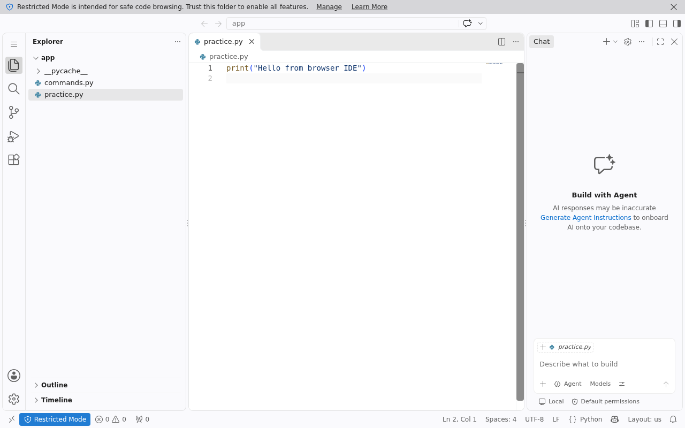

临时开发工作区可以把编辑器和代码放在同一个沙箱。这里通过 code-server 打开真实 VS Code 界面，将 practice.py 改为一行 Python，保存后从独立文件与进程接口核对结果。

## 准备平台与配置

本例使用极速版默认源码配方、CLI0.5.7 和 client/server0.4.0a6。按[平台配置指南](https://github.com/Alibaba-Agent-Sandbox/awesome-templates/blob/main/docs/using-templates.zh-CN.md#安装)准备沙箱 API Key、连接地址、地域、Docker、构建权限和镜像仓库。API Key、模型服务密钥和应用令牌各有用途，不相互替代。

```bash
curl -fsSL https://www.agent-sandbox.cn/install.sh | ABX_VERSION=0.5.7 sh
export PATH="$HOME/.local/bin:$PATH"
python3 -m venv .venv
. .venv/bin/activate
python -m pip install --index-url https://pypi.org/simple 'agent-sandbox-client==0.4.0a6'
export ABX_PROVIDER=alicloud-express
export ABX_SERVER_TOKEN="$(python3 -c 'import secrets; print(secrets.token_urlsafe(32))')"
export CODE_SERVER_PASSWORD="$(python3 -c 'import secrets; print(secrets.token_urlsafe(24))')"
export ABX_HTTP_TIMEOUT=450
abx template launch Alibaba-Agent-Sandbox/awesome-templates//code-server --sandbox-timeout 1800 --yes
export SANDBOX_ID='<launch 返回的沙箱 ID>'
abx sandbox command list "$SANDBOX_ID"
```

所有尖括号内容替换为自己的配置；密钥仅放在终端或自己的凭据管理器中。launch 已启动应用，后续调用连接这个实例。

## 完成实际任务

```bash
abx run "$SANDBOX_ID" code_server_start --json-args '{"port":8443,"timeout_s":60}'
abx upload "$SANDBOX_ID" ./practice.py /home/user/app/practice.py
```

先在本机创建 `practice.py`，内容为 `print("before IDE edit")`。启动 IDE 并上传后，按[SDK 预览指南](https://github.com/Alibaba-Agent-Sandbox/awesome-templates/blob/main/docs/preview-proxy.md)解析8443端口并打开保留网关认证的预览入口。9000端口是命令服务，8443才是 IDE。

登录页面输入独立的 `CODE_SERVER_PASSWORD`。在 Explorer 中双击 practice.py，点击代码行使编辑器获得焦点，改为：

```python
print("Hello from browser IDE")
```

按 Ctrl+S 保存。该流程实际保存的源码已由独立文件接口读取，内容精确等于上述代码和一个换行；沙箱 Python 独立执行后输出 `Hello from browser IDE`。截图来自同一次真实浏览器会话，未重新绘制。



```bash
abx download "$SANDBOX_ID" /home/user/app/practice.py ./saved-practice.py
abx exec "$SANDBOX_ID" 'python3 /home/user/app/practice.py'
```

浏览器编辑时注意当前焦点确实位于文件代码区，侧栏 Chat 与文件编辑器是不同区域。Restricted Mode 下的基本文件编辑保存已经可用；是否信任自己的项目和启用更多能力由项目内容决定。

## 接入 Python 与 HTTP

[quickstart.py](./quickstart.py) 是实际执行过的完整模板 SDK 示例。保留上面的环境与实例 ID 后运行 `python quickstart.py`；它连接同一实例并关闭连接。该脚本用于生命周期启动/停止；需要在浏览器持续编辑时先使用 CLI 启动，再按预览指南打开。

直接 HTTP 按[调用指南](https://github.com/Alibaba-Agent-Sandbox/awesome-templates/blob/main/docs/using-templates.zh-CN.md#http-post)解析9000端口并保留网关头、路径、查询与应用认证。对应方法是 `POST /commands/code_server_start`，body 使用上述 CLI `--json-args` 内的直接对象，不套 args。返回外层为 `result`。完整参数、返回值与各方法见[模板说明](https://github.com/Alibaba-Agent-Sandbox/awesome-templates/blob/main/code-server/README.zh-CN.md)。

CLI、Python、HTTP 是替代入口，选择一种即可；本文的三种入口分别实际运行。命令执行期限、客户端等待与实例1800秒寿命分别控制不同阶段，客户端断开不表示远端工作已取消。

## 二次开发与使用边界

上传自己的项目和锁文件后，使用同一工作区编辑。Git 远程账号、扩展市场登录与本机登录状态彼此独立；实例不会继承你本机的 cookie。这个模板不附带模型账号、endpoint 或模型 Key。需要 AI 扩展时，按所选扩展自己的说明配置服务和账号，不能把界面上的 Chat 按钮视为已经接通模型。

`code_server_status` 查看当前服务，`code_server_stop` 停止本次拥有的进程并删除私有 IDE 配置、会话和日志。工作区文件仍保留到实例删除，先导出源码。全部五个命名入口包含版本、启动、状态、停止和带密码认证的原生 self-test。

## 在 OpenSandbox 中使用同一工作流

这个案例也可以在 OpenSandbox 中完成。先按[OpenSandbox 提供方指南](https://github.com/Alibaba-Agent-Sandbox/awesome-providers/blob/main/opensandbox/docs/README.md)准备服务地址、服务 API Key 和镜像仓库，然后在创建实例前选择平台：

```bash
export ABX_PROVIDER=opensandbox
export ABX_OPENSANDBOX_USE_SERVER_PROXY=false
```

接着执行上面的 launch、业务命令和 SDK 示例；后续终端与 Python 继续使用同一个平台和实例 ID。沙箱 API Key 与应用令牌分别配置，原有业务输入、返回结果和结束实例的方法相同。

这里使用能从本机访问的直连端点，再通过 SDK 预览入口打开 IDE。OpenSandbox1.1.1 的服务代理会移除 Cookie，不能保持这个 IDE 的登录会话；不能仅凭出现登录页面或工作台外壳判断编辑器已连接。保留原生密码、会话 Cookie、网关头和 HTTPS 校验，按前面的步骤打开文件、修改并保存，再独立执行保存后的源码。CLI、完整 SDK 示例与直接 HTTP 都已完成同样的实际编辑器生命周期。

## 导出与结束

需要的文件先取回，再停止服务并结束实例：

```bash
abx run "$SANDBOX_ID" code_server_stop
abx kill "$SANDBOX_ID"
```

SDK close 只关闭连接。预备模板与镜像可用于复用，按[清理指南](https://github.com/Alibaba-Agent-Sandbox/awesome-templates/blob/main/docs/using-templates.zh-CN.md#导出文件与清理)只删除本次拥有的精确资源。本例的实例、预备模板、本地与远端镜像均已独立确认不存在。
