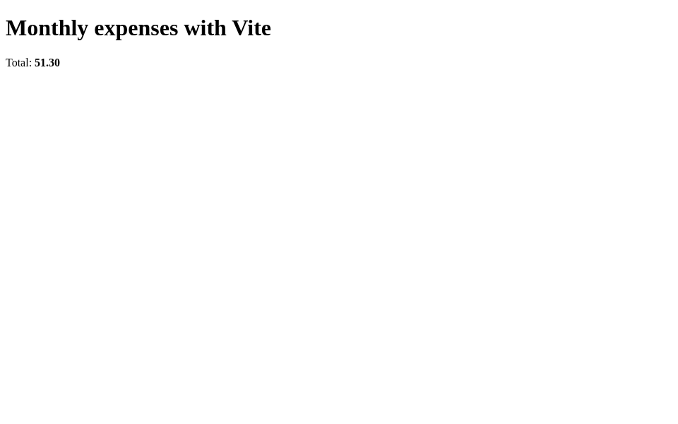

从一个能运行的前端项目开始，比先处理依赖安装更适合短期页面工作。`next-app` 模板
预装了固定版本的 Next、React 和 Vite，提供项目创建、预览、日志与停止入口。
这个案例把默认页面改成一个费用展示页，打开浏览器后直接看到内容随着编辑更新。

下面是 Next 页面实际热更新后的截图；金额 `51.30` 是本例写入页面的展示内容：


Vite 的对应页面也通过浏览器完成了同样的修改：



本例使用模板 `1.1.3`、Next `16.4.2`、React/React DOM `19.3.1`、Vite `8.3.4`，
CLI `0.5.7` 和 Python client/server `0.4.0a6`，运行在极速版。
浏览器实际读取过原始页面，随后在没有手动刷新的情况下显示了编辑后的内容。

## 准备平台和客户端

```bash
curl -fsSL https://www.agent-sandbox.cn/install.sh | ABX_VERSION=0.5.7 sh
export PATH="$HOME/.local/bin:$PATH"
python3 -m venv .venv
. .venv/bin/activate
python -m pip install --index-url https://pypi.org/simple 'agent-sandbox-client==0.4.0a6' 'aiohttp==3.14.5'
```

先按[平台与镜像构建配置](https://github.com/Alibaba-Agent-Sandbox/awesome-templates/blob/main/docs/using-templates.zh-CN.md#安装)
准备极速版连接信息、Docker、构建权限和镜像仓库。模型 API Key、模型 endpoint 和
换模型配置不属于这个前端模板的运行条件；这里启动固定依赖的开发服务器。

```bash
export ABX_PROVIDER=alicloud-express
export ABX_SERVER_TOKEN="$(python3 -c 'import secrets; print(secrets.token_urlsafe(32))')"
export ABX_HTTP_TIMEOUT=450
abx template launch Alibaba-Agent-Sandbox/awesome-templates//next-app --sandbox-timeout 1800 --yes
export SANDBOX_ID='<返回的沙箱 ID>'
abx run "$SANDBOX_ID" toolchain_versions --json-args '{}'
```

沙箱 API Key 负责平台连接，`ABX_SERVER_TOKEN` 独立保护端口 9000 的管理命令。
预览应用本身使用模板中的初始页面，没有应用级登录；访问控制使用所选 provider
提供的机制。需要业务登录时，把认证加入自己的前端项目。

## 创建 Next 项目并启动预览

```bash
abx run "$SANDBOX_ID" scaffold --json-args '{"kind":"next","path":"preview-app"}'
abx run "$SANDBOX_ID" dev_start --json-args '{"kind":"next","path":"preview-app","timeout_s":120}'
abx run "$SANDBOX_ID" dev_status --json-args '{}'
abx run "$SANDBOX_ID" dev_logs --json-args '{}'
```

`scaffold` 创建新目录，不覆盖已有项目。启动返回 `running: true` 和端口 `3000`；
原始页面内容是 `ABX_NEXT_PREVIEW`。项目的 `node_modules` 指向模板内预装的固定
依赖，源文件保留在 `/home/user/app/preview-app`。

先用 `await sb.network.resolve(3000)` 获取实际地址和网关头，保留其路径、查询参数
和认证。极速版可能把 HTML 标记为附件；需要浏览器预览时，可以保存本例随附的
[preview_proxy.py](./preview_proxy.py)，在同一个已配置客户端环境运行：

```bash
python preview_proxy.py --sandbox-id "$SANDBOX_ID" --remote-port 3000
```

在本机浏览器打开脚本打印的私有 loopback 入口。中继只借用该实例，保留上游 HTTPS
证书检查，转发页面与 WebSocket，并将 HTML 附件响应转换为可渲染页面。
这里的 Next 和 Vite 页面均通过这个实际入口打开，并收到了热更新。

## 修改自己的页面，直接看到结果

将项目中的 `app/page.js` 改为：

```jsx
export default function Page() {
  return <main><h1>Monthly expenses</h1><p>Total: <strong>51.30</strong></p></main>;
}
```

可以通过 SDK 的 `sb.files.write` 写入这份源文件，也可以上传自己的页面代码。
本例写入后，浏览器中的标题和金额通过 HMR 自动更新为截图内容，没有手动刷新。
这是展示页，后续可接入自己的费用数据和业务逻辑。

结束这一轮预览：

```bash
abx run "$SANDBOX_ID" dev_stop --json-args '{}'
```

停止开发服务器后，项目源码仍在。需要保留的文件可分别导出，例如
`abx download "$SANDBOX_ID" /home/user/app/preview-app/app/page.js ./page.js`。
保留自己的源文件、依赖版本和相应锁文件，方便后续开发；预装依赖链接属于临时环境。

## 选择 SDK 或 HTTP 接入自己的工具

CLI、SDK 与 HTTP 是替代入口，选择一个完整创建和启动项目即可。
[quickstart.py](./quickstart.py) 是实际运行过的完整 SDK 版本：连接同一实例，调用
`scaffold` 和 `dev_start`，结束时停止预览并关闭连接。使用新实例，或先清理自己上一轮
的 `preview-app`，避免目录冲突。它不删除外层沙箱。

HTTP 用户按[直接调用指南](https://github.com/Alibaba-Agent-Sandbox/awesome-templates/blob/main/docs/using-templates.zh-CN.md#http-post)
解析端口 9000，依次调用 `POST /commands/scaffold`、`POST /commands/dev_start`、
`POST /commands/dev_status`、`POST /commands/dev_logs`，结束调用
`POST /commands/dev_stop`。参数使用上面 CLI 的直接 JSON 对象，不加 `args` 包装层。
模板的另一个 `preview_self_test` 命令会启动固定的 Next 和 Vite 页面并清理自己的目录，
适合检查当前实例的预览工具链。

## 用 Vite 创建另一份页面

先停止当前预览，再创建新的 Vite 项目。其预览端口是 `5173`；解析该端口地址后，
将**实际网关 hostname** 填入 `allowed_host`，不带协议、端口或通配符。

```bash
abx run "$SANDBOX_ID" scaffold --json-args '{"kind":"vite","path":"vite-preview"}'
abx run "$SANDBOX_ID" dev_start --json-args '{"kind":"vite","path":"vite-preview","timeout_s":120,"allowed_host":"<实际网关 hostname>"}'
python preview_proxy.py --sandbox-id "$SANDBOX_ID" --remote-port 5173
```

SDK 中可以用 `urlsplit((await sb.network.resolve(5173))[0]).hostname` 取得该值。
这个设置只增加明确的上游允许主机，不改写 Host，也不开全局允许模式。
修改 Vite 项目的 `index.html` 后，本例浏览器同样自动显示了新的标题和金额。

## 整理产物并释放工作区

二次开发可以围绕现有项目继续：用文件 API 上传组件、修改路由和样式，用状态与日志
命令查看预览。需要增加依赖时，在自己的模板中保留原有版本记录并更新锁文件，
重新构建后再使用；预装项目不会自动更新公开模板。

保存所需文件后停止本机中继、停止自己的开发服务器，再删除实例：

```bash
abx run "$SANDBOX_ID" dev_stop --json-args '{}'
abx kill "$SANDBOX_ID"
```

`dev_stop` 负责开发进程，`kill` 删除实例；`close()` 只释放本机客户端连接。
预备模板与镜像按[清理说明](https://github.com/Alibaba-Agent-Sandbox/awesome-templates/blob/main/docs/using-templates.zh-CN.md#导出文件与清理)
只删除本次创建的资源。随附中继脚本保留原实现，采用仓库
[Apache-2.0 许可证](./TEMPLATE-LICENSE.txt)。
