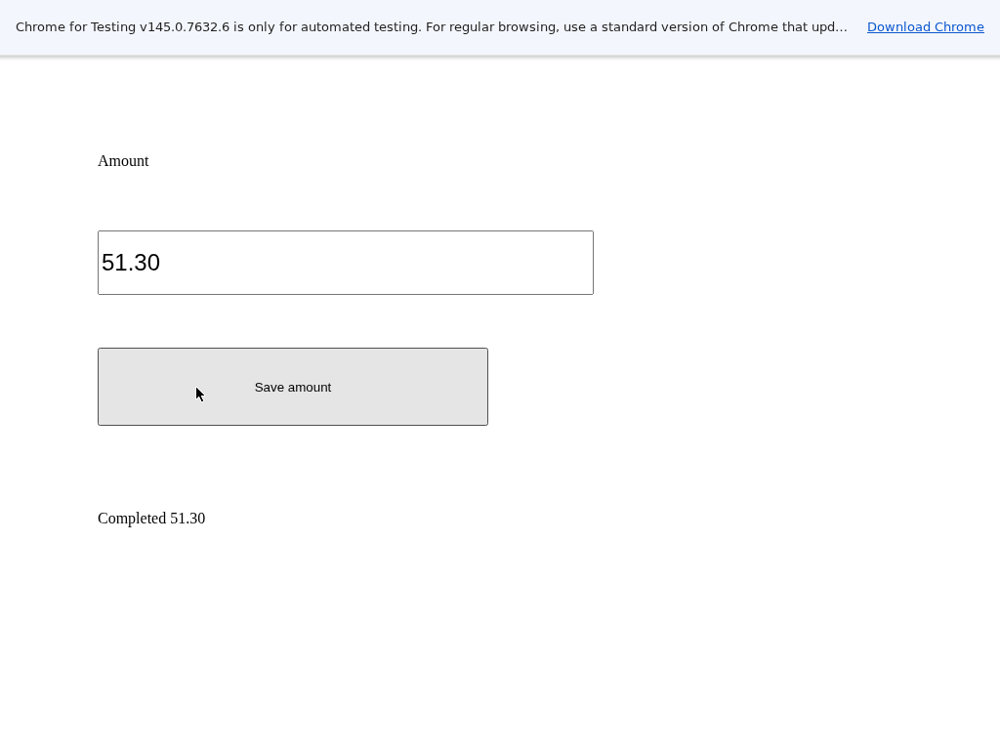

把总额51.30填入远端报销表单并保存，是桌面自动化中一个完整的小任务：打开自己的页面、定位输入区域、修改内容、点击保存，再取回实际结果。本例使用 OSWorld 模板的 Linux 浏览器切片，通过真实鼠标、键盘和原生可访问性接口完成这条路径。

实际保存后的界面如下，输入值为51.30，页面显示 Completed 51.30。截图来自原始桌面，没有替换或编辑图像。



同一版本模板在极速版和 OpenSandbox 上都完成了这条业务路径。原版任务评分从0变为1，独立读取的当前 XML 包含保存结果，前后 PNG 像素发生变化。这里只使用公开说明的 Linux 浏览器能力，不代表完整 OSWorld 基准、Office 或 VM 环境。

## 准备平台与应用

本文使用模板1.0.3、CLI0.5.7/client-server0.4.0a6，原版 OSWorld 固定源码和 Chromium145.0.7632.6。先按[平台指南](https://github.com/Alibaba-Agent-Sandbox/awesome-templates/blob/main/docs/using-templates.zh-CN.md#安装)完成 API Key、连接地址、地域、Docker、构建权限与镜像仓库配置。

```bash
curl -fsSL https://www.agent-sandbox.cn/install.sh | ABX_VERSION=0.5.7 sh
export PATH="$HOME/.local/bin:$PATH"
python3 -m venv .venv
. .venv/bin/activate
python -m pip install --index-url https://pypi.org/simple 'agent-sandbox-client==0.4.0a6'
export ABX_PROVIDER=alicloud-express
export ABX_SERVER_TOKEN="$(python3 -c 'import secrets; print(secrets.token_urlsafe(32))')"
abx template launch Alibaba-Agent-Sandbox/awesome-templates//osworld --sandbox-timeout 1800 --yes
export SANDBOX_ID='<launch 返回的沙箱 ID>'
```

这个桌面切片不需要模型 Key、model 或 LLM endpoint；独立应用 token 用于保护命名接口。若要登录自己的业务网站，使用自己有权限的账号并在该桌面内完成登录，本文的本地表单无需账号。OpenSandbox 使用自己服务的连接地址和 API Key，按同一指南安装插件并设置 ABX_PROVIDER=opensandbox。

## 上传自己的页面与任务配置

下载 [expense.html](./expense.html) 和 [task.json](./task.json)。前者是报销输入页面，后者描述打开页面及原生评分规则。

```bash
abx upload "$SANDBOX_ID" ./expense.html /home/user/app/owned-desktop-expense.html
abx upload "$SANDBOX_ID" ./task.json /home/user/app/owned-desktop-expense.json
abx run "$SANDBOX_ID" desktop_start --json-args '{}'
abx run "$SANDBOX_ID" a11y_tree --json-args '{}'
abx run "$SANDBOX_ID" run_task_config --json-args '{"task_path":"/home/user/app/owned-desktop-expense.json"}'
abx run "$SANDBOX_ID" evaluate --json-args '{"task_path":"/home/user/app/owned-desktop-expense.json"}'
```

开始时页面显示 Awaiting amount，评分为0。run_task_config 返回实际 browser_geometry。网页视口与1024×768屏幕是两种尺寸：把 content_x、content_y 加到网页内坐标上，再传给 click。本例页面的输入区位于网页(100,180)附近，保存按钮位于(100,300)附近；不要把其他页面的坐标直接照搬。

## 聚焦、修改并保存

图中这次页面的内容偏移为(0,56)，以下是对应的实际屏幕坐标：

```bash
abx run "$SANDBOX_ID" click --json-args '{"x":150,"y":266}'
abx run "$SANDBOX_ID" type --json-args '{"text":"temporary"}'
abx run "$SANDBOX_ID" hotkey --json-args '{"keys":"ctrl,a"}'
abx run "$SANDBOX_ID" type --json-args '{"text":"51.30"}'
abx run "$SANDBOX_ID" click --json-args '{"x":200,"y":396}'
abx run "$SANDBOX_ID" evaluate --json-args '{"task_path":"/home/user/app/owned-desktop-expense.json"}'
abx run "$SANDBOX_ID" a11y_tree --json-args '{}'
```

换页面或看到不同的 browser_geometry 时，按实际内容偏移重新计算整数坐标再提交。实际界面保存后，原生评分为1，XML包含 Completed 51.30，原始截图如文首。type 使用真实剪贴板与键盘粘贴路径，hotkey 修改实际焦点；结果由原生当前状态确认。

## 接入 SDK 或 HTTP

[quickstart.py](./quickstart.py) 是实际使用过的完整模板 SDK 程序：连接同一个实例，启动桌面、读取真实 XML，再停止。保留环境与实例 ID 后执行 python quickstart.py，避免在自己还要使用的桌面上同时启动另一个流程。

业务方法也使用同一个 client.commands.run，参数与命名接口相同。直接 HTTP 按[调用指南](https://github.com/Alibaba-Agent-Sandbox/awesome-templates/blob/main/docs/using-templates.zh-CN.md#http-post)解析9000端口，保留网关头、路径、查询和独立应用认证；POST /commands/run_task_config 等方法发送直接参数对象，不加 args 包装。本文的表单操作通过这些真实方法完成，截图返回 base64，解码后保存为 PNG。

## 扩展为自己的流程

替换为自己拥有的网页和输入数据，保留实际界面结果、当前可访问性状态和输出文件。支持范围内的 chrome_open_tabs/sleep 与原生评分配置见[模板说明](https://github.com/Alibaba-Agent-Sandbox/awesome-templates/blob/main/osworld/README.zh-CN.md)。可以由自己的规划程序读取截图/XML，再通过这些命令发送操作；模型选择和账号由那个规划程序配置。

本例还覆盖了原生 Unicode 输入、原始页面操作与支持范围外参数的明确拒绝。任务评分不能用提交结果中的自报 score 替代，应对实际界面重新执行 evaluate。先保存截图或文件，再结束资源。

```bash
abx run "$SANDBOX_ID" desktop_stop --json-args '{}'
abx run "$SANDBOX_ID" osworld_setup_check --json-args '{}'
abx kill "$SANDBOX_ID"
```

停止后 running 应为false。SDK close 只关闭连接；实例和本次预备模板/镜像按[清理指南](https://github.com/Alibaba-Agent-Sandbox/awesome-templates/blob/main/docs/using-templates.zh-CN.md#导出文件与清理)处理。本例两种平台的实例、预备模板、本地和远端镜像均独立确认已清理。
