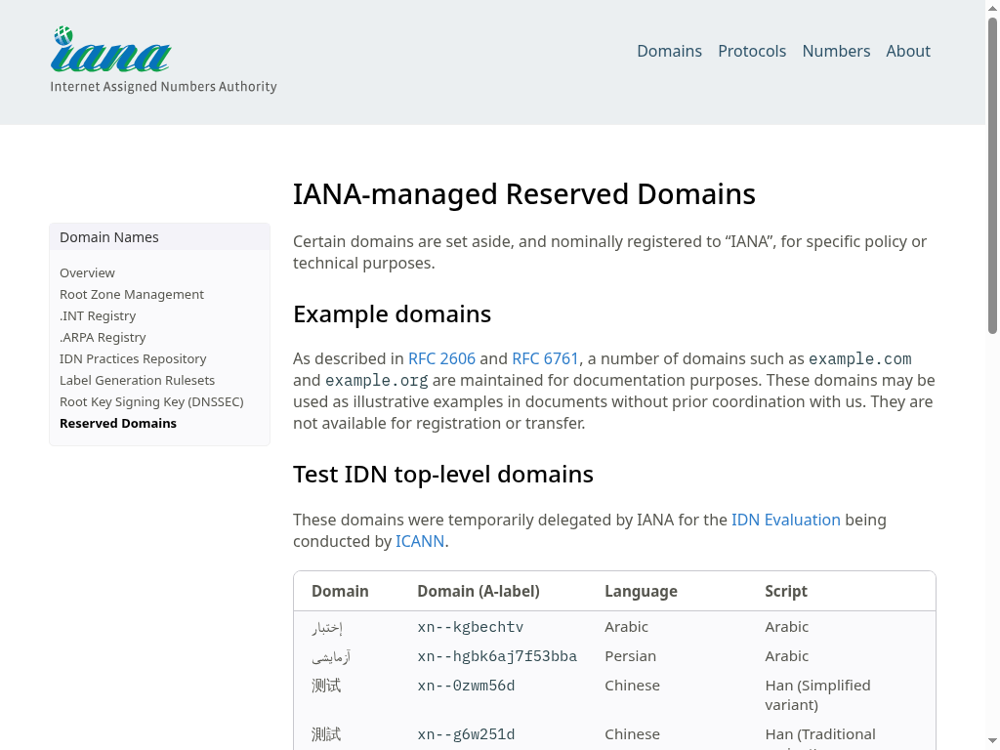

在页面操作后读取结果，可以把“点击什么”和“取回什么”分别表达。本例让原版 Stagehand4.3.0 的本地浏览器先打开 [IANA 示例域名说明](https://www.iana.org/help/example-domains)，用自然语言点击预留域名链接，再从目标页面提取标题。

真实浏览器最终到达 [Reserved Domains 页面](https://www.iana.org/domains/reserved)，提取的标题为 IANA-managed Reserved Domains。CLI、完整 SDK 和直接 HTTP 分别完成了这个动作和提取，下载各自的真实 PNG。下面是同一次原生浏览器的画面。



## 配置平台和模型

本例使用极速版默认源码配方、CLI0.5.7 和 client/server0.4.0a6。先按[平台配置指南](https://github.com/Alibaba-Agent-Sandbox/awesome-templates/blob/main/docs/using-templates.zh-CN.md#安装)准备沙箱 API Key、地域、连接地址、Docker、构建权限和镜像仓库。应用令牌与模型密钥分别设置，所有尖括号替换为自己的值：

```bash
curl -fsSL https://www.agent-sandbox.cn/install.sh | ABX_VERSION=0.5.7 sh
export PATH="$HOME/.local/bin:$PATH"
python3 -m venv .venv
. .venv/bin/activate
python -m pip install --index-url https://pypi.org/simple 'agent-sandbox-client==0.4.0a6'
export ABX_PROVIDER=alicloud-express
export ABX_SERVER_TOKEN="$(python3 -c 'import secrets; print(secrets.token_urlsafe(32))')"
export STAGEHAND_API_KEY='<YOUR_MODEL_API_KEY>'
export STAGEHAND_BASE_URL='<YOUR_CHAT_COMPLETIONS_API_BASE>'
export STAGEHAND_MODEL='<YOUR_AUTHORIZED_MODEL_ID>'
export ABX_HTTP_TIMEOUT=450
abx template launch Alibaba-Agent-Sandbox/awesome-templates//stagehand --sandbox-timeout 1800 --yes
export SANDBOX_ID='<launch 返回的沙箱 ID>'
abx sandbox command list "$SANDBOX_ID"
```

模型、API base 和 Key 来自自己有权限的同一个服务；base 使用供应商要求的前缀，常见为 `/v1`，不要再追加 `/chat/completions`。API Key 模式无需浏览器 OAuth 登录。

## 运行页面任务与保存结果

```bash
abx run "$SANDBOX_ID" stagehand --json-args '{"task": "Click the IANA-managed Reserved Domains link.", "url": "https://www.iana.org/help/example-domains", "extract_instruction": "Return the visible heading.", "command_timeout": 180}'
# 使用返回的 screenshot_path，而不是猜测文件名。
abx download "$SANDBOX_ID" '<screenshot_path>' ./page.png
```

返回字段、参数边界和原生版本见[模板说明](https://github.com/Alibaba-Agent-Sandbox/awesome-templates/blob/main/stagehand/README.zh-CN.md)。
任务执行期限、客户端等待和实例1800秒寿命分别设置。网页内容会变化，自己的流程应核对实际标题和页面状态。

## 用 SDK 或 HTTP 接到应用

下载 [quickstart.py](./quickstart.py)，保留上述变量和实例 ID，执行 `python quickstart.py`。这是实际执行过的完整模板 SDK 示例，连接同一个实例并把那一次截图保存到本机。

HTTP 按[直接调用指南](https://github.com/Alibaba-Agent-Sandbox/awesome-templates/blob/main/docs/using-templates.zh-CN.md#http-post)解析9000端口，保留网关头、路径、查询并添加应用认证，发送 `POST /commands/stagehand`，body 为上面 --json-args 中的直接对象，不加 args 包装。用实际返回的 screenshot_path 导出 PNG。

CLI、SDK、HTTP 是替代入口，选择一种即可。本例完整页面流程使用 qwen3.8-max，另一次原生页面交互使用 qwen3.8-flash。更换模型、Key 或 endpoint 时，先保存产物，重新 export 对应三项并创建新实例；本机后来改变环境不会更新旧应用。

## 二次开发与业务边界

此处使用 Stagehand LOCAL 模式，不需要 Browserbase 账号、项目 ID 或云浏览器 token。模型服务单独通过 API Key、base 和 model 配置；上游需提供兼容 Chat Completions。模型身份不是网页账号，目标网站登录需要由自己的远端浏览器流程处理，不会继承本机 cookie。

二次开发时把 task 写成一次明确 act，用 extract_instruction 描述完成后的可见字段。当前封装是单次原生动作加可选 schema 文本提取；多步骤业务由调用方组织，不把这个入口当成任意多步 Agent。原生链路实际完成过唯一页面上的发布按钮操作，并从新状态提取精确收据，由独立接口核对结果。

模型不会自动保证动作可重复。提交、支付或发布等操作需要自己的幂等设计，不能看到网络超时便盲目重复点击。调用后检查真实目标 URL、提取结果和业务状态，再决定是否继续。保持原版依赖与许可证，修改自己模板副本的封装参数即可接入自己的应用。

## 导出并结束

截图可能包含业务数据，先保存需要的结果，再结束自己的实例：

```bash
abx kill "$SANDBOX_ID"
```

SDK close 只关闭连接。模板和镜像用于复用时可保留，按[清理指南](https://github.com/Alibaba-Agent-Sandbox/awesome-templates/blob/main/docs/using-templates.zh-CN.md#导出文件与清理)只删除自己创建的精确资源。本例的实例、预备模板、本地/远端镜像以及业务截图文件均独立确认不存在。
